<!-- AI contribution: 50% or more AI-generated -->
<!-- Size exception: keep the cross-module field definitions beside the complete
Mermaid ERD so foreign keys and migration ordering can be reviewed together. -->
# Iris database schema — Release 1 draft

This is a logical design draft based on the documented requirements. Field labels describe the information to store, and types describe logical values. This document does not establish a deployed SQL schema.

## Changes over sprints

Iris follows an Agile methodology. Small design changes can be made in later sprints as requirements develop. The responsible module owners review those changes and update this document, the ERD, and the migration plan together. Changes to a database whose migrations have already been applied are introduced through new migrations.

## Database terms

| Term | Meaning |
| --- | --- |
| Nullability | Whether a database field can contain NULL, meaning no value. An optional form input does not by itself specify SQL nullability. |
| Constraint | A database rule that protects data, such as uniqueness or a CHECK. Business rules enforced by services are identified separately below. |
| Index | A structure that helps database lookups. PostgreSQL unique constraints have supporting indexes. |
| Module owner | The Django module responsible for the model, migrations, and public services and queries. |
| Foreign key (FK) | A field linking a record to another model. |
| Unique key (UK) | A field or combination of fields that cannot be duplicated. |

## Sign-in, sign-up, and invitations

Users sign in with email and password through Django/allauth. The User password field stores an encoded password hash and its hashing metadata. Django handles password hashing and verification. Password hashes are excluded from API responses.

Household sign-up uses email verification. An invited person accepts a one-use invitation to create a new active User carrying the invited role and optional store assignment. Existing active or inactive accounts with the invited email are refused case-insensitively and are not overwritten. A store can have multiple managers and staff.

Sources: [Issue #422](https://github.com/B-A-D-R-SL/iris/issues/422), [Issue #426](https://github.com/B-A-D-R-SL/iris/issues/426), [Issue #428](https://github.com/B-A-D-R-SL/iris/issues/428), [Issue #433](https://github.com/B-A-D-R-SL/iris/issues/433), [Django password storage](https://docs.djangoproject.com/en/stable/topics/auth/passwords/).

## Models

### User

**Owner module:** `accounts`.

A person who can sign in to Iris.

| Field | Logical type | Key | Details |
| --- | --- | --- | --- |
| id | UUID | Primary key | Stable public user identifier. |
| email | string | Unique key | Case-insensitive unique sign-in email. |
| password | string | — | Django-managed encoded password hash, including hashing metadata; never the plain-text password. Django standard field: NULL is not allowed. |
| first_name | string | — | User first name. |
| last_name | string | — | User last name. |
| phone | string | — | Contact phone number. |
| preferred_language | string | — | `fr` or `en`; default `fr`. |
| role | string | — | `beneficiary`, `store_staff`, `store_manager`, `intake_worker`, or `admin`. |
| store | reference | Foreign key | Required for store staff and managers; nullable for other roles. Deletion is protected while users reference the store. |
| is_active | boolean | — | Whether the account is active. |

**Documented constraints and business rules**

| Rule | Enforcement |
| --- | --- |
| Email must be unique regardless of case. | Database unique constraint on lowercased email. |
| Passwords are stored as Django-managed hashes; inactive accounts cannot sign in. | Django/allauth authentication. |
| Store staff and managers must have a store. | Database check constraint. |
| A store referenced by a user cannot be deleted. | Protected foreign key. |

**Documented indexes**

| Fields | Purpose |
| --- | --- |
| email | The unique email constraint provides an index for sign-in lookup. |

Sources: [Issue #424](https://github.com/B-A-D-R-SL/iris/issues/424), [Issue #433](https://github.com/B-A-D-R-SL/iris/issues/433).

### Invitation

**Owner module:** `accounts`.

An invitation to create a new active account with an assigned role. Acceptance does not sign the user in or switch an existing session.

| Field | Logical type | Key | Details |
| --- | --- | --- | --- |
| email | string | — | Recipient email. |
| first_name | string | — | Recipient first name. |
| last_name | string | — | Recipient last name. |
| role | string | — | Role assigned on acceptance. |
| store | reference | Foreign key | Optional store assignment. |
| token_hash | string | Unique key | SHA-256 hash of the invitation token; not the raw token. |
| expires_at | datetime | — | Expiration saved when issued, using the active `invitations.expires_after_days` rule. |
| accepted_at | datetime | — | Acceptance time; unset before acceptance. |
| invited_by | reference | — | Person who issued the invitation, when applicable. |

**Documented constraints and business rules**

| Rule | Enforcement |
| --- | --- |
| Invitations are refused at or after the saved expiry and can be accepted once. The default lifetime is seven days. | Issuance reads the active `invitations.expires_after_days` RuleSet value; later rule versions affect only new invitations. Acceptance checks the saved expiry and marks acceptance atomically with user creation. |
| Generate a token from 32 random bytes and store only its unique SHA-256 hash. | Invitation generation service and database uniqueness. The raw token is returned to the caller for its invitation email. |
| Acceptance creates a new user; an existing active or inactive user with the invited email is refused case-insensitively. | Invitation acceptance service and the User email constraint. |

Sources: [Issue #428](https://github.com/B-A-D-R-SL/iris/issues/428), [Issue #430](https://github.com/B-A-D-R-SL/iris/issues/430).

### Store

**Owner module:** `stores`.

An approved partner store, including the B.A.D.R. store.

| Field | Logical type | Key | Details |
| --- | --- | --- | --- |
| name | string | — | Store name. |
| street_number | string | — | Civic number. |
| street_name | string | — | Street name. |
| unit | string | — | Unit or suite. |
| city | string | — | City name. |
| postal_code | string | — | Postal code. |
| phone | string | — | Contact phone number. |
| email | string | — | Contact email. |
| opening_hours | json | — | Operating hours; JSONB is specified by the Store task. |
| pickup_instructions | string | — | Instructions for collecting goods. |
| is_badr | boolean | — | Identifies the B.A.D.R. store. |
| is_active | boolean | — | Whether the store is active. |
| application | reference | FK, UK | Nullable one-to-one to the PartnerApplication that created the store (column `application_id`). Set by the US-13 approval; null for B.A.D.R. and manually created stores. PROTECT. |
| created_at | datetime | — | Store creation time. |

**Documented constraints and business rules**

| Rule | Enforcement |
| --- | --- |
| At most one Store has is_badr set to true. | Partial unique index. |
| Inactive stores cannot post; deactivation cancels open listings. | Store and listing services. |

**Documented indexes**

| Fields | Purpose |
| --- | --- |
| is_badr | Partial unique index enforcing at most one B.A.D.R. store. |

Sources: [Issue #439](https://github.com/B-A-D-R-SL/iris/issues/439), [Issue #452](https://github.com/B-A-D-R-SL/iris/issues/452), [Iteration 2 plan](https://github.com/B-A-D-R-SL/iris/blob/main/docs/06-planning/iteration-2.md).

### PartnerApplication

**Owner module:** `stores`.

A business request to become a partner; no account or store is created at submission. Implemented by US-12 (#445) as table `stores_partnerapplication`. Field names and rules follow the [partner application form](../02-requirements/forms-and-fields.md#partner-application-form).

| Field | Type | Null | Details |
| --- | --- | --- | --- |
| id | uuid | No | Primary key. |
| business_name | varchar(150) | No | 2 to 150 characters. |
| business_type | text choice | No | `grocery`, `supermarket`, `bakery`, `restaurant`, `cafe`, `convenience_store`, `pharmacy`, `farm_producer`, `community_organization`, `other`. |
| neq | varchar(10) | Yes | Quebec enterprise number, exactly 10 digits. |
| street_number, street_name, unit, city, postal_code | as Store | `unit` only | Business address; postal code stored as `A1A 1A1`. |
| contact_first_name, contact_last_name | varchar(100) | No | Letters, spaces, apostrophes, hyphens. |
| contact_role | varchar(100) | Yes | Optional role. |
| contact_email | citext | No | Lowercase; becomes the store manager's sign-in after approval. |
| contact_phone | varchar(16) | No | Canadian number in E.164, for example `+15145550123`. |
| website | varchar(200) | Yes | `https://` added if missing. |
| goods_categories | text[] | No | Stable category codes; at least one, each active at submission. |
| expected_frequency | text choice | No | `daily`, `weekly`, `monthly`, `occasional`. |
| opening_hours | varchar(300) | No | Free text, for example "lun-ven 9 h-18 h". |
| message | varchar(1000) | Yes | Optional additional information. |
| consent_contact | boolean | No | Consent to be contacted; must be true (Law 25 record, with `created_at`). |
| language | text choice | No | `fr` (default) or `en`; language of the emails to the contact, who has no account. |
| status | text choice | No | `submitted` (default), `approved`, `rejected`. |
| decision_reason | varchar(500) | Yes | Required when rejected. |
| decided_by | uuid FK accounts_user | Yes | Administrator who decided (US-13). PROTECT. |
| decided_at | timestamptz | Yes | Decision time (US-13). |
| created_at | timestamptz | No | Submission time. |

**Constraints and indexes**

| Rule | Enforcement |
| --- | --- |
| At most one `submitted` application per contact email, ignoring case. | Partial unique index `stores_application_one_open_per_email` on citext `contact_email` where `status = 'submitted'`; the service checks first for a friendly message. |
| Consent given. | CHECK `stores_application_consent_given`. |
| At least one goods category. | CHECK `stores_application_has_category`; active codes checked by the service. |
| Rejection requires a reason. | CHECK `stores_application_rejection_has_reason`. |
| Choice values valid. | CHECKs on `status`, `business_type`, `expected_frequency`, `language`. |
| Review list by status, oldest first (US-13). | Index `stores_application_status_idx` on (`status`, `created_at`). |
| Approval creates a Store and Invitation, updates application status, and records audit atomically. Email follows commit. | Approval transaction and background notification (US-13). |

Sources: [Issue #443](https://github.com/B-A-D-R-SL/iris/issues/443), [Issue #445](https://github.com/B-A-D-R-SL/iris/issues/445), [Issue #447](https://github.com/B-A-D-R-SL/iris/issues/447).

### Household

**Owner module:** `households`.

A household registration and approval file.

Migration history: the SET-18 seed (#617) created the first table (`0001_initial`); US-17 (#461) migrates it forward (`0002_walk_in_registration`: walk-in fields, `Member`, `HouseholdDraftEvent`, seeded rows converted; `0003_household_consent`: consent fields), as decided on #461.

| Field | Logical type | Key | Details |
| --- | --- | --- | --- |
| holder | reference | Foreign key, unique | Holder's user account; empty for walk-ins without online access. |
| member_number | string | Unique | Optional short file number. |
| channel | string | — | Registration channel: walk-in or online. |
| status | string | — | Household file status. |
| status_reason | string | — | Optional reason for the current status. |
| email | string | — | Optional holder email; without it a walk-in is served only at the counter. |
| preferred_language | string | — | `fr` or `en`; used for emails. |
| street_number | string | — | Civic number. |
| street_name | string | — | Street name. |
| unit | string | — | Optional apartment or unit. |
| city | string | — | City name. |
| postal_code | string | — | Validated, normalized Canadian postal code. |
| address_key | string | — | Normalized address, including unit, used to find possible duplicates. |
| phone | string | — | Household contact phone. |
| alternate_name, alternate_phone, alternate_email | string | — | Optional alternate for pickups. |
| identity_checked_in_person | boolean | — | Staff checked photo ID in person; nothing about the ID is stored. |
| consent_data_processing_at | datetime | — | When the person agreed to data processing (walk-in: notice read aloud); empty until given. |
| consent_text_version | string | — | Version of the consent text that was read, for example `2026-11-v1`. US-20 may move consents to a separate record later. |
| created_by | reference | — | Person who created the household file. |
| created_at | datetime | — | Household file creation time. |
| updated_at | datetime | — | Last change to the file. |
| verified_by | reference | — | Staff member who checked the identity. |
| verified_at | datetime | — | Identity check time. |
| submitted_at | datetime | — | Submission time. |
| approved_at | datetime | — | Approval time. |
| expires_at | datetime | — | Approval expiration time. |
| anonymized_at | datetime | — | Time personal data was removed. |

**Confirmed information requirements**

These documented workflow inputs are retained as requirements. They are separate from the field definitions shown in the ERD.

| Information | Requirement |
| --- | --- |
| Main contact | Registration collects first name, last name, date of birth, optional email, phone, and preferred language for the household holder. |
| Identity check | Staff record that identity was checked in person, without storing identity-document details. |

**Documented constraints and business rules**

| Rule | Enforcement |
| --- | --- |
| Possible duplicate addresses or people trigger review. | Duplicate detection service. |
| Approval lasts twelve months; suspended or expired households cannot reserve. | Approval and reservation services. |

Sources: [Issue #461](https://github.com/B-A-D-R-SL/iris/issues/461), [Issue #463](https://github.com/B-A-D-R-SL/iris/issues/463), [PR #617](https://github.com/B-A-D-R-SL/iris/pull/617), [Issue #469](https://github.com/B-A-D-R-SL/iris/issues/469), [Issue #477](https://github.com/B-A-D-R-SL/iris/issues/477).

### Member

**Owner module:** `households`.

A person belonging to a household.

| Field | Logical type | Key | Details |
| --- | --- | --- | --- |
| household | reference | Foreign key | Household containing this member. |
| first_name | string | — | Member first name. |
| last_name | string | — | Member last name. |
| date_of_birth | date | — | Used to determine age. |
| relation | string | — | Relationship within the household. |
| person_key | string | — | Normalized person identity used to find possible duplicates. |
| created_at | datetime | — | When the member was added. |
| updated_at | datetime | — | Last change to the member. |

**Documented constraints and business rules**

| Rule | Enforcement |
| --- | --- |
| Record household membership, name, date of birth, and relationship. | Household registration. |
| A matching person in another active file triggers review. | Duplicate detection service. |

Source: [Issue #463](https://github.com/B-A-D-R-SL/iris/issues/463).

### HouseholdDraftEvent

**Owner module:** `households`.

A write-once record of who created or edited a walk-in draft. It is temporary: it will be replaced by the central audit log once US-62 supports household events.

| Field | Logical type | Key | Details |
| --- | --- | --- | --- |
| household | reference | Foreign key | Draft that was created or edited. |
| actor | reference | Foreign key | Staff member who acted. |
| actor_role | string | — | Their role at that moment. |
| action | string | — | `created` or `updated`. |
| created_at | datetime | — | When it happened. |

**Documented constraints and business rules**

| Rule | Enforcement |
| --- | --- |
| No names, dates of birth, phone numbers, addresses or emails in the event. | `households` services. |

Sources: [Issue #463](https://github.com/B-A-D-R-SL/iris/issues/463), [Issue #464](https://github.com/B-A-D-R-SL/iris/issues/464), [Issue #547](https://github.com/B-A-D-R-SL/iris/issues/547).

### IncomeNotice

**Owner module:** `documents`.

An adult member income-evidence record or a non-filing explanation.

| Field | Logical type | Key | Details |
| --- | --- | --- | --- |
| member | reference | Foreign key | Member whose income evidence is recorded. |
| status | string | — | Income evidence status. |
| source | string | — | Source of recorded values; staff entry uses staff. |
| file_ref | string | — | Private PDF/photo storage reference. |
| tax_year | integer | — | Tax year represented. |
| total_income_cents | integer | — | Line 199 assessed income: Montant etabli; integer cents. |
| name_on_notice | string | — | Name recorded on the notice. |
| postal_code_on_notice | string | — | Postal code recorded on the notice. |
| notice_date | date | — | Notice issuance date. |
| seen_in_person | boolean | — | Whether staff saw the notice in person. |
| did_not_file_reason | string | — | Required explanation for a non-filing adult. |

**Documented constraints and business rules**

- A member may retain notice records from different tax years.
- Eligibility uses the appropriate verified notice for the relevant
  tax year, rather than adding income across different years.
- Handling corrected or replacement notices for the same tax year
  remains to be decided.

| Rule | Enforcement |
| --- | --- |
| Each adult needs accepted evidence or a required non-filing explanation for approval. | Document and approval services. |
| Record line 199 assessed income in integer cents. Do not extract SIN or document numbers. | Document entry and reading. |

Sources: [Issue #468](https://github.com/B-A-D-R-SL/iris/issues/468), [Issue #474](https://github.com/B-A-D-R-SL/iris/issues/474).

### EligibilityDecision

**Owner module:** `eligibility`.

An immutable record of calculation inputs and eligibility result.

| Field | Logical type | Key | Details |
| --- | --- | --- | --- |
| household | reference | Foreign key | Household being assessed. |
| household_size | integer | — | Household size used for the calculation. |
| adult_incomes_cents | list | — | Snapshot of the adult income inputs, in cents. |
| household_income_cents | integer | — | Sum of accepted adult incomes in cents. |
| threshold_cents | integer | — | Applied income threshold in cents. |
| threshold_year | integer | — | Threshold reference year. |
| ruleset_version | reference | Foreign key | Applied rule version. |
| eligible | boolean | — | Eligibility result. |
| decided_by_type | string | — | Whether the decision was made by a person or automatically. |
| decided_by | reference | — | Decision maker, when applicable. |
| created_at | datetime | — | Decision recording time. |

**Documented constraints and business rules**

| Rule | Enforcement |
| --- | --- |
| Preserve the input snapshot, applied threshold, rule version, result, and time. Existing decisions are never updated. | Eligibility service. |
| Sum accepted income for members aged eighteen or older. Income at or below the household-size threshold is eligible. | Eligibility calculation. |
| Use the seven-or-more threshold group for households of seven or more. | Eligibility calculation. |

Sources: [Issue #457](https://github.com/B-A-D-R-SL/iris/issues/457), [Issue #460](https://github.com/B-A-D-R-SL/iris/issues/460).

### RuleSetVersion

**Owner module:** `rules`.

A preserved version of configurable business rules.

| Field | Logical type | Key | Details |
| --- | --- | --- | --- |
| rule_type | string | — | Type of settings. |
| version | integer | — | Version number. |
| values | json | — | Versioned settings; JSONB documented. |
| effective_from | datetime | — | When the version takes effect. |
| created_by | reference | — | Person who published the rule version. |
| created_at | datetime | — | Creation time. |

**Documented constraints and business rules**

| Rule | Enforcement |
| --- | --- |
| The combination of rule_type and version is unique. Publishing creates a new version and preserves previous versions. | Composite unique constraint and publishing service. |
| Validate values against the schema for the rule type. | Rule validation service. |

**Documented indexes**

| Fields | Purpose |
| --- | --- |
| rule_type, version | Composite unique constraint provides its supporting index. |

Source: [Iteration 2 plan](https://github.com/B-A-D-R-SL/iris/blob/main/docs/06-planning/iteration-2.md).

### Category

**Owner module:** `categories`.

An approved category of goods.

| Field | Logical type | Key | Details |
| --- | --- | --- | --- |
| code | string | — | Category code. |
| name_fr | string | — | French category name. |
| name_en | string | — | English category name. |
| is_food | boolean | — | Whether food-safety rules apply. |
| default_value_cents | integer | — | Default estimated monetary value in cents. |
| is_active | boolean | — | Whether the category is available for selection. |

**Documented constraints and business rules**

| Rule | Enforcement |
| --- | --- |
| A category in use can be deactivated, but cannot be deleted. | Category service; the admin API has no delete (US-35). |
| The code cannot change after creation. | `save_category()` and the admin API. |
| The default value is between 0 and the listing value limit (`listing_posting.estimated_value_max_cents`). | Category service, from the rule settings. |
| Inactive categories are hidden from the posting and partner forms; existing listings keep them. | Public `queries.list_active_categories()`. |

Source: [Issue #501](https://github.com/B-A-D-R-SL/iris/issues/501).

### Listing

**Owner module:** `listings`.

Goods offered by an active store.

| Field | Logical type | Key | Details |
| --- | --- | --- | --- |
| store | reference | Foreign key | Offering store. |
| category | reference | Foreign key | Goods category. |
| title | string | — | Listing title. |
| description | string | — | Optional description. |
| quantity_total | integer | — | Total offered units. |
| quantity_reserved | integer | — | Reserved units. |
| unit | string | — | item or bundle. |
| max_per_household | integer | — | Quantity limit per household. |
| pickup_start | datetime | — | Pickup window start. |
| pickup_end | datetime | — | Pickup window end. |
| best_before | date | — | Required for food; applicability differs for non-food. |
| photo_ref | string | — | Optional stored photo reference. |
| estimated_value_cents | integer | — | Optional estimated value in cents. |
| status | string | — | Listing status. |
| safe_confirmed_by | reference | — | Person who confirmed listing safety. |
| safe_confirmed_at | datetime | — | Safety confirmation time. |
| published_at | datetime | — | Publication time. |

**Documented constraints and business rules**

| Rule | Enforcement |
| --- | --- |
| quantity_total >= 1; 0 <= quantity_reserved <= quantity_total; pickup_end > pickup_start. | Database CHECK constraints. |
| Food needs a best-before date meeting the configured safety margin. Prohibited categories cannot be selected. | Listing safety rules. |
| Post for the assigned active store and record safety confirmation. | Posting permissions and service. |

Sources: [Issue #491](https://github.com/B-A-D-R-SL/iris/issues/491), [Issue #493](https://github.com/B-A-D-R-SL/iris/issues/493), [Issue #497](https://github.com/B-A-D-R-SL/iris/issues/497).

### Reservation

**Owner module:** `reservations`.

A household claim on goods from a listing.

| Field | Logical type | Key | Details |
| --- | --- | --- | --- |
| listing | reference | Foreign key | Reserved listing. |
| household | reference | Foreign key | Receiving household. |
| quantity | integer | — | Reserved units. |
| pickup_code | string | — | Six-character collection code. |
| status | string | — | Reservation status. |
| late_cancel | boolean | — | Cancellation during the pickup window. |
| made_by_type | string | — | Whether the reservation was made by the household or staff. |
| made_by | reference | — | Person who created the reservation. |
| picked_up_at | datetime | — | Collection confirmation time. |
| confirmed_by | reference | — | Person who confirmed collection. |

**Documented constraints and business rules**

| Rule | Enforcement |
| --- | --- |
| The combination of listing and pickup_code is unique. | Composite unique constraint. |
| Stock allocation and reservation creation are atomic. Enforce household limits and approved, non-expired, non-suspended eligibility. | Reservation transaction and validation. |

**Documented indexes**

| Fields | Purpose |
| --- | --- |
| listing, pickup_code | Composite unique constraint provides a per-listing code lookup index. |

Sources: [Issue #513](https://github.com/B-A-D-R-SL/iris/issues/513), [Issue #515](https://github.com/B-A-D-R-SL/iris/issues/515), [Issue #520](https://github.com/B-A-D-R-SL/iris/issues/520).

### AuditEvent

**Owner module:** `audit`.

An accountable record of access or action.

| Field | Logical type | Key | Details |
| --- | --- | --- | --- |
| actor | reference | — | Person who performed the action. |
| actor_role | string | — | Role at the time of the action. |
| action | string | — | Recorded action. |
| target_type | string | — | Affected record type. |
| target_id | identifier | — | Identifier of the affected record. |
| metadata | json | — | Event details without personal data. |
| created_at | datetime | — | Event recording time. |

**Documented constraints and business rules**

| Rule | Enforcement |
| --- | --- |
| Events are append-only. Normal updates and deletes are refused by the database; metadata excludes personal data. | Database protection and audit service. |

Sources: [Issue #547](https://github.com/B-A-D-R-SL/iris/issues/547), [Issue #549](https://github.com/B-A-D-R-SL/iris/issues/549), [Issue #567](https://github.com/B-A-D-R-SL/iris/issues/567).

### EmailLog

**Owner module:** `notifications`.

Email-delivery status without retained email content.

| Field | Logical type | Key | Details |
| --- | --- | --- | --- |
| to_email | string | — | Recipient address. |
| user | reference | — | Associated user, when applicable. |
| template_key | string | — | Template used. |
| language | string | — | Template language. |
| status | string | — | Delivery status. |
| attempts | integer | — | Delivery attempts. |
| error | string | — | Delivery error. |
| sent_at | datetime | — | Sending time. |

**Documented constraints and business rules**

| Rule | Enforcement |
| --- | --- |
| Record delivery information without storing email content. | Notification service. |
| Send after the originating transaction commits; use the documented retry schedule. | Background notification jobs. |

Sources: [Issue #538](https://github.com/B-A-D-R-SL/iris/issues/538), [Issue #541](https://github.com/B-A-D-R-SL/iris/issues/541).

## Relationships in plain language

| First model | Relationship | Second model | Meaning |
| --- | --- | --- | --- |
| Store | One-to-many | User | Each User has zero or one Store; a Store has zero or many Users. |
| Store | One-to-many | Invitation | Each Invitation has zero or one Store; a Store has zero or many Invitations. |
| Household | One-to-many | Member | Each Member belongs to one Household; draft households may have zero or many Member rows. |
| Member | One-to-many | IncomeNotice | Each IncomeNotice belongs to one Member. A Member may have zero or many notices, including notices from different tax years. |
| Household | One-to-many | EligibilityDecision | Each decision belongs to one Household; a Household may have many decisions. |
| RuleSetVersion | One-to-many | EligibilityDecision | Each decision uses one rule version; a version may be used by many decisions. |
| Store | One-to-many | Listing | Each Listing belongs to one Store; a Store may have many Listings. |
| Category | One-to-many | Listing | Each Listing uses one Category; a Category may be used by many Listings. |
| Household | One-to-many | Reservation | Each Reservation belongs to one Household; a Household may have many Reservations. |
| Listing | One-to-many | Reservation | Each Reservation belongs to one Listing; a Listing may have many Reservations. |

One-to-many means that one record of the first model can be related to multiple records of the second model. Optional store assignments are described in the Meaning column.

## ERD

The field tables and diagram contain the same fields, logical types, key labels, and descriptions.
[Open the ERD diagram](https://mermaid.live/edit#pako:eNrFWutv2zgS_1cE39ckl3eb5FPatLe967bdpO0BhwACLdE2G4nUkpSTbLb_-80MH5Jl0U5wC1yxWEvkzPAxr9-M8jQpVMkn5xOurwSba1bf6luZwb8bqzTP1J-7u-op-2a4zs6z24lqrFCSVZmhaWaMmMuaS3s7GWX8IJfCMuR5LvsvqjV8oaoy-9OJ-JXXU796oaRlQpoN1O8qMRdTUQn7eMULYcLKC2ay0g_0-K_bit9w-51rotwiBNYqs-nj8Kye66MwVsg5UTbK2N4yb5nlc6Ufx0gLNyf-4JvOdc1BBcvuJmt216cPAhPUmt5h83ahVTtfdIyk2afwhv-M1SiJ10xU2bd_Afc3KX5veYa62hXSzex1InpMDWj0XukSmK5-MDlXuzWTbA4Lc4mGVnYUoJDFTiZkUbUlsuI7_tbcspJZdpFJvoS92QXPmgq0vmv5g438e5lbAFZmsmQgcCZ4VZ5nn759_JgJk0llM1ZV6p6X43udCW1sLlnN8Yh4DTSS4cg4R8UGDDiwgb5ZKIm0b9FsC-vfZYv2nODQfMa15mVeweFauDlgf6_h8haZ0tk7Oa-EWYzzalXFjeHzgIokgyDufe89avZzyh_34j36OwSzJ1WUqmiRAEZopRq0OjSGqYLlmQTuHI4tlritfy84sDt1sqJQrbQkneZ7_D_DQy9ypM3zdnIN_tkI2NAms1xRdcfxEn13XFuU7tVwjT_uPuGq4BBwaN6ArRb_o2JGF7XqjsscXQh4b3653D08OSWPytSMrlx0t0m0F-QfOKPZvRsaSAYf5FbA2flDIyB-5MyC7J5WaNyLFGu3EdnducGiif8y3gIxXWStNNxmUz6jY26_IzoISANzvJ18gbANy98vFNiSaSm-9c-6A1Mcrr5pKlGwaTVqaC6Gj9mYV70jSGscfjgHQyG_RncXS1FsdPPAEeTj24YFWimsC8MWo4Bp4QbGKQvIWLQD-NkQlyA5sSrHgIyXSG8Zvv1VYSw4Z-AYc80fqDnVcAkM-UK12pDZczQpTAc4cpH98-bzpzcYKEwDDgghPgYipxXLzF1i16K4a5sc0ILVbYHWYMh-e69gc3DsquIFLTlXqjTpUDZlJWr3QwleiDsxtI03e5d7V3vXe85RXxgInXOPhcEVFyo0Z9GD3LlpaMT1olV_YdpKri-d6SfD6LQ1QnJjgi2-8e8brCey2MdmhQXfx1kAPUx5kWPa0I0WhnfOEgPdb0STdTQbLaxwlpWvRPZgbtviemDux_fAuyW6B1Yf5ePu_fhY4h1wPsc3Biwvd8B7PjUQJPo79EPj9DXoz4GNSM_KUvhHIcFTajKihIGHncKvwRxJe6UnqyC4h_kUFIMAZFt0T9NOa2GBbgeDtlZLfAIv1fwHT7MHXJ-DU2BUAfAZUDskKUBStPULkPJ7C6msJMd3IteP1KUaFFuGVHNZ1kICyIbwBMyYcfy0QzSdm6WcOEgjJ477S7lvh__HvLZYMCm5gz9ztykU5ofPs3tW3SFSh50qWYF3brn2brWZqLgf__8mu84OG4hkiHzwNDj512W-76wSqB-wMYkGXkENVkKtJlkpwKibbYkRXERjILzjuPSnToSf6Jc3uPOdjApIcImZkCXKNwJASVa2znq42ZyAOzUV_UiQNOCQN4ZYyY-T5S5WVP-sDDSwllQqWt0LlHKUvtc2EyZesJsoi7bznd6KZyBRH1E8EqU30O8mlhXsGznSyDf6r29aPI1fRndMAvsDvQpJkH4BuKDmab9aSX1-vZdUNJ4llfDwDuh_uZrlU6HtwhWXZL8lhywNAREudZ6qg3jlrgiDlHuEAr_J7gWcTK5qO2H2ZCTr3uXGM0FADNz9BU7Vqy4LVfNPyoqCp7TkLt-pyF8WGKzBAgOZM77ELRQE4DQvlC635rcPA86NkRYQcEEh0z1AJRdWycAKWw7wGPhnM8RMmq7BuIGUvVQcMuQM3U-LJar3y9X7v0MIsYqQKAKAePqBDAGwbI6olT3kj5xh5P_KHjJ61LzB_pJcz8-RS2HUddeWF0CJd_ERzefg7AyLWwiWcCpHcJ79il6AFb2Fmk1cRDHEOX44NOAcjEU6jYK9oJHH-1LO4Nzs1tSwIqhXHj1PHjmOm8npGY2XhGGNSqUvDieQlOFQyAuZeyPv6gWnaoPVelwZbsZ7QwIYiRIPknvVe3B0HWBQDxwRJGIgVu4CsUtubWXHXGesOfrSODfltIRXfMJqInduwO9X-GmA_B73jRdSsKpoqzEEVgFAcqfxFmiiCd5I1hiw_9AlIarg3kI2raUcPmp467sc2PdNW6Pc0P9YEW62SbULcCmSGsRRJRedpCN4vqTgt5GzUxROJVO3bitwb5svfZOcdBm2g5OZn0mYNCeDoXqpZzuwgFm1sAGid9A7VJn9sjngfcC5kCIZOCaAChbyAhpyaxXWK2AU1ePz8H00ZWys602NozQwijJcnKAsnsAHg-8OYyAfbzac_iv-gDGBGrBVkdJ10BCBInoaBebUenEppCMFXQbpoe3S9XqT-Gg249S6yGda1U5NLjSGrVj8TuHpXgxUm3aK_W4PDjeY2rg-3m5rksTPMqNFlisSIk26DqDkM9Ndq74IPGkkRjwcVeWb-huZeo2kmVJlzx_wddewGUePQkclo31MGEjJZwwDISk_hpYrN5pxAxdFlUEN9mAZ7IUIUyFmW3srngg7XEsmKvQkitiGV2vF98_ht6yn7V1yMCsPsNabbz3zCvsgpn9gmy-OJfrpwlK8Cluh91SoMoUWjYe6sWztDSd08TtgAcSvOaEjdHL6VXgmUAEWjGYba_yuh1ndP44xrtbWwvIaw-S0lWWVQno1ID2IqHmXw28nv_l1IafWIKnpp7-UR_o-LMAXjWt_oVeoAmSp7jMa3cLJZbnGB2NjqGsKFpz7bwk9nIMWh35yEQO6y0ClwLt2fWBCPkCTrMCt8uB59dNM6ea2AufoWwPfi9I659voc8OKIljoaCXRcxqIENidgwKxHusIhBlCSySPQkpKNQNxrjHtgpAf3V6Ox-Du2L_ga7E5Xvc_ayeiQ9g_uXr0CT-avJ4BUL3mBRdL_xli1LyHnvhMB_Qm7VPLjXjYLRZMY2e0-xKBjbxkqol671_FqO5DcK6whC-w7KCuMz34yrxsXbBbBF_z7pXoEQPQSgAy3dtMH5OttnSUHi1PewW3WyHdrOqtsylogEnBJTsI0L_UzYbZyxfP8JNOW2OGetmWwr5bYtcyYaegc6UHaIdr7LOHlvJYczo0HpE5X_nS7D7m0hWEYmazgNCa8RXtJmoI0nPA_17xl4TlEPoT79hnHxG-kenAK8r-pzMd97gqawynhr8HQaREF1rCgKgMNZJUaz3sx5QLVM_ChU7OdpD-Dj_NfFTzUXgI-WD9bxB84zdpWa2hpvmlMaoQZNY4sq3aCCvyuiFvdh2xr_6V6uBUuy_-EUmkDmNb4ssVVG2AtR_Hg0sIf8zipuwKQxhLfBrWmuw-ktNAMs_ApfrsAik_pavJzmSuRTk5t7rlO5Oag5fj6-QJiW4nYGk1v53gH0JNmYGnnd74d6YF3rlBgicnFemKu7lWAJAc39_2pweHh_ueFSkaDelaP0KAUdrTHJweHZ0cr9N85Q-2Tzejf-t0b9AVdZ_y9PDsuDjrUeLHnD5BecZfzV71COy2tbS6_1yGUx0cH74-4quz6B2DaZz9eSt_wkU3TP5HqTrcNf012eR8xioDb22DmvN_SBhJQHN4qlbayfnBCYmYnD9NHibnu2cnr_ZeHe7Df0fH-2dHZwc7k0cYPjk42Ts5PTo-Pjl5fXx28Or4587kD1r1YO_07Oj09f7J4fHrw9P947PXP_8LJxqypQ)

```mermaid
%%{init: {"theme": "base", "themeVariables": {"background": "#0b1220", "primaryColor": "#163354", "primaryTextColor": "#ffffff", "primaryBorderColor": "#64748b", "lineColor": "#a0aec0", "textColor": "#ffffff", "rowOdd": "#14283e", "rowEven": "#14283e"}}}%%
erDiagram
    Store o|--o{ User : "required for store roles"
    Store o|--o{ Invitation : "optional store assignment"
    PartnerApplication |o--o| Store : "approval creates"
    Household ||--o{ Member : "contains"
    Household ||--o{ HouseholdDraftEvent : "draft history"
    Member ||--o{ IncomeNotice : "provides"
    Household ||--o{ EligibilityDecision : "has decisions"
    RuleSetVersion ||--o{ EligibilityDecision : "used by"
    Store ||--o{ Listing : "posts"
    Category ||--o{ Listing : "categorizes"
    Household ||--o{ Reservation : "makes"
    Listing ||--o{ Reservation : "reserved through"


    User {
        string id PK "UUID user identifier."
        string email UK "Case-insensitive unique sign-in email."
        string password "Django-managed encoded password hash, including hashing metadata; never the plain-text password. Django standard field: NULL is not allowed."
        string first_name "User first name."
        string last_name "User last name."
        string phone "Contact phone number."
        string preferred_language "French or English."
        string role "User role."
        reference store FK "Required for store roles; nullable otherwise."
        boolean is_active "Whether the account is active."
    }

    Invitation {
        string email "Recipient email."
        string first_name "Recipient first name."
        string last_name "Recipient last name."
        string role "Role assigned on acceptance."
        reference store FK "Optional store assignment."
        string token_hash UK "SHA-256 hash of the invitation token; not the raw token."
        datetime expires_at "Expiration saved from the active invitations rule when issued."
        datetime accepted_at "Acceptance time; unset before acceptance."
        reference invited_by "Person who issued the invitation, when applicable."
    }

    Store {
        string name "Store name."
        string street_number "Civic number."
        string street_name "Street name."
        string unit "Unit or suite."
        string city "City name."
        string postal_code "Postal code."
        string phone "Contact phone number."
        string email "Contact email."
        json opening_hours "Operating hours; JSONB is specified by the Store task."
        string pickup_instructions "Instructions for collecting goods."
        boolean is_badr "Identifies the B.A.D.R. store."
        boolean is_active "Whether the store is active."
        reference application "Optional one-to-one: application that created the store."
        datetime created_at "Store creation time."
    }

    PartnerApplication {
        string business_name "Business name."
        string business_type "Business type."
        string neq "Optional Quebec enterprise number."
        string street_number "Civic number."
        string street_name "Street name."
        string unit "Optional unit."
        string city "City name."
        string postal_code "Postal code."
        string contact_first_name "Contact first name."
        string contact_last_name "Contact last name."
        string contact_role "Optional contact role."
        string contact_email "Contact email (citext)."
        string contact_phone "Contact phone number."
        string website "Optional website."
        string goods_categories "Category codes (text array)."
        string expected_frequency "Expected donation frequency."
        string opening_hours "Opening hours."
        string message "Optional additional information."
        boolean consent_contact "Consent to be contacted."
        string language "Email language: fr or en."
        string status "submitted, approved, or rejected."
        string decision_reason "Decision explanation; required for rejection."
        reference decided_by "Administrator who decided the application."
        datetime decided_at "Decision time."
    }

    Household {
        reference holder "Holder's account; empty for walk-ins without online access."
        string member_number "Optional short file number."
        string channel "Registration channel: walk-in or online."
        string status "Household file status."
        string status_reason "Optional reason for the current status."
        string email "Optional holder email."
        string preferred_language "fr or en; used for emails."
        string street_number "Civic number."
        string street_name "Street name."
        string unit "Optional apartment or unit."
        string city "City name."
        string postal_code "Validated, normalized Canadian postal code."
        string address_key "Normalized address, including unit, used to find possible duplicates."
        string phone "Household contact phone."
        string alternate_name "Optional alternate for pickups."
        boolean identity_checked_in_person "Photo ID checked in person; nothing about the ID stored."
        datetime consent_data_processing_at "When data-processing consent was given."
        string consent_text_version "Version of the consent text read."
        reference created_by "Person who created the household file."
        datetime created_at "Household file creation time."
        datetime updated_at "Last change to the file."
        reference verified_by "Staff member who checked the identity."
        datetime verified_at "Identity check time."
        datetime submitted_at "Submission time."
        datetime approved_at "Approval time."
        datetime expires_at "Approval expiration time."
        datetime anonymized_at "Time personal data was removed."
    }

    HouseholdDraftEvent {
        reference household FK "Draft that was created or edited."
        reference actor FK "Staff member who acted."
        string actor_role "Role at that moment."
        string action "created or updated."
        datetime created_at "When it happened."
    }

    Member {
        reference household FK "Household containing this member."
        string first_name "Member first name."
        string last_name "Member last name."
        date date_of_birth "Used to determine age."
        string relation "Relationship within the household."
        string person_key "Normalized person identity used to find possible duplicates."
        datetime created_at "When the member was added."
        datetime updated_at "Last change to the member."
    }

    IncomeNotice {
        reference member FK "Member whose income evidence is recorded."
        string status "Income evidence status."
        string source "Source of recorded values; staff entry uses staff."
        string file_ref "Private PDF/photo storage reference."
        integer tax_year "Tax year represented."
        integer total_income_cents "Line 199 assessed income: Montant etabli; integer cents."
        string name_on_notice "Name recorded on the notice."
        string postal_code_on_notice "Postal code recorded on the notice."
        date notice_date "Notice issuance date."
        boolean seen_in_person "Whether staff saw the notice in person."
        string did_not_file_reason "Required explanation for a non-filing adult."
    }

    EligibilityDecision {
        reference household FK "Household being assessed."
        integer household_size "Household size used for the calculation."
        list adult_incomes_cents "Snapshot of the adult income inputs, in cents."
        integer household_income_cents "Sum of accepted adult incomes in cents."
        integer threshold_cents "Applied income threshold in cents."
        integer threshold_year "Threshold reference year."
        reference ruleset_version FK "Applied rule version."
        boolean eligible "Eligibility result."
        string decided_by_type "Whether the decision was made by a person or automatically."
        reference decided_by "Decision maker, when applicable."
        datetime created_at "Decision recording time."
    }

    RuleSetVersion {
        string rule_type "Type of settings."
        integer version "Version number."
        json values "Versioned settings; JSONB documented."
        datetime effective_from "When the version takes effect."
        reference created_by "Person who published the rule version."
        datetime created_at "Creation time."
    }

        Category {
        string code "Category code."
        string name_fr "French category name."
        string name_en "English category name."
        boolean is_food "Whether food-safety rules apply."
        integer default_value_cents "Default estimated monetary value in cents."
        boolean is_active "Whether the category is available for selection."
    }

    Listing {
        reference store FK "Offering store."
        reference category FK "Goods category."
        string title "Listing title."
        string description "Optional description."
        integer quantity_total "Total offered units."
        integer quantity_reserved "Reserved units."
        string unit "item or bundle."
        integer max_per_household "Quantity limit per household."
        datetime pickup_start "Pickup window start."
        datetime pickup_end "Pickup window end."
        date best_before "Required for food; applicability differs for non-food."
        string photo_ref "Optional stored photo reference."
        integer estimated_value_cents "Optional estimated value in cents."
        string status "Listing status."
        reference safe_confirmed_by "Person who confirmed listing safety."
        datetime safe_confirmed_at "Safety confirmation time."
        datetime published_at "Publication time."
    }

    Reservation {
        reference listing FK "Reserved listing."
        reference household FK "Receiving household."
        integer quantity "Reserved units."
        string pickup_code "Six-character collection code."
        string status "Reservation status."
        boolean late_cancel "Cancellation during the pickup window."
        string made_by_type "Whether the reservation was made by the household or staff."
        reference made_by "Person who created the reservation."
        datetime picked_up_at "Collection confirmation time."
        reference confirmed_by "Person who confirmed collection."
    }

    AuditEvent {
        reference actor "Person who performed the action."
        string actor_role "Role at the time of the action."
        string action "Recorded action."
        string target_type "Affected record type."
        identifier target_id "Identifier of the affected record."
        json metadata "Event details without personal data."
        datetime created_at "Event recording time."
    }

    EmailLog {
        string to_email "Recipient address."
        reference user "Associated user, when applicable."
        string template_key "Template used."
        string language "Template language."
        string status "Delivery status."
        integer attempts "Delivery attempts."
        string error "Delivery error."
        datetime sent_at "Sending time."
    }
```

## Module ownership

Each owner maintains its model and migrations and exposes services for writes and queries for reads. Other modules use those interfaces. The modules share the PostgreSQL database.

## Documented search approach

Staff search uses PostgreSQL pg_trgm, unaccent, and trigram indexes for partial and accent-insensitive matching.

Source: [Issue #553](https://github.com/B-A-D-R-SL/iris/issues/553).

## Migration order

This order follows the documented model dependencies. Django migration dependencies enforce the order when migration files are generated from the implemented models.

| Stage | Models or change | Documented dependency |
| --- | --- | --- |
| 1 | accounts: initial User | Django requires a custom user model in the first migration of its app. |
| 2 | stores: Store; categories: Category; rules: RuleSetVersion | Create these before the dependent models below. |
| 3 | accounts: add User.store and create Invitation | Their store references depend on Store. |
| 4 | households: Household, then Member | Member references Household. |
| 5 | documents: IncomeNotice | IncomeNotice references Member. |
| 6 | eligibility: EligibilityDecision | References Household and RuleSetVersion. |
| 7 | listings: Listing | References Store and Category. |
| 8 | reservations: Reservation | References Household and Listing. |
| 9 | stores: PartnerApplication; audit: AuditEvent; notifications: EmailLog | Include the remaining documented models. User, Store, and Invitation are available at this stage. This placement does not assert additional foreign-key dependencies. |

Django, allauth, sessions, and background-job packages manage their supporting tables through their own migrations.

This plan can evolve over sprints with the reviewed model design. Applied databases receive new migrations for subsequent changes.

Source: [Django custom user migration requirements](https://docs.djangoproject.com/en/stable/topics/auth/customizing/#changing-to-a-custom-user-model).
