AI usage: 50% or more AI-generated.
# Iris database schema — Release 1 draft

This is a logical design draft based on the documented requirements. Field labels describe the information to store, and types describe logical values. This document does not establish a deployed SQL schema.

## Changes over sprints

Iris follows an Agile methodology. Small design changes can be made in later sprints as requirements develop. The responsible module owners review those changes and update this document, the ERD, and the migration plan together. Changes to a database whose migrations have already been applied are introduced through new migrations.

## Database terms

| Term | Meaning |
| --- | --- |
| Nullability | Whether a database field can contain NULL, meaning no value. An optional form input does not by itself specify SQL nullability. |
| Constraint | A database rule that protects data, such as uniqueness or a CHECK. Business rules enforced by services are identified separately below. |
| Index | A structure that helps database lookups. PostgreSQL unique constraints have supporting indexes. |
| Module owner | The Django module responsible for the model, migrations, and public services and queries. |
| Foreign key (FK) | A field linking a record to another model. |
| Unique key (UK) | A field or combination of fields that cannot be duplicated. |

## Sign-in, sign-up, and invitations

Users sign in with email and password through Django/allauth. The User password field stores an encoded password hash and its hashing metadata. Django handles password hashing and verification. Password hashes are excluded from API responses.

Household sign-up uses email verification. An invited staff member accepts a one-use invitation and creates or activates a User record carrying the invited role and optional store assignment. A store can have multiple managers and staff.

Sources: [Issue #422](https://github.com/B-A-D-R-SL/iris/issues/422), [Issue #426](https://github.com/B-A-D-R-SL/iris/issues/426), [Issue #428](https://github.com/B-A-D-R-SL/iris/issues/428), [Issue #433](https://github.com/B-A-D-R-SL/iris/issues/433), [Django password storage](https://docs.djangoproject.com/en/stable/topics/auth/passwords/).

## Models

### User

**Owner module:** `accounts`.

A person who can sign in to Iris.

| Field | Logical type | Key | Details |
| --- | --- | --- | --- |
| email | string | Unique key | Unique sign-in email. |
| password | string | — | Django-managed encoded password hash, including hashing metadata; never the plain-text password. Django standard field: NULL is not allowed. |
| first_name | string | — | User first name. |
| last_name | string | — | User last name. |
| phone | string | — | Contact phone number. |
| preferred_language | string | — | French or English. |
| role | string | — | User role. |
| store | reference | Foreign key | Optional store assignment. NULL is allowed by the documented User model. |
| is_active | boolean | — | Whether the account is active. |

**Documented constraints and business rules**

| Rule | Enforcement |
| --- | --- |
| Email must be unique. | Database unique constraint. |
| Passwords are stored as Django-managed hashes; inactive accounts cannot sign in. | Django/allauth authentication. |

**Documented indexes**

| Fields | Purpose |
| --- | --- |
| email | The unique email constraint provides an index for sign-in lookup. |

Sources: [Issue #424](https://github.com/B-A-D-R-SL/iris/issues/424), [Issue #433](https://github.com/B-A-D-R-SL/iris/issues/433).

### Invitation

**Owner module:** `accounts`.

An invitation to create or activate an account with an assigned role.

| Field | Logical type | Key | Details |
| --- | --- | --- | --- |
| email | string | — | Recipient email. |
| first_name | string | — | Recipient first name. |
| last_name | string | — | Recipient last name. |
| role | string | — | Role assigned on acceptance. |
| store | reference | Foreign key | Optional store assignment. |
| token_hash | string | — | SHA-256 hash of the invitation token; not the raw token. |
| expires_at | datetime | — | Invitation expiration time. |
| accepted_at | datetime | — | Acceptance time; unset before acceptance. |
| invited_by | reference | — | Person who issued the invitation, when applicable. |

**Documented constraints and business rules**

| Rule | Enforcement |
| --- | --- |
| Invitations expire after seven days and can be accepted once. | Invitation acceptance service. |
| Store the SHA-256 token hash. | Invitation generation service. |

Sources: [Issue #428](https://github.com/B-A-D-R-SL/iris/issues/428), [Issue #430](https://github.com/B-A-D-R-SL/iris/issues/430).

### Store

**Owner module:** `stores`.

An approved partner store, including the B.A.D.R. store.

| Field | Logical type | Key | Details |
| --- | --- | --- | --- |
| name | string | — | Store name. |
| street_number | string | — | Civic number. |
| street_name | string | — | Street name. |
| unit | string | — | Unit or suite. |
| city | string | — | City name. |
| postal_code | string | — | Postal code. |
| phone | string | — | Contact phone number. |
| email | string | — | Contact email. |
| opening_hours | json | — | Operating hours; JSONB is specified by the Store task. |
| pickup_instructions | string | — | Instructions for collecting goods. |
| is_badr | boolean | — | Identifies the B.A.D.R. store. |
| is_active | boolean | — | Whether the store is active. |
| created_at | datetime | — | Store creation time. |

**Documented constraints and business rules**

| Rule | Enforcement |
| --- | --- |
| At most one Store has is_badr set to true. | Partial unique index. |
| Inactive stores cannot post; deactivation cancels open listings. | Store and listing services. |

**Documented indexes**

| Fields | Purpose |
| --- | --- |
| is_badr | Partial unique index enforcing at most one B.A.D.R. store. |

Sources: [Issue #439](https://github.com/B-A-D-R-SL/iris/issues/439), [Issue #452](https://github.com/B-A-D-R-SL/iris/issues/452), [Iteration 2 plan](https://github.com/B-A-D-R-SL/iris/blob/main/docs/06-planning/iteration-2.md).

### PartnerApplication

**Owner module:** `stores`.

A business request to become a partner; no account or store is created at submission.

| Field | Logical type | Key | Details |
| --- | --- | --- | --- |
| business_name | string | — | Business name. |
| business_type | string | — | Business type. |
| quebec_enterprise_number | string | — | Optional Quebec enterprise number. |
| contact_first_name | string | — | Contact first name. |
| contact_last_name | string | — | Contact last name. |
| contact_role | string | — | Optional contact role. |
| contact_email | string | — | Contact email. |
| contact_phone | string | — | Contact phone number. |
| website | string | — | Optional website. |
| message | string | — | Optional additional information. |
| contact_consent | boolean | — | Consent to be contacted. |
| status | string | — | submitted, approved, or rejected. |
| decision_reason | string | — | Decision explanation; required for rejection. |
| decided_by | reference | — | Administrator who decided the application. |
| decided_at | datetime | — | Decision time. |

**Confirmed information requirements**

These documented workflow inputs are retained as requirements. They are separate from the field definitions shown in the ERD.

| Information | Requirement |
| --- | --- |
| Business address | The application collects the business address. |
| Goods categories | The applicant selects at least one goods category. |
| Expected donation frequency | The application collects the expected donation frequency. |
| Opening hours | The application collects business operating hours. |

**Documented constraints and business rules**

| Rule | Enforcement |
| --- | --- |
| Prevent another open application with the same contact email. | Application validation. |
| Select at least one goods category; rejection requires a reason. | Application validation. |
| Approval creates a Store and Invitation, updates application status, and records audit atomically. Email follows commit. | Approval transaction and background notification. |

Sources: [Issue #443](https://github.com/B-A-D-R-SL/iris/issues/443), [Issue #445](https://github.com/B-A-D-R-SL/iris/issues/445), [Issue #447](https://github.com/B-A-D-R-SL/iris/issues/447).

### Household

**Owner module:** `households`.

A household registration and approval file.

| Field | Logical type | Key | Details |
| --- | --- | --- | --- |
| channel | string | — | Registration channel: walk-in or online. |
| status | string | — | Household file status. |
| street_number | string | — | Civic number. |
| street_name | string | — | Street name. |
| unit | string | — | Optional apartment or unit. |
| city | string | — | City name. |
| postal_code | string | — | Validated, normalized Canadian postal code. |
| address_key | string | — | Normalized address, including unit, used to find possible duplicates. |
| phone | string | — | Household contact phone. |
| created_by | reference | — | Person who created the household file. |
| created_at | datetime | — | Household file creation time. |
| verified_by | reference | — | Person who verified the household file. |
| verified_at | datetime | — | Verification time. |
| approved_at | datetime | — | Approval time. |
| expires_at | datetime | — | Approval expiration time. |

**Confirmed information requirements**

These documented workflow inputs are retained as requirements. They are separate from the field definitions shown in the ERD.

| Information | Requirement |
| --- | --- |
| Main contact | Registration collects first name, last name, date of birth, optional email, phone, and preferred language for the household holder. |
| Identity check | Staff record that identity was checked in person, without storing identity-document details. |

**Documented constraints and business rules**

| Rule | Enforcement |
| --- | --- |
| Possible duplicate addresses or people trigger review. | Duplicate detection service. |
| Approval lasts twelve months; suspended or expired households cannot reserve. | Approval and reservation services. |

Sources: [Issue #461](https://github.com/B-A-D-R-SL/iris/issues/461), [Issue #463](https://github.com/B-A-D-R-SL/iris/issues/463), [Issue #469](https://github.com/B-A-D-R-SL/iris/issues/469), [Issue #477](https://github.com/B-A-D-R-SL/iris/issues/477).

### Member

**Owner module:** `households`.

A person belonging to a household.

| Field | Logical type | Key | Details |
| --- | --- | --- | --- |
| household | reference | Foreign key | Household containing this member. |
| first_name | string | — | Member first name. |
| last_name | string | — | Member last name. |
| date_of_birth | date | — | Used to determine age. |
| relation | string | — | Relationship within the household. |
| person_key | string | — | Normalized person identity used to find possible duplicates. |

**Documented constraints and business rules**

| Rule | Enforcement |
| --- | --- |
| Record household membership, name, date of birth, and relationship. | Household registration. |
| A matching person in another active file triggers review. | Duplicate detection service. |

Source: [Issue #463](https://github.com/B-A-D-R-SL/iris/issues/463).

### IncomeNotice

**Owner module:** `documents`.

An adult member income-evidence record or a non-filing explanation.

| Field | Logical type | Key | Details |
| --- | --- | --- | --- |
| member | reference | Foreign key | Member whose income evidence is recorded. |
| status | string | — | Income evidence status. |
| source | string | — | Source of recorded values; staff entry uses staff. |
| file_ref | string | — | Private PDF/photo storage reference. |
| tax_year | integer | — | Tax year represented. |
| total_income_cents | integer | — | Line 199 assessed income: Montant etabli; integer cents. |
| name_on_notice | string | — | Name recorded on the notice. |
| postal_code_on_notice | string | — | Postal code recorded on the notice. |
| notice_date | date | — | Notice issuance date. |
| seen_in_person | boolean | — | Whether staff saw the notice in person. |
| did_not_file_reason | string | — | Required explanation for a non-filing adult. |

**Documented constraints and business rules**

| Rule | Enforcement |
| --- | --- |
| Each adult needs accepted evidence or a required non-filing explanation for approval. | Document and approval services. |
| Record line 199 assessed income in integer cents. Do not extract SIN or document numbers. | Document entry and reading. |

Sources: [Issue #468](https://github.com/B-A-D-R-SL/iris/issues/468), [Issue #474](https://github.com/B-A-D-R-SL/iris/issues/474).

### EligibilityDecision

**Owner module:** `eligibility`.

An immutable record of calculation inputs and eligibility result.

| Field | Logical type | Key | Details |
| --- | --- | --- | --- |
| household | reference | Foreign key | Household being assessed. |
| household_size | integer | — | Household size used for the calculation. |
| adult_incomes_cents | list | — | Snapshot of the adult income inputs, in cents. |
| household_income_cents | integer | — | Sum of accepted adult incomes in cents. |
| threshold_cents | integer | — | Applied income threshold in cents. |
| threshold_year | integer | — | Threshold reference year. |
| ruleset_version | reference | Foreign key | Applied rule version. |
| eligible | boolean | — | Eligibility result. |
| decided_by_type | string | — | Whether the decision was made by a person or automatically. |
| decided_by | reference | — | Decision maker, when applicable. |
| created_at | datetime | — | Decision recording time. |

**Documented constraints and business rules**

| Rule | Enforcement |
| --- | --- |
| Preserve the input snapshot, applied threshold, rule version, result, and time. Existing decisions are never updated. | Eligibility service. |
| Sum accepted income for members aged eighteen or older. Income at or below the household-size threshold is eligible. | Eligibility calculation. |
| Use the seven-or-more threshold group for households of seven or more. | Eligibility calculation. |

Sources: [Issue #457](https://github.com/B-A-D-R-SL/iris/issues/457), [Issue #460](https://github.com/B-A-D-R-SL/iris/issues/460).

### RuleSetVersion

**Owner module:** `rules`.

A preserved version of configurable business rules.

| Field | Logical type | Key | Details |
| --- | --- | --- | --- |
| rule_type | string | — | Type of settings. |
| version | integer | — | Version number. |
| values | json | — | Versioned settings; JSONB documented. |
| effective_from | datetime | — | When the version takes effect. |
| created_by | reference | — | Person who published the rule version. |
| created_at | datetime | — | Creation time. |

**Documented constraints and business rules**

| Rule | Enforcement |
| --- | --- |
| The combination of rule_type and version is unique. Publishing creates a new version and preserves previous versions. | Composite unique constraint and publishing service. |
| Validate values against the schema for the rule type. | Rule validation service. |

**Documented indexes**

| Fields | Purpose |
| --- | --- |
| rule_type, version | Composite unique constraint provides its supporting index. |

Source: [Iteration 2 plan](https://github.com/B-A-D-R-SL/iris/blob/main/docs/06-planning/iteration-2.md).

### Category

**Owner module:** `categories`.

An approved category of goods.

| Field | Logical type | Key | Details |
| --- | --- | --- | --- |
| code | string | — | Category code. |
| french_label | string | — | French category name. |
| english_label | string | — | English category name. |
| food_indicator | boolean | — | Whether food-safety rules apply. |
| default_value_cents | integer | — | Default estimated monetary value in cents. |
| active_indicator | boolean | — | Whether the category is available for selection. |

**Documented constraints and business rules**

| Rule | Enforcement |
| --- | --- |
| A category in use can be deactivated, but cannot be deleted. | Category service. |

Source: [Issue #501](https://github.com/B-A-D-R-SL/iris/issues/501).

### Listing

**Owner module:** `listings`.

Goods offered by an active store.

| Field | Logical type | Key | Details |
| --- | --- | --- | --- |
| store | reference | Foreign key | Offering store. |
| category | reference | Foreign key | Goods category. |
| title | string | — | Listing title. |
| description | string | — | Optional description. |
| quantity_total | integer | — | Total offered units. |
| quantity_reserved | integer | — | Reserved units. |
| unit | string | — | item or bundle. |
| max_per_household | integer | — | Quantity limit per household. |
| pickup_start | datetime | — | Pickup window start. |
| pickup_end | datetime | — | Pickup window end. |
| best_before | date | — | Required for food; applicability differs for non-food. |
| photo_ref | string | — | Optional stored photo reference. |
| estimated_value_cents | integer | — | Optional estimated value in cents. |
| status | string | — | Listing status. |
| safe_confirmed_by | reference | — | Person who confirmed listing safety. |
| safe_confirmed_at | datetime | — | Safety confirmation time. |
| published_at | datetime | — | Publication time. |

**Documented constraints and business rules**

| Rule | Enforcement |
| --- | --- |
| quantity_total >= 1; 0 <= quantity_reserved <= quantity_total; pickup_end > pickup_start. | Database CHECK constraints. |
| Food needs a best-before date meeting the configured safety margin. Prohibited categories cannot be selected. | Listing safety rules. |
| Post for the assigned active store and record safety confirmation. | Posting permissions and service. |

Sources: [Issue #491](https://github.com/B-A-D-R-SL/iris/issues/491), [Issue #493](https://github.com/B-A-D-R-SL/iris/issues/493), [Issue #497](https://github.com/B-A-D-R-SL/iris/issues/497).

### Reservation

**Owner module:** `reservations`.

A household claim on goods from a listing.

| Field | Logical type | Key | Details |
| --- | --- | --- | --- |
| listing | reference | Foreign key | Reserved listing. |
| household | reference | Foreign key | Receiving household. |
| quantity | integer | — | Reserved units. |
| pickup_code | string | — | Six-character collection code. |
| status | string | — | Reservation status. |
| late_cancel | boolean | — | Cancellation during the pickup window. |
| made_by_type | string | — | Whether the reservation was made by the household or staff. |
| made_by | reference | — | Person who created the reservation. |
| picked_up_at | datetime | — | Collection confirmation time. |
| confirmed_by | reference | — | Person who confirmed collection. |

**Documented constraints and business rules**

| Rule | Enforcement |
| --- | --- |
| The combination of listing and pickup_code is unique. | Composite unique constraint. |
| Stock allocation and reservation creation are atomic. Enforce household limits and approved, non-expired, non-suspended eligibility. | Reservation transaction and validation. |

**Documented indexes**

| Fields | Purpose |
| --- | --- |
| listing, pickup_code | Composite unique constraint provides a per-listing code lookup index. |

Sources: [Issue #513](https://github.com/B-A-D-R-SL/iris/issues/513), [Issue #515](https://github.com/B-A-D-R-SL/iris/issues/515), [Issue #520](https://github.com/B-A-D-R-SL/iris/issues/520).

### AuditEvent

**Owner module:** `audit`.

An accountable record of access or action.

| Field | Logical type | Key | Details |
| --- | --- | --- | --- |
| actor | reference | — | Person who performed the action. |
| actor_role | string | — | Role at the time of the action. |
| action | string | — | Recorded action. |
| target_type | string | — | Affected record type. |
| target_id | identifier | — | Identifier of the affected record. |
| metadata | json | — | Event details without personal data. |
| created_at | datetime | — | Event recording time. |

**Documented constraints and business rules**

| Rule | Enforcement |
| --- | --- |
| Events are append-only. Normal updates and deletes are refused by the database; metadata excludes personal data. | Database protection and audit service. |

Sources: [Issue #547](https://github.com/B-A-D-R-SL/iris/issues/547), [Issue #549](https://github.com/B-A-D-R-SL/iris/issues/549), [Issue #567](https://github.com/B-A-D-R-SL/iris/issues/567).

### EmailLog

**Owner module:** `notifications`.

Email-delivery status without retained email content.

| Field | Logical type | Key | Details |
| --- | --- | --- | --- |
| to_email | string | — | Recipient address. |
| user | reference | — | Associated user, when applicable. |
| template_key | string | — | Template used. |
| language | string | — | Template language. |
| status | string | — | Delivery status. |
| attempts | integer | — | Delivery attempts. |
| error | string | — | Delivery error. |
| sent_at | datetime | — | Sending time. |

**Documented constraints and business rules**

| Rule | Enforcement |
| --- | --- |
| Record delivery information without storing email content. | Notification service. |
| Send after the originating transaction commits; use the documented retry schedule. | Background notification jobs. |

Sources: [Issue #538](https://github.com/B-A-D-R-SL/iris/issues/538), [Issue #541](https://github.com/B-A-D-R-SL/iris/issues/541).

## Relationships in plain language

| First model | Relationship | Second model | Meaning |
| --- | --- | --- | --- |
| Store | One-to-many | User | Each User has zero or one Store; a Store has zero or many Users. |
| Store | One-to-many | Invitation | Each Invitation has zero or one Store; a Store has zero or many Invitations. |
| Household | One-to-many | Member | Each Member belongs to one Household; draft households may have zero or many Member rows. |
| Household | One-to-many | EligibilityDecision | Each decision belongs to one Household; a Household may have many decisions. |
| RuleSetVersion | One-to-many | EligibilityDecision | Each decision uses one rule version; a version may be used by many decisions. |
| Store | One-to-many | Listing | Each Listing belongs to one Store; a Store may have many Listings. |
| Category | One-to-many | Listing | Each Listing uses one Category; a Category may be used by many Listings. |
| Household | One-to-many | Reservation | Each Reservation belongs to one Household; a Household may have many Reservations. |
| Listing | One-to-many | Reservation | Each Reservation belongs to one Listing; a Listing may have many Reservations. |

One-to-many means that one record of the first model can be related to multiple records of the second model. Optional store assignments are described in the Meaning column.

## ERD

The field tables and diagram contain the same fields, logical types, key labels, and descriptions.
[Open the ERD diagram](https://mermaid.live/edit#pako:eNrFWm1T3DgS_iuuua_AZYYAAT6RkNzmLptkIclVXVHl0tiaGQVb8kryAMvmv19368X2jDyQuq26fMjYUnfrpd-ebvM4KVTJJ2cTri8FW2pW38gM_l1bpXmm_tzfV4_ZV8N1dpbdTFRjhZKsygxNM2PEUtZc2ptJgu29XAvLkON5zL-o1vCVqsrsTyfgV17P_cqFkpYJaUZp31ZiKeaiEvbhkhfChFVXzGSlH4jcV23Fr7n9xjXRPSECViqz-cPwjJ7ngzBWyCXRNcrYuMQbZvlS6YcUYeHmxB98_DxXHC593d1ezW476iBshFbTO2zarrRql6vARnp8dM_4z1iNUnjNRJV9_RdwfpXi95ZnqJl9Id3MQWDvsTSgvTulS2C5_M7kUu3XTLIlLMklGlTZUYACVnuZkEXVlsiK7_hbc8tKZtl5Jvka9mVXPGsq0PG-5fc28h9kbgFYmcmSgcCF4FV5ln38-uFDJkwmlc1YVak7XqZ2uhDa2FyymuPx8AJoJMORFH3FNshxYJS6WSmJlG_QPAvr32WLdpuk13zBteZlXsGhWrgxYH6n4dJWmdLZW7mshFmlOLWq4pbweUBDUkEI9771DnX5aczfDuLd-XsD46brL1XRIgGM0Do1aHKo_rmCpZkE3hyOK9a4pX-vODA7BbKiUK20JJvmI_cP99OLCWOGeDO5Au9rBGxk3AAHau3on6_bjmengv21X-GPu0G4HNg8HJQ3YJHF_6SIxIJW3XKZo5MA5_UvF_uzo2PymUwt6IpFd4NEe04egDOa3bmhgVzwMW4FnJnfNwIiQ84sSO7pgca9QLFxC5HZnRfslrgv4umJ5TxrpeE2m_MFHfCpu6EjgCwwu5vJZwjCsPTdSoHVmJaiVv-UezDF4cKbphIFm1dbJuXi8bY1eUW76TH9wg_nYBTksejIYi2KHQ4c6INsfBsV3kphXVC16N2mhVOn6ArIOLQ2_IxGGkgurMoxuOKl0VuGb39FWAqOF-i33e476kg1XAJ5vlKtNmTYHA0HgzqOnGf_vP708TU6v2nAvSBQx9DitGCZuU3uVxS3bZNDfre6LVDrhmy09wqWBcetKl7QgkulSjMWmuasRF2-L8HHcBeGtvD64OLg8uDqwLnhT4U157jbQW3gIoXmLHqIOy8NbTmWt9vPTFvJ9YUz7JGQOG-NkNyYYHGv_fuonUQG-9AMGPA9xQD5fs6LHMO-brQwvHOGGLh-I5qso9lhS4WzoXwQoYNh7Y7PgbUfpwPnzigdGH20jvv249sJc4PvafvfYPhZB7vjcwPO39-bH0pR16AvBw0iNStL4R-FBF-oyWCSRhz2CL8G8xvtkp6sghAd5tNwCcKKbdH5TDuvhQWqPQy9Wq3xCXxQ8-98jDng7BzMHuMFgMOAoyHJAOKhTZ-DjN9bSEUlObUTuHmYLlmg0DIki4uyFhLAL4QdYMWc4acd-uhcKe2iQRa5aNxbyjk7PL7tk8WKSckdUFm6zaAYP3yW3bHqFtEz7FDJCrxv50V3Ky1Exf34_ytVdfbWQHRCjIKnwMm_Jm99Y5VAbYAtSTTiCmqgEmolyUoBptvsTmvgBBpD2y3HZT92AvxEv8zAPe9lVLqB2S-ELFG6EQAgsrJ1dsLNruTZKaboe_mImYbov4lp_DjZ52qg6mdkkQ3bSKeT4T6glKLEu7WRMPHsnURJtJVv9FY8iRN9rPA4kd5Ao-MMA1Qa6ccwqfdO3xh4TF1AdzQC3xtaFJJA9gpyec3HPGeQuvxaz68sPEM6YeG56b9cLfK50Hblijqy0pJDfoUAB9e4TFcjvHKXgqHHPUIx3WR3Ak4kh5pNmjaZw7b_uPFMEGACZ36228SqrlA1_6isKHhaK-6ynUr8BYFRGgT6yJrxNS5eEMjSvIDC_4n89H6Db0fcBGxaUAh0D1BHhRUysLWWA3AF7sUC8Y2mwxs3kLaNikN-W6BzabFGdX6-fPd3CA1WEU7ExB3PPZAgAD4tEVGy-_yBM4zhX9h9Ro-aN9i1kZuZNfIojKLusvIC6PAOPqCpTE9PsaSE8AfncQRn2a9o61g_W6iYxHkUQ5ypY6Gh5mAa0ukQrAONOd6TcsblZp8I8wMxvULlOdLIPdx4Ts9opiQKa0MqOHE4iXsMh8JZyNwbc4fgnXINVsdxVbgRb_VJICNKPELule3BzFWALT0wQxCGgVC5D8QuSbWV3XSQVGvx56LXnJNwr-ikjUTe3IBXD7hpgLwa94vXULCqaKttrFQBoHFn8NZmorldS9YYsPPQiSCq4MBCNq2lDJwwsu0dbljydVuj1NBlGIg2u2XaFTgOyQzCqKKKztARPFdO8M3I16kHp0YSr24rcGCbr31TmfQXtoKTmZ9JGi8nA6HqpWcrIN70rWkDaztYHCq9fsEakDhgUUh0DJwP4AALcR5NtrUKawgwg-rhOcg7mi02ovV4U2YczEQJLg5QHk7k9o3e_Db8xrsMZ_6CP2A4cPHYFkhrNmiEQAw9JUAzNThcOugIQXNBcmhudD3SETyzWHBqEuQLrWqnFhfuwjYsdvI93U-CyaadY3_Yg7hRo0rf_5tdzYj4uSJR7jjoHinG0PmC2thQvM-pNvJd7SKwjUEn7nrekc_3wHcwBp9ZKIWBpERMonTPA3Bi37AFRw9CtyRDfUgaR8kXDIMdqT6GkEs3mnEDl0X4vQZrsAy2Q4TpUBI25rpEya250OtPhg2lNRMVOhAFZsOrjVr4x_CDz-NTrWawKo-TNntcPesK6xPLP7CTFseSLWlhKTCFTdB7OiaZQovGI9RYS_aGkyr4HRI7ws6cQA56Nf0qPAvcPFZyZjdj_OCFSdo_brMNS11heY2RcN7KskoDtRqAGoTMvEvKN5Pf_JqQKGuQ0_SzWtoJfXMTUIjGdT_TK0B2Waq7jEZ38nFZbnHB2DZsmoOx5r4F3wMraFfoEOcxWrvUUgq8X9dYJfgCNCPlsFUe8Q6_ZJRu7gm0G11ow8WirM7HdrjWJvwPtpiA_T3HgBCAbTCo3epUaR5mCPSQNIoZaXVsCHNdXhdj_OhTtXGM3o75M74W4yG5_1U36fdh1-TG0e796MiVbODLK15wsfYd_IQRb3rasxzMG67PG9fifr9YMY0tx66Fj_2ykTwSddy_gISeQ7StsJousDagFi49-DK5bF0AWwVv8g6UbLoCShpBU7q3kT6gGnZSlE5Ujb0K2Mkf7w71VhkPCGA8cLUun_evcpcB9iL_M3yh09CmQV60pbBv19gUTNojaJhyXR-wcI3N6tCf3e7zhs4esuaDj63umyYdPNQbu9hDV8SXmOO0EHCXANO9mi8IhiFCJ87tryQifETSgVOU_W9LOu5uKGkbXIY_eECMQ5dYwoCoDHVvVGs9OseECVTPAHROym40_Ra_ZHxQywSug6i-_cHdd1JH7Kc11Hm-MEYVggwXR3YXA2E1Xjfkqa759MW_UlGa7qjFv4-ItGFsZ9S4hFIKQPFDKmSEcMYsbscOyMNYEqNqTZYdiWlgJE_ANfrsAGk6pZfJ3mSpRTk5s7rle5Oag-fi64R0dDMBa6r5zQT_kmfODDzt9ca_MS3wjg0SeKUiXXG71AqgjOP724v5dDZ74VmRotGQZPUDBA2lPc30-PDw6OU2zRd-b_t0C_q3TfcaXU33KY9npy-L0x4lfv3oE5Sn_GRx0iOwT62l1d2nMpxq-nL26pAPZ9ELNqZxFu75B1x0w-R_lKrDXdOfQ03OFqwy8NY2qDX_d2-RBLSGp2qlnZwdkYTJ2ePkfnK2P3txcnRw9OLo5HQ2nc5OT2Z7k4fJ2ez46ODV9Hj6ano0PZzBFl7-2Jv8QYseHsymL46nhyezk6PjU-A7_vFfd8wq9w)

```mermaid
%%{init: {"theme": "base", "themeVariables": {"background": "#0b1220", "primaryColor": "#163354", "primaryTextColor": "#ffffff", "primaryBorderColor": "#64748b", "lineColor": "#a0aec0", "textColor": "#ffffff", "rowOdd": "#14283e", "rowEven": "#14283e"}}}%%
erDiagram
    Store o|--o{ User : "optional store assignment"
    Store o|--o{ Invitation : "optional store assignment"
    Household ||--o{ Member : "contains"
    Household ||--o{ EligibilityDecision : "has decisions"
    RuleSetVersion ||--o{ EligibilityDecision : "used by"
    Store ||--o{ Listing : "posts"
    Category ||--o{ Listing : "categorizes"
    Household ||--o{ Reservation : "makes"
    Listing ||--o{ Reservation : "reserved through"

    User {
        string email UK "Unique sign-in email."
        string password "Django-managed encoded password hash, including hashing metadata; never the plain-text password. Django standard field: NULL is not allowed."
        string first_name "User first name."
        string last_name "User last name."
        string phone "Contact phone number."
        string preferred_language "French or English."
        string role "User role."
        reference store FK "Optional store assignment. NULL is allowed by the documented User model."
        boolean is_active "Whether the account is active."
    }

    Invitation {
        string email "Recipient email."
        string first_name "Recipient first name."
        string last_name "Recipient last name."
        string role "Role assigned on acceptance."
        reference store FK "Optional store assignment."
        string token_hash "SHA-256 hash of the invitation token; not the raw token."
        datetime expires_at "Invitation expiration time."
        datetime accepted_at "Acceptance time; unset before acceptance."
        reference invited_by "Person who issued the invitation, when applicable."
    }

    Store {
        string name "Store name."
        string street_number "Civic number."
        string street_name "Street name."
        string unit "Unit or suite."
        string city "City name."
        string postal_code "Postal code."
        string phone "Contact phone number."
        string email "Contact email."
        json opening_hours "Operating hours; JSONB is specified by the Store task."
        string pickup_instructions "Instructions for collecting goods."
        boolean is_badr "Identifies the B.A.D.R. store."
        boolean is_active "Whether the store is active."
        datetime created_at "Store creation time."
    }

    PartnerApplication {
        string business_name "Business name."
        string business_type "Business type."
        string quebec_enterprise_number "Optional Quebec enterprise number."
        string contact_first_name "Contact first name."
        string contact_last_name "Contact last name."
        string contact_role "Optional contact role."
        string contact_email "Contact email."
        string contact_phone "Contact phone number."
        string website "Optional website."
        string message "Optional additional information."
        boolean contact_consent "Consent to be contacted."
        string status "submitted, approved, or rejected."
        string decision_reason "Decision explanation; required for rejection."
        reference decided_by "Administrator who decided the application."
        datetime decided_at "Decision time."
    }

    Household {
        string channel "Registration channel: walk-in or online."
        string status "Household file status."
        string street_number "Civic number."
        string street_name "Street name."
        string unit "Optional apartment or unit."
        string city "City name."
        string postal_code "Validated, normalized Canadian postal code."
        string address_key "Normalized address, including unit, used to find possible duplicates."
        string phone "Household contact phone."
        reference created_by "Person who created the household file."
        datetime created_at "Household file creation time."
        reference verified_by "Person who verified the household file."
        datetime verified_at "Verification time."
        datetime approved_at "Approval time."
        datetime expires_at "Approval expiration time."
    }

    Member {
        reference household FK "Household containing this member."
        string first_name "Member first name."
        string last_name "Member last name."
        date date_of_birth "Used to determine age."
        string relation "Relationship within the household."
        string person_key "Normalized person identity used to find possible duplicates."
    }

    IncomeNotice {
        reference member FK "Member whose income evidence is recorded."
        string status "Income evidence status."
        string source "Source of recorded values; staff entry uses staff."
        string file_ref "Private PDF/photo storage reference."
        integer tax_year "Tax year represented."
        integer total_income_cents "Line 199 assessed income: Montant etabli; integer cents."
        string name_on_notice "Name recorded on the notice."
        string postal_code_on_notice "Postal code recorded on the notice."
        date notice_date "Notice issuance date."
        boolean seen_in_person "Whether staff saw the notice in person."
        string did_not_file_reason "Required explanation for a non-filing adult."
    }

    EligibilityDecision {
        reference household FK "Household being assessed."
        integer household_size "Household size used for the calculation."
        list adult_incomes_cents "Snapshot of the adult income inputs, in cents."
        integer household_income_cents "Sum of accepted adult incomes in cents."
        integer threshold_cents "Applied income threshold in cents."
        integer threshold_year "Threshold reference year."
        reference ruleset_version FK "Applied rule version."
        boolean eligible "Eligibility result."
        string decided_by_type "Whether the decision was made by a person or automatically."
        reference decided_by "Decision maker, when applicable."
        datetime created_at "Decision recording time."
    }

    RuleSetVersion {
        string rule_type "Type of settings."
        integer version "Version number."
        json values "Versioned settings; JSONB documented."
        datetime effective_from "When the version takes effect."
        reference created_by "Person who published the rule version."
        datetime created_at "Creation time."
    }

    Category {
        string code "Category code."
        string french_label "French category name."
        string english_label "English category name."
        boolean food_indicator "Whether food-safety rules apply."
        integer default_value_cents "Default estimated monetary value in cents."
        boolean active_indicator "Whether the category is available for selection."
    }

    Listing {
        reference store FK "Offering store."
        reference category FK "Goods category."
        string title "Listing title."
        string description "Optional description."
        integer quantity_total "Total offered units."
        integer quantity_reserved "Reserved units."
        string unit "item or bundle."
        integer max_per_household "Quantity limit per household."
        datetime pickup_start "Pickup window start."
        datetime pickup_end "Pickup window end."
        date best_before "Required for food; applicability differs for non-food."
        string photo_ref "Optional stored photo reference."
        integer estimated_value_cents "Optional estimated value in cents."
        string status "Listing status."
        reference safe_confirmed_by "Person who confirmed listing safety."
        datetime safe_confirmed_at "Safety confirmation time."
        datetime published_at "Publication time."
    }

    Reservation {
        reference listing FK "Reserved listing."
        reference household FK "Receiving household."
        integer quantity "Reserved units."
        string pickup_code "Six-character collection code."
        string status "Reservation status."
        boolean late_cancel "Cancellation during the pickup window."
        string made_by_type "Whether the reservation was made by the household or staff."
        reference made_by "Person who created the reservation."
        datetime picked_up_at "Collection confirmation time."
        reference confirmed_by "Person who confirmed collection."
    }

    AuditEvent {
        reference actor "Person who performed the action."
        string actor_role "Role at the time of the action."
        string action "Recorded action."
        string target_type "Affected record type."
        identifier target_id "Identifier of the affected record."
        json metadata "Event details without personal data."
        datetime created_at "Event recording time."
    }

    EmailLog {
        string to_email "Recipient address."
        reference user "Associated user, when applicable."
        string template_key "Template used."
        string language "Template language."
        string status "Delivery status."
        integer attempts "Delivery attempts."
        string error "Delivery error."
        datetime sent_at "Sending time."
    }
```

## Module ownership

Each owner maintains its model and migrations and exposes services for writes and queries for reads. Other modules use those interfaces. The modules share the PostgreSQL database.

## Documented search approach

Staff search uses PostgreSQL pg_trgm, unaccent, and trigram indexes for partial and accent-insensitive matching.

Source: [Issue #553](https://github.com/B-A-D-R-SL/iris/issues/553).

## Migration order

This order follows the documented model dependencies. Django migration dependencies enforce the order when migration files are generated from the implemented models.

| Stage | Models or change | Documented dependency |
| --- | --- | --- |
| 1 | accounts: initial User | Django requires a custom user model in the first migration of its app. |
| 2 | stores: Store; categories: Category; rules: RuleSetVersion | Create these before the dependent models below. |
| 3 | accounts: add User.store and create Invitation | Their store references depend on Store. |
| 4 | households: Household, then Member | Member references Household. |
| 5 | documents: IncomeNotice | IncomeNotice references Member. |
| 6 | eligibility: EligibilityDecision | References Household and RuleSetVersion. |
| 7 | listings: Listing | References Store and Category. |
| 8 | reservations: Reservation | References Household and Listing. |
| 9 | stores: PartnerApplication; audit: AuditEvent; notifications: EmailLog | Include the remaining documented models. User, Store, and Invitation are available at this stage. This placement does not assert additional foreign-key dependencies. |

Django, allauth, sessions, and background-job packages manage their supporting tables through their own migrations.

This plan can evolve over sprints with the reviewed model design. Applied databases receive new migrations for subsequent changes.

Source: [Django custom user migration requirements](https://docs.djangoproject.com/en/stable/topics/auth/customizing/#changing-to-a-custom-user-model).