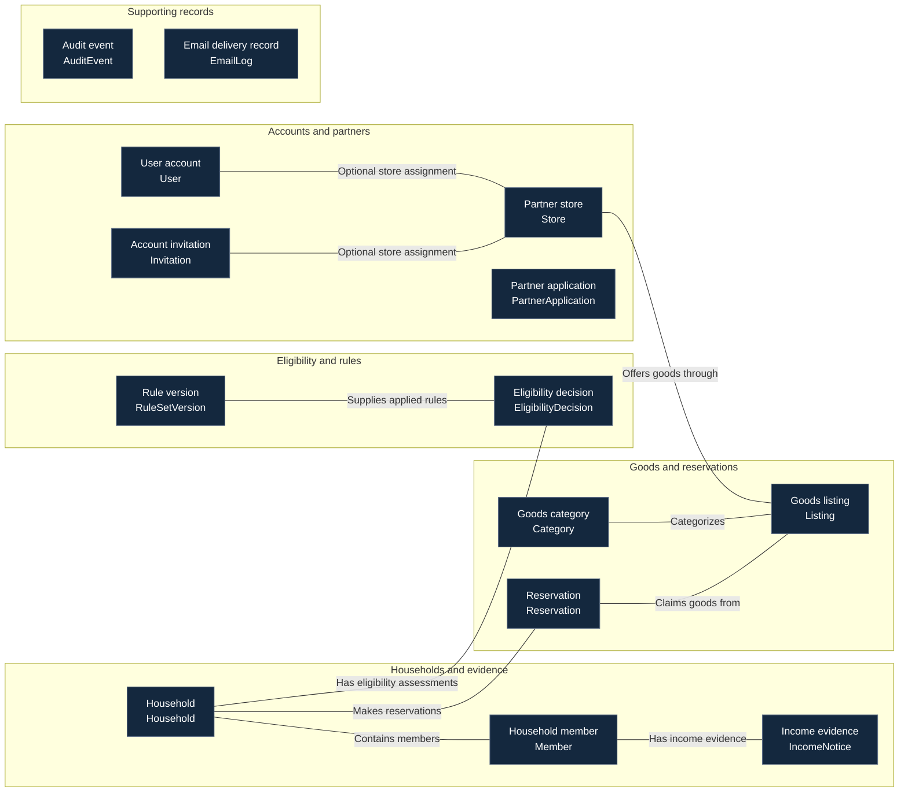
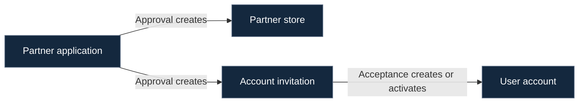

<!-- AI usage: 50% or more AI-generated. -->

# Iris domain model — Release 1 draft

This domain model describes the confirmed business concepts and how they relate. The ERD documents their stored fields and database relationships.

## Changes over sprints

Iris follows an Agile methodology. Small design changes can be made in later sprints as requirements develop. The responsible module owners review changes and keep the domain model, ERD, schema documentation, and migration plan consistent.

## Business concepts

| Concept | Model | Owner module | Meaning |
| --- | --- | --- | --- |
| User account | User | accounts | A person who can sign in and act according to their role. |
| Account invitation | Invitation | accounts | An invitation to create or activate an account with an assigned role and optional store assignment. |
| Partner store | Store | stores | An approved business offering goods, including the B.A.D.R. store. |
| Partner application | PartnerApplication | stores | A business request to become a partner. |
| Household | Household | households | A household registration and approval file. |
| Household member | Member | households | A person belonging to a household. |
| Income evidence | IncomeNotice | documents | Income evidence for an adult member, or their required non-filing explanation. |
| Eligibility decision | EligibilityDecision | eligibility | A preserved assessment of household eligibility and the inputs and rules used. |
| Rule version | RuleSetVersion | rules | A preserved version of configurable business rules. |
| Goods category | Category | categories | A category used to organize goods and apply category-specific rules. |
| Goods listing | Listing | listings | Goods offered by a store, with quantities and a pickup window. |
| Reservation | Reservation | reservations | A household claim on goods from a listing. |
| Audit event | AuditEvent | audit | An accountable record of an action, its actor, target, and time. |
| Email delivery record | EmailLog | notifications | A record of notification delivery without retaining email content. |

The groups in the diagram organize related concepts for readability. The owner module is listed in the table.

## Business relationships

Connecting lines describe business associations. Their labels explain the relationship in words. They do not specify database cardinality, foreign-key rules, or deletion behavior.

Partner application approval and invitation acceptance are shown separately as business actions.

Audit events and email delivery records appear as supporting concepts without implying direct database links to every model.

## Partner onboarding actions

These arrows describe what the application does. They do not establish stored links between an application, its resulting store, its invitation, and the resulting user.

Approval creates the store and invitation, updates the application, and records the audit event in one transaction.

The invitation email is sent after the transaction commits.

Acceptance creates or activates the user account with the invited role and optional store assignment.

## Confirmed business rules

### Accounts and partners

- A store can have multiple managers and staff.
- A user has an optional store assignment.
- A partner application collects business and contact information, a business address, at least one goods category, expected donation frequency, opening hours, and contact consent.
- Approval creates the partner store and account invitation.

### Households and income evidence

- Household registration collects the main contact information, a structured address, and member details.
- Walk-in registration records an in-person identity-check confirmation without storing identity-document details.
- Each adult needs accepted income evidence or a required non-filing explanation.
- Income evidence is recorded for the individual member.

### Eligibility

- Eligibility uses accepted assessed income for members aged eighteen or older and the threshold for household size.
- Income at or below the threshold is eligible.
- Eligibility decisions preserve their calculation inputs, result, and applied rule version.
- Existing eligibility decisions are never updated.

### Goods and reservations

- Stores offer goods through listings.
- Listings belong to goods categories.
- Reservations claim stock from a listing.
- Stock allocation and reservation creation are atomic.
- Household eligibility and configured reservation limits are checked.
- Pickup confirmation records who confirmed collection and when.

### Supporting records

- Audit events record actions without copying sensitive information into event metadata.
- Email delivery records track notification delivery without storing email content.

## Sources

- Accounts and invitations: [#424](https://github.com/B-A-D-R-SL/iris/issues/424), [#428](https://github.com/B-A-D-R-SL/iris/issues/428), [#430](https://github.com/B-A-D-R-SL/iris/issues/430), [#433](https://github.com/B-A-D-R-SL/iris/issues/433).
- Partner onboarding: [#443](https://github.com/B-A-D-R-SL/iris/issues/443), [#445](https://github.com/B-A-D-R-SL/iris/issues/445), [#447](https://github.com/B-A-D-R-SL/iris/issues/447).
- Households and evidence: [#461](https://github.com/B-A-D-R-SL/iris/issues/461), [#463](https://github.com/B-A-D-R-SL/iris/issues/463), [#468](https://github.com/B-A-D-R-SL/iris/issues/468).
- Eligibility and rules: [#457](https://github.com/B-A-D-R-SL/iris/issues/457), [#460](https://github.com/B-A-D-R-SL/iris/issues/460), [Iteration 2 plan](https://github.com/B-A-D-R-SL/iris/blob/main/docs/06-planning/iteration-2.md).
- Goods and reservations: [#493](https://github.com/B-A-D-R-SL/iris/issues/493), [#501](https://github.com/B-A-D-R-SL/iris/issues/501), [#513](https://github.com/B-A-D-R-SL/iris/issues/513), [#515](https://github.com/B-A-D-R-SL/iris/issues/515), [#520](https://github.com/B-A-D-R-SL/iris/issues/520).
- Supporting records: [#541](https://github.com/B-A-D-R-SL/iris/issues/541), [#549](https://github.com/B-A-D-R-SL/iris/issues/549).