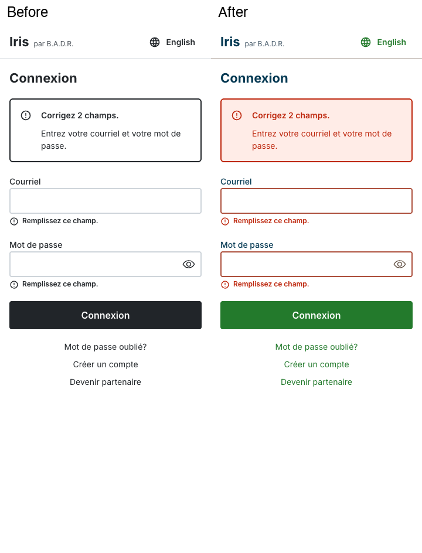
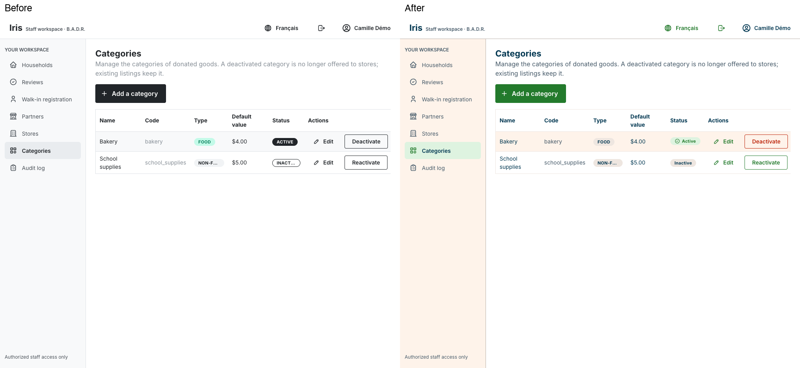

<!-- AI contribution: 50% or more AI-generated -->

# SET-34 colour verification

Source: [SET-33 PR #668](https://github.com/B-A-D-R-SL/iris/pull/668), merged at
`fd731869d7998425eeb8553ff58a812581b2473e`, and
[Foundations](../../mockups/Foundations.png). The 70 original palette shades match
that export exactly, including its pinned primary/text shades. Component values
(input border, placeholder, neutral badge, primary hover/pressed) come from its note.

## Before and after

Before is the merged main without SET-34; after applies SET-34. All data is fictional.

[Download all 76 full-resolution screenshots and browser measurements](screenshots.zip).
The archive contains French and English screens at 360 px, with staff also at 1024 px:
welcome, sign-in (empty and validation), invitation, partner application, listing
posting, not-found, household search (empty and all eight statuses), walk-in,
categories, destructive confirmation and audit. No backend writes were made.

## Checks

- `pnpm test:coverage`: 529 tests across 32 files; 94.72% line coverage.
- `pnpm typecheck`, `pnpm lint`, `pnpm format:check`, `pnpm build`, `git diff --check`: pass.
- Required colour searches, including new files: no matches outside `tokens.ts`.
- 70/70 Foundations palette swatches match; contrast tests pass for all semantic pairs.
- Input border: 3.36:1 on white, 3.08:1 on cream. Placeholders: 4.84:1 on white.
- Lowest status text pair: warning 4.5866:1; success 4.6259:1.
- Live primary button states match normal, hover and pressed tokens.
- No page exceptions, page-level horizontal overflow or clipped status labels.

Compared in-scope colours with Foundations and the available committed prototypes.
Existing app layouts, content and flows were retained. Welcome, sign-in and not-found
have no separate export in this merge and were checked against Foundations/shared
components. Captures represent the listed states rather than every workflow transition;
full pixel identity or independent WCAG certification is not claimed.

The backend is unchanged by SET-34. The build retains its existing large-bundle advisory.
CI and teammate review are separate from these local results.

## Ammar review follow-up

See the [complete route and override inventory](affected-screens.md), including the
AppBar dropdown, category add/edit dialogs, HolderStep checkboxes, IntegerField and
SignOutButton. [Supplemental before/after captures and hover measurements](ammar-review.zip)
compare this follow-up with the PR before review fixes (`ea428cd`), rather than main.
The original archive remains the evidence for the initial palette migration.

Removed the legacy household status labels/map and unused category admin status
labels: `shared.status` is the sole bilingual source. Household search validates
against the same status map, with tests for all eight API statuses and unknown keys.
Filled, light and default controls now have distinct hover colours; light hover text
also darkens to maintain normal-text contrast. SET-33's 70 palette shades are unchanged.

Follow-up verification: **578 tests pass** across 32 files, with **94.72% line
coverage**; TypeScript, lint, formatting and production build pass. Browser checks
record 32 route captures and two control-matrix captures, 42 normal/hover measurements,
no page exceptions or page-level horizontal overflow, and unchanged disabled controls.
All filled/light hover text pairs meet 4.5:1. The 70 original palette entries are
byte-for-byte unchanged from the pre-review PR head.
