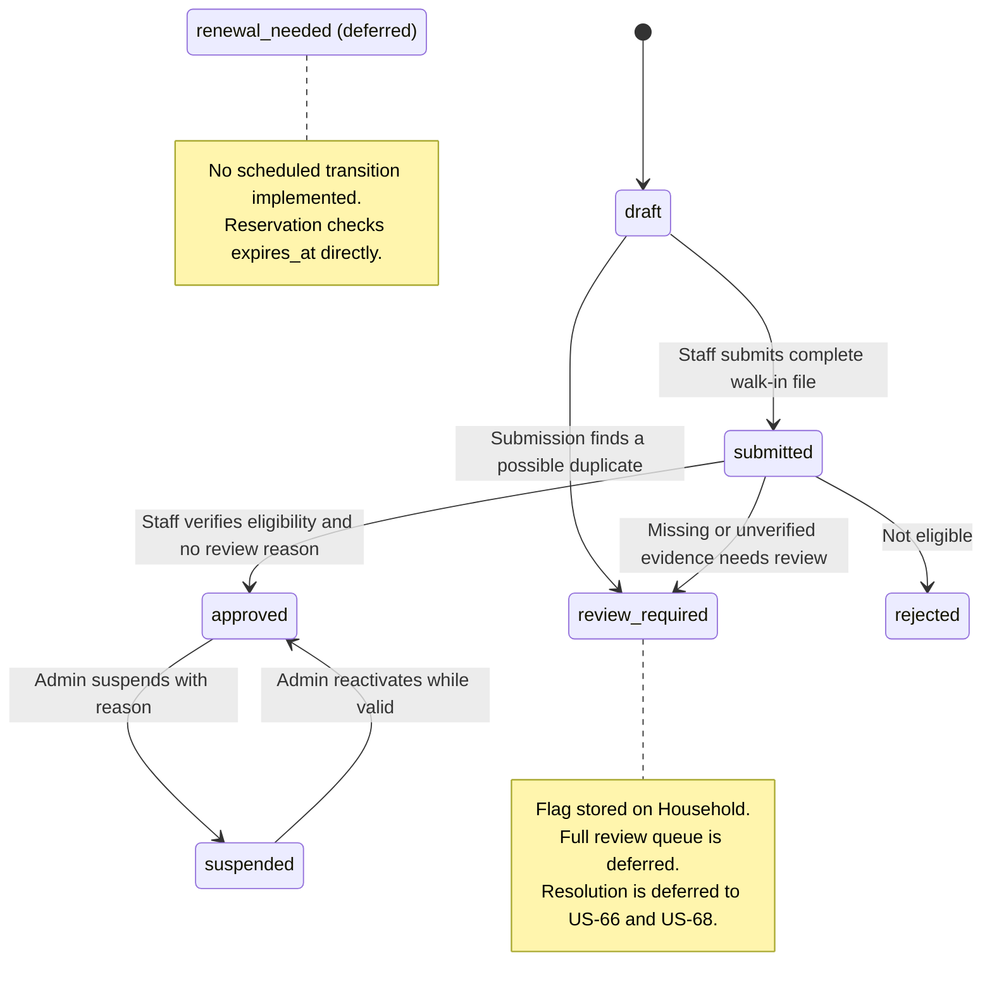
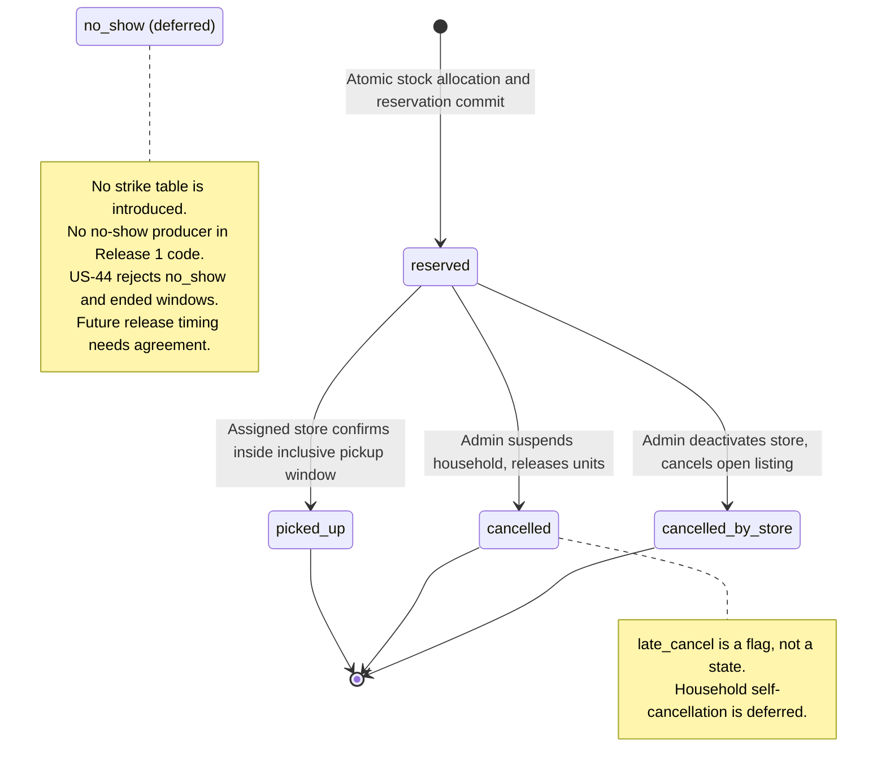

<!-- AI contribution: 50% or more AI-generated -->

# Release 1 workflows and lifecycle decisions

These sequences and state diagrams continue the [Release 1 architecture](architecture.md).
The [scope](architecture.md#scope), [module ownership](architecture.md#module-ownership)
and [dependency graph](architecture.md#4-release-1-module-dependencies) define their shared context.

Revision: 15 November 2026, `main` at `a022580`. Updated implemented walk-in,
eligibility, invitation, reserve, pickup and cancellation paths; deferred state
transitions are explicitly labelled. Evidence and remaining gaps are in the
[Release 1 review](architecture.md#release-1-review).

The sequences below were traced through HTTP permissions, service transactions,
queries, jobs and their existing tests. Arrows in the state diagrams represent
implemented transitions; isolated future states do not imply a running job.
The [code trace](#code-trace-and-other-release-1-workflows) also covers active
workflows described in the architecture overview without a dedicated sequence.

## Diagrams

### 6. Sequence — walk-in registration

Flagged households remain unapproved. The full review queue is outside
Release 1.

US-17 built the first part (draft creation and step-by-step saving,
React screens at `/staff/walk-in`). Its creation and edit events are
recorded locally in `HouseholdDraftEvent` and centrally as `create` and `update`
through FIX-08. Submission adds local `submitted` and central `submit`, including duplicate
review outcomes. Each mutation and its audit share a transaction; detail reads
record `view` before disclosure and fail closed if auditing fails. Eligibility
decisions append `decision` events with only decision ID, outcome and LICO rule
version in the decision transaction. Automatic events have a null actor and
`system` role and must match a saved automatic decision.

The notices and approval part is implemented by US-18 (PR #698): the notices
screen (`/staff/walk-in/{id}/notices`, T-03.18.4) shows one card per adult and a
decision summary whose "Approve the file" button calls
`POST /api/staff/households/{id}/approve/`, which runs `approve_walk_in` (#469).

The server's decision-summary endpoint supplies amounts, threshold, adult IDs,
review routing and calendar-month expiry. Notice recording currently writes only
local draft history; central notice-update auditing and audited notice/summary
reads are pending #713 / PR #715. Consent is required at submission, but the
pre-upload consent checks are pending #714 / PR #716.

```mermaid
sequenceDiagram
    actor IW as Intake worker
    participant H as Households service
    participant D as Documents service
    participant E as Eligibility service
    participant AC as Accounts service
    participant A as Audit service
    participant NS as Notifications service
    participant N as Email worker
    actor HC as Household contact

    Note over IW,H: React and DRF authenticate staff and check permissions before service calls

    IW->>H: create_walk_in(holder, phone, optional fields) — first "Continue" or "Save draft"
    H->>H: Save draft household and holder Member<br/>Stamp consent time and version only if consent is supplied
    H->>H: Record HouseholdDraftEvent "created"
    H->>A: Record central "create" in the same transaction
    H-->>IW: Draft id<br/>The screen moves to /staff/walk-in/{id}

    loop Each later step (address, members, review)
        IW->>H: update_draft(id, step values)
        H->>H: Save draft changes, retain unchanged member records
        H->>H: Record HouseholdDraftEvent "updated"
        H->>A: Record central "update" in the same transaction
    end

    IW->>H: Open /staff/walk-in/{id}/notices: GET /api/staff/households/{id}/notices/
    H->>D: current_notices(members)
    H-->>IW: Saved notices<br/>One card per adult (18 or older), saved ones shown as recorded

    loop Each adult
        IW->>IW: Photograph the notice (camera) or choose a file, type tax year and line-199 income, or tick "did not file" with a reason
        IW->>H: POST /api/staff/households/{id}/notices/ (multipart) → record_walk_in_notice(id, member, values or reason, file)
        H->>H: Check the draft and adult membership before storing anything
        H->>D: prepare_staff_notice(values, file, staff)
        D->>D: Check notice rules and store the optional file privately, without a household lock
        D-->>H: Prepared notice
        H->>H: Lock the draft and recheck adult membership
        Note over H,D: Notice and draft-history writes share one transaction
        H->>H: Record HouseholdDraftEvent "updated"
        H->>D: save_prepared_notice(member, prepared, staff)
        D->>D: Supersede the current notice and save the prepared entry
        Note over H,D: A save failure rolls back writes and invokes discard_prepared_notice
        H-->>IW: 201 recorded notice<br/>The decision summary marks the adult
    end

    IW->>H: GET /api/staff/households/{id}/decision-summary/
    H->>H: Read adult evidence and preview eligibility when verified
    H-->>IW: Read-only summary, readiness, review reasons and projected validity<br/>No saved eligibility decision or approval

    IW->>H: "Submit the file" (every adult has a notice or reason): POST /api/staff/households/{id}/submit/ → submit_walk_in()
    rect rgb(24, 42, 62)
        Note over H,A: Submission transaction
        H->>H: Lock visible walk-in household and require draft status
        H->>H: Require complete address, identity check, consent and valid members
        H->>H: Lock address/person duplicate keys and check possible duplicates (US-25)
        H->>D: Require a current notice or non-filing entry for every adult
        H->>H: Save submitted or review_required, submitted_at and local submitted event
        H->>A: Record central "submit" in the same transaction
        Note over H,A: Validation or lock failure leaves the draft unchanged
    end
    H-->>IW: submitted, or review_required with POSSIBLE_DUPLICATE<br/>Approval is offered only for submitted files

    IW->>H: "Approve the file": POST /api/staff/households/{id}/approve/ → approve_walk_in() (400 while still a draft)

    rect rgb(24, 42, 62)
        Note over H,A: Approval outcome and associated writes share a database transaction
        H->>H: Lock visible walk-in household<br/>Require submitted status and recheck file completeness
        Note over H,E: Duplicate search already ran at submission<br/>Approval does not rerun it or resolve review_required

        H->>H: Check evidence completeness and review reasons
        alt Each adult has a current entry
            H->>E: decide_for_household(household_id, staff)
            E->>H: queries.eligibility_inputs(household_id)
            H->>D: Read current notices through public query
            D-->>H: Income evidence and verification status
            alt Verified adult incomes available
                H-->>E: Adult incomes and household size
                E->>E: Save decision inputs, result and applied rule version
                E->>A: Record eligibility decision ID, outcome and rule version
                E-->>H: Eligibility result and threshold
            else Evidence needs review
                H-->>E: Evidence-unavailable reason codes
                E-->>H: Refusal<br/>No eligibility decision saved
            end
        else Adult evidence is missing after submission
            H->>H: Add NOTICE_MISSING review reason
        end

        alt Eligible, verified and no review reason
            H->>H: Save approval and validity dates
            H->>A: Record approval

            opt Household has email
                H->>AC: create_invitation(role=beneficiary, holder Member identity)
                alt Email already belongs to an active or inactive User
                    AC-->>H: email_already_registered<br/>Skip invitation and set invitation_not_sent=true
                else New account email
                    AC-->>H: Saved invitation and raw setup token
                    H->>NS: queue_set_password_email(email, token, language)
                    NS->>NS: Save EmailLog and register after-commit enqueue if configuration is valid
                end
            end
        else Requires clarification or review
            H->>H: Set review_required
            H->>A: Record flagged outcome
        else Not eligible
            H->>H: Set rejected
            H->>A: Record rejection outcome
        end
        Note over H,NS: Audit, validity or other invitation errors roll back all approval writes
    end

    opt Committed approval has a valid setup email
        NS-->>N: Attempt enqueue after commit<br/>Queue failure is recorded without undoing approval
    end

    H-->>IW: 200 {status, status_reason, approved_at, expires_at, invitation_not_sent}<br/>The screen explains each reason

    opt Invitation email queued
        N-->>HC: Deliver setup link independently
    end
```

Approval adds `file_validity.approved_months` calendar months in
`America/Montreal` (default twelve), rather than a fixed number of days. A
non-filer, unseen notice, unaccepted tax year, name/postal-code mismatch or missing adult evidence sends
the file to `review_required`; income above LICO produces `rejected` with
`INCOME_ABOVE_LICO`. The household outcome and eligibility calculation have
separate central decision events. `status_reason` stores the household reason.

`invitation_not_sent=true` means an existing active or inactive account prevented
invitation issuance while approval committed. It is false for outcomes without
an invitation (including no email or a non-approved file), and for an email
configuration failure recorded in `EmailLog`. It is not a delivery receipt.
Other invitation validation or database errors propagate and roll back approval.

Drafts may lack identity verification or consent. Submission requires both;
the current notice-upload path does not enforce consent before storage. Notice
entry and draft editing stop after submission. A newly adult member without
evidence at approval therefore routes the submitted file to review.

The draft's holder is a `Member(relation="holder")`. `Household.holder` is a
different, nullable one-to-one User field. It remains null for walk-ins, and
`Household.clean()` refuses setting it on that channel. Accepting a walk-in
invitation creates the User but does not link the file. US-93 (#704, Release 2)
owns that linkage; the ERD does not imply it already works.

### 7. Sequence — partner onboarding

The proposed store manager is the contact designated in the partner
application. Approval and rejection notifications use that person's
recorded email address. Receiving a rejection email does not require
an Iris account or invitation.

```mermaid
sequenceDiagram
    actor B as Business applicant
    actor AD as Administrator
    participant API as Staff applications API
    participant S as Stores service
    participant AC as Accounts service
    participant A as Audit service
    participant NS as Notifications service
    participant N as Email worker
    actor M as Proposed store manager

    Note over B,S: Public API validates and normalizes the form<br/>Each staff endpoint requires an active admin
    B->>S: submit_application(form)
    S->>S: Check active category codes and no open application for this email
    rect rgb(24, 42, 62)
        S->>S: Save submitted application<br/>Unique index settles concurrent duplicate submissions
        S->>NS: send(partner_application_received)
        NS->>NS: Save EmailLog and register enqueue if valid
    end
    NS-->>N: Attempt receipt enqueue after commit
    S-->>B: 201 application<br/>No Store or User created yet

    AD->>API: GET /api/staff/partner-applications/?status=submitted
    API->>API: Check active admin (else 401 or 403)
    API->>S: partner_applications(status), oldest first
    S-->>API: Page of applications
    API-->>AD: 200 list

    alt Approve
        AD->>API: POST /api/staff/partner-applications/{id}/approve/
        API->>S: approve_application(application, admin)
        rect rgb(24, 42, 62)
            Note over S,A: One transaction, failure rolls back all approval writes
            S->>S: Lock application and require submitted status (else 409)
            S->>S: Create active Store
            S->>AC: create_invitation(role=store_manager, store)
            AC-->>S: Invitation prepared
            S->>S: Save approved application and decision information
            S->>A: Record approval
            S->>NS: send(partner_application_approved, invitation link)
            NS->>NS: Save EmailLog and register enqueue if valid
        end
        NS-->>N: Attempt invitation enqueue after commit
        S-->>API: Approved application
        API-->>AD: 200 application

        opt Email queued
            N-->>M: Deliver invitation link independently
        end

        M->>AC: accept_invitation(token, password)
        rect rgb(24, 42, 62)
            AC->>AC: Lock invitation by token hash<br/>Verify unused, unexpired, new email and valid password
            AC->>AC: Create active User with invited identity, role and Store<br/>Mark invitation accepted in the same transaction
        end
        AC-->>M: Account ready for sign-in<br/>Existing browser session is preserved
    else Reject
        AD->>API: POST /api/staff/partner-applications/{id}/reject/ {reason}
        API->>S: reject_application(application, admin, reason)
        rect rgb(24, 42, 62)
            S->>S: Lock application and require submitted status (else 409)
            S->>S: Save rejected status and required reason (400 if blank or over 500)
            S->>A: Record rejection
            S->>NS: send(partner_application_rejected, reason)
            NS->>NS: Save EmailLog and register enqueue if valid
        end
        NS-->>N: Attempt decision enqueue after commit
        S-->>API: Rejected application
        API-->>AD: 200 application
        opt Email queued
            N-->>M: Deliver rejection independently
        end
    end
```

The US-04 backend creates new accounts only: an existing active or inactive
account with the same email is refused case-insensitively. Acceptance commits
user creation and invitation consumption together and does not sign the user in
or change an existing browser session. Issuance stores only the unique SHA-256
hash of a token generated from 32 random bytes and saves an expiry from the active
`invitations.expires_after_days` rule (default seven days); later rule versions
affect only new invitations. The raw token is returned for the calling workflow's
email. US-13 partner approval, rejection and operator invitation reissue now use
US-57's shared queue/templates/EmailLog; links use `PUBLIC_APP_ORIGIN`. Reissue
invalidates previous unaccepted links atomically, and the worker checks stale
invitation jobs before transport without claiming recall of in-flight messages.
Staff/team issuing screens remain US-05 and US-06; household linking is US-93
(#704, Release 2). The acceptance page (#431) is implemented at
`/invitation/:token`. Manager reissue is an operator management command
(`resend_partner_invitation`), not a staff resend screen. Partner submission,
approval, rejection and reissue use shared notification delivery; an email
queue or transport failure does not undo a committed decision. Invalid email
configuration is recorded as a failed `EmailLog` inside the transaction. Database
or unexpected programming errors can still abort that transaction. Unlike walk-in
approval, partner approval does not catch an already-registered-email refusal:
it rolls back the new Store and application decision.

### 8. Sequence — reserve and pickup

Reservation allocation is implemented by US-41 (PR #691), and lookup/confirmation
by US-44 (PRs #684 and #686). Central reservation and pickup
audits below remain planned; their application logs do not provide that guarantee.

The Listings module owns the stock UPDATE.
Reservations owns the reservation INSERT.

Code uniqueness is `(listing, pickup_code)` in the database, so
store-and-code lookup must not assume global uniqueness.

Lookup selects the sole `reserved` match at the assigned store; more than one
is `ambiguous_code`, even if a window has ended. With no `reserved` local match
it uses the latest local pickup end to explain a refusal, unless a `reserved`
claim for a non-anonymized household elsewhere requires `wrong_store`.
Here `reserved` is a saved status, not a guarantee that the pickup window is open.
Codes are normalized to uppercase without spaces. The scan screen accepts a
bare code or a bounded six-character token; no global reservation-ID QR
contract is established. The reservation confirmation currently shows text,
without generating a QR image.

Invalid or duplicate confirmations do not create a second pickup.

```mermaid

sequenceDiagram
    actor HH as Household user
    participant API as Reservations API
    participant R as Reservations service
    participant H as Households services and queries
    participant L as Listings service and queries
    participant DB as PostgreSQL
    actor ST as Store staff

    HH->>API: POST /api/reservations/ {listing_id, quantity}
    API->>API: Require active beneficiary and validate input
    API->>H: approved_household_id(signed-in user, now)
    H-->>API: Linked, approved and unexpired household (else 403)
    API->>R: reserve(actor, household_id, listing_id, quantity)

    rect rgb(24, 42, 62)
        Note over R,DB: One PostgreSQL transaction for stock and reservation<br/>Central reservation audit is planned

        R->>H: services.lock_approved_household(household_id)
        H->>DB: Lock household row<br/>Check approved status and expires_at
        H-->>R: Current eligibility under lock
        R->>L: reservable_listing(household_id, listing_id, now)
        L-->>R: Published, pickup not ended, stock and per-household limit
        R->>R: Read active reservation rule<br/>Count reserved claims and their cumulative quantity on this listing

        break Ineligible, unavailable listing, invalid quantity or limit reached
            R-->>API: Refuse with no stock or reservation change
        end

        R->>L: take_units(listing, quantity)
        L->>DB: Conditional UPDATE of own listing stock counter
        DB-->>L: Number of rows changed
        L-->>R: Allocation result

        alt One row changed
            R->>DB: INSERT reservation with six-character pickup code
            Note over R,DB: Retry only code collisions, up to five inserts in savepoints
            R->>R: Commit
        else No row changed
            R->>L: Reread availability to distinguish sold out, insufficient units or unavailable
            R->>R: Refuse and roll back
        end
    end

    Note over R,DB: A code collision rolls back only its insert savepoint<br/>Exhausted retries or another insert failure roll back stock and reservation together

    alt Committed
        R-->>API: Saved reservation and pickup code
        API-->>HH: 201 reservation<br/>React keeps the confirmation visible
    else Failed
        R-->>API: Reservation refusal
        API-->>HH: Refusal response
    end

    ST->>R: POST /api/store/pickups/lookup/ {code}
    Note over ST,R: API and service require active store staff/manager with an assigned store<br/>Store assignment comes from the account, not request data
    R->>L: Query listings in the staff member's permitted store
    R->>R: Resolve a unique reservation match

    alt Unique authorized match with reserved status and open inclusive window
        R->>H: Get permitted pickup display name
        R-->>ST: First name and last initial, item and quantity

        ST->>R: POST /api/store/pickups/{id}/confirm/
        rect rgb(24, 42, 62)
            Note over R,DB: Confirmation transaction<br/>Does not rely on the earlier lookup
            R->>DB: Lock authorized reservation row
            R->>R: Read current time after waiting<br/>Recheck status, inclusive window and permitted names
            R->>DB: Save picked_up, picked_up_at and confirmed_by
            Note over R,DB: Stock remains allocated<br/>No second decrement or release
        end
        R-->>ST: Confirmation outcome
    else Missing, ambiguous, unauthorized, finished, outside window or anonymized household
        R-->>ST: Reject lookup without exposing household details
    end
```

### 9. State — household file

This is the staff-led Release 1 subset of the supplied state diagram.

Online registration, awaiting-visit routing and the full review
workflow are not introduced.

Validity and suspension remain visible because reservation eligibility uses
them. There is no implemented scheduled expiry-to-renewal transition in this
snapshot. Expired files are refused by reservation queries/services even if
their saved status is still `approved`.

Each new reservation checks expiry directly. Existing reservations are not
automatically cancelled when the file expires; pickup checks the reservation's
status/window and household visibility, without rechecking approval or expiry.

`Household.status_reason` stores review/rejection/suspension reasons.
Reactivation clears the stored reason; its required reason remains in the
audit event and status email. Only admins can suspend/reactivate, and an expired
suspended file cannot be reactivated.

### 10. State — reservation

`renewal_needed` and `no_show` are model/seed states without producers in these
Release 1 workflows. Expiry-to-renewal (Households), window-end no-show (US-46)
and no-show-to-picked-up correction (US-45) are deferred transitions. An ended
window alone leaves a reservation `reserved`, still consuming allocation and
active-reservation limits until an implemented cancellation changes its status.

## Review points

This table distinguishes decisions resolved in code from work still deferred.

| Area | Decision needed |
| --- | --- |
| Holder/account linkage | Storage is resolved: optional `Household.holder` → User and a separate holder Member. Walk-in linkage is explicitly refused and invitation acceptance does not set it. US-93 (#704) implements the missing path in Release 2. |
| Partner form storage | Resolved by US-12 (#445): flat address columns as on Store, `goods_categories` as a text array of category codes, plus `expected_frequency`, `opening_hours`, `consent_contact` and `language` columns. See [PartnerApplication](../03-design/database-schema.md#partnerapplication). |
| Pickup lookup | Implemented: per-listing uniqueness, five insert attempts on code collision, assigned-store lookup and ambiguity refusal. Text code confirmation and browser QR scanning exist; household QR generation does not. |
| Household flags and reasons | `status_reason` is implemented. Duplicate submission and evidence review leave the file in `review_required`; the review queue/resolution is deferred. |
| Lifecycle timing | Approval uses calendar months from `file_validity.approved_months` (12 by default). US-44 accepts the inclusive pickup window only. US-45's later 24-hour correction is not implemented. |
| Cancellation/no-show stock | Suspension releases units and cancels reserved claims. Store deactivation cancels eligible listings and claims without releasing counters. No-show, late correction and household cancellation remain later stories. |
| Worker deployment | Implemented in `backend/iris/release.py`: one release container couples Gunicorn and Procrastinate, stops both if either exits, and forwards shutdown to both process groups. Staging targets one App Service instance. Live Azure startup/shutdown and queue/email verification remain pending; `/api/ready/` checks process existence, not queue progress. |
| Dependency contracts | Reconciled with current import-linter permissions, including Eligibility → Households queries and the suspension/deactivation coordination calls. Domain purity and public cross-module interfaces remain enforced. |

### 11. Administrative cancellation

US-32 (PR #669) and US-14 (PR #710) coordinate through public services inside
the initiating transaction. Both paths lock listings before reservations in
stable ID order, so a concurrent suspension and deactivation do not invert locks.

| Trigger | Transactional effect | After commit |
| --- | --- | --- |
| Admin suspends an approved household, with a privacy-validated reason | Lock household; set `suspended`; lock affected listings then reserved claims; release their quantities through Listings; set claims `cancelled`, `late_cancel=false`; record central suspension audit and email metadata | Queue holder status email when the file has an email |
| Admin reactivates a still-valid suspended household, with a reason | Set `approved`, clear `status_reason`; record reason in central audit and email metadata; cancelled reservations stay cancelled | Queue status email when an address exists |
| Admin deactivates a partner store, with a reason (fixed 500-character maximum) | Lock store; set inactive; lock/cancel published listings with `pickup_end > now`; lock their reserved claims; set `cancelled_by_store`, `late_cancel=false`; retain reserved stock counters; record reason/counts in audit and email metadata | Queue one cancellation email per affected reservation with an email contact |
| Admin reactivates a partner store, with a reason | Set active and audit the reason; cancelled listings and reservations stay cancelled | New posting becomes possible |

The B.A.D.R. store cannot change active status through these services. Repeated
store status changes are 409; invalid household source states are 400.
Suspension requires saved `approved` status, even if its expiry has passed;
reactivation requires `suspended` status and a future expiry. Both household
actions lock the household before changing it. Store editing locks the store,
audits only changed field names, and emits no audit for an unchanged patch.
Ended listing windows are excluded from store cancellation, pending US-46's
no-show processing. No strike is created by either cancellation path.

### Failed pickup attempts and no-shows — proposed handling

This section retains the earlier anchor for incoming links. Lookup and pickup
are now implemented; no-show lifecycle handling remains future work.

| Situation | Current implementation or deferred decision |
| --- | --- |
| Incorrect, missing or ambiguous pickup code | Refuse pickup without changing stock or cancelling a reservation. |
| Identity cannot be verified | Staff see holder and alternate as first name + last initial and choose whether to hand over. There is no persisted identity-verification outcome or automatic cancellation for this case. |
| Pickup window ends without collection | US-44 refuses confirmation after the end. The reservation remains `reserved`; the US-46 (#525) no-show/closing job is not implemented. |
| Later correction or stock release | US-45 (#524) proposes a 24-hour correction. It is not a Release 1 grace period. Stock release versus later correction must be designed with US-46 before adding either producer. |

The current code permits confirmation at both pickup-window endpoints and
refuses `no_show`, cancelled and already picked-up claims. Seeded statuses
demonstrate screens/tests; they do not prove a background transition exists.

If a grace period is retained, stock must not be released while the
same reservation can still be confirmed for pickup.

Releasing an allocation does not automatically reopen the listing.
Whether the goods can be offered again depends on the listing's status,
collection window and the goods' continued availability and suitability.

Before implementation, agree on:

- What information is required to verify pickup identity.
- Whether a grace period applies and its duration.
- When reserved stock is released.
- How stock release prevents duplicate releases or conflicting pickup
  confirmations.

When the deferred stories implement these decisions, update the sequence,
state diagram and business rules together.

## Code trace and other Release 1 workflows

Paths below are the implementation sources reviewed at `a022580`. Test links
identify existing checks inspected during the review; they do not claim a new
application-test run. The API boundary performs authentication, role checks and
input validation before the service calls shown in the sequences.

| Workflow | Code trace | Logic confirmed in code |
| --- | --- | --- |
| Walk-in draft and submission (6) | [Households services](../../backend/modules/households/services.py), [policies](../../backend/modules/households/policies.py), [submission API](../../backend/modules/households/api/views.py); [walk-in tests](../../backend/modules/households/tests/test_walk_in.py) | Only visible walk-in drafts can be edited/submitted. Submission checks complete data, verification, consent and every adult's evidence. Household and shared duplicate-key locks protect the saved outcome and both histories. |
| Notice entry and summary (6) | [Notice service](../../backend/modules/households/notice_services.py), [evidence queries](../../backend/modules/households/queries.py), [approval services](../../backend/modules/households/approval_services.py); [notice safety tests](../../backend/modules/households/tests/test_walk_in_notice_safety.py) | Storage preparation precedes the household lock; the draft/member checks run again under lock. Summary previews do not save decisions. The server supplies adult IDs and readiness used by the [React decision screen](../../frontend/src/areas/staff/pages/WalkIn/DecisionSummary.tsx). |
| Eligibility and approval (6) | [Approval entry point](../../backend/modules/households/approval_services.py), [outcome helper](../../backend/modules/households/_approval.py), [Eligibility service](../../backend/modules/eligibility/services.py); [outcome tests](../../backend/modules/households/tests/approval/test_outcomes.py), [side-effect tests](../../backend/modules/households/tests/approval/test_side_effects.py) | Approval locks and accepts submitted walk-ins only. Eligibility pulls adult evidence, checks the accepted tax year, seen-in-person flag, name and postal code, then saves inputs/results/rule version. Review evidence never becomes assumed zero income. Validity, household outcome, audits and any invitation commit together. |
| Partner application/decision/reissue (7) | [Stores services](../../backend/modules/stores/services.py), [Accounts services](../../backend/modules/accounts/services.py); [decision tests](../../backend/modules/stores/tests/test_application_decisions.py) | Submission creates no account/store. A locked submitted application can be decided once. Approval creates Store + manager invitation; rejection requires a reason. Reissue atomically expires old unaccepted links. |
| Invitation acceptance (7) | [Acceptance API](../../backend/modules/accounts/api/views.py), [Accounts services](../../backend/modules/accounts/services.py); [invitation tests](../../backend/modules/accounts/tests/test_invitations.py) | An unused, unexpired token authorizes only its invited new account. Invitation locking, password validation, User creation and consumption are atomic. Acceptance neither signs in nor links a walk-in household. |
| Browse and reserve (8) | [Browse API](../../backend/modules/reservations/api/views.py), [reservation API](../../backend/modules/reservations/api/reserve_views.py), [Reservations service](../../backend/modules/reservations/services.py), [Listings queries](../../backend/modules/listings/queries.py); [reserve tests](../../backend/modules/reservations/tests/test_reserve_service.py) | The household comes from the active beneficiary account. Browse shows published, unsold listings whose pickup has not ended, 20 per page. Reserve serializes household limits, conditionally allocates stock and inserts atomically. Tier delays and strike blocking are deferred. |
| Pickup lookup/confirmation (8, 10) | [Pickup API](../../backend/modules/reservations/api/pickup_views.py), [queries](../../backend/modules/reservations/queries.py), [service](../../backend/modules/reservations/services.py); [pickup tests](../../backend/modules/reservations/tests/test_pickup_service.py) | Active store staff/managers act only within their account's assigned store. Lookup is read-only; confirmation locks and rechecks the claim and inclusive window. Anonymized households disclose no pickup names. Pickup retains allocated stock and records the confirmer once. |
| Household/store administration (9–11) | [Households services](../../backend/modules/households/services.py), [Stores services](../../backend/modules/stores/services.py), [reservation cancellation](../../backend/modules/reservations/services.py), [listing cancellation](../../backend/modules/listings/services.py); [suspension tests](../../backend/modules/households/tests/test_suspension_api.py), [listing cancellation tests](../../backend/modules/listings/tests/test_cancel_for_store.py) | Admin status actions enforce source states and reasons under lock. Suspension releases reserved units; store cancellation retains counters. Reactivation restores neither listings nor reservations. No expiry/no-show job is present in their task modules. |
| Sign-in, sign-out and landing | [Account adapter](../../backend/modules/accounts/adapter.py), [root URLs](../../backend/iris/urls.py), [React routes](../../frontend/src/app/routes) | Allauth browser sessions handle login/logout; the adapter serializes email-key throttling. Role landings use the implemented screens listed in the overview. Invitation acceptance is a separate public token action. |
| Category administration | [Category services](../../backend/modules/categories/services.py), [staff routes](../../backend/modules/categories/api/staff_urls.py) | Active admins create/edit categories; code is immutable after creation. Changed default values obey the active posting rule. Deactivation hides the category from posting/partner choices; it does not delete it or cancel existing goods. |
| Posting goods and photo storage | [Listings service](../../backend/modules/listings/services.py), [Store query](../../backend/modules/stores/queries.py) | The assigned store is locked and must be active. Active category, posting rules and safety rules are required. Valid input creates a published listing directly, with safety confirmation and optional sanitized private photo. Failed persistence invokes photo cleanup; there is no separate draft/publish workflow. |
| Staff search/detail and audit search | [Household API](../../backend/modules/households/api/views.py), [queries](../../backend/modules/households/queries.py), [Audit API](../../backend/modules/audit/api/views.py); [search API tests](../../backend/modules/households/tests/test_search_api.py), [walk-in audit tests](../../backend/modules/households/tests/test_walk_in_audit.py) | Intake/admin search and detail hide anonymized files and audit returned disclosures before responding. Resume/open capabilities come from backend policies. Central audit search is admin-only; application logs and local draft history are separate records. |
| Staff notice download | [Documents service](../../backend/modules/documents/services.py), [file API](../../backend/modules/documents/api/views.py) | Authorized staff obtain an audited, signed Iris link with a captured lifetime. Download rechecks staff identity, signature and expiry and proxies the private attachment; it does not expose a Blob URL. |
| Rule publication and resolution | [Rules services](../../backend/modules/rules/services.py), [queries](../../backend/modules/rules/queries.py) | Publication validates values and saves the next immutable version and audit together. Resolution selects the latest effective date at/before the supplied time, then highest version, rather than simply the largest version number. This is a backend operation, not a Release 1 rule-editor screen. |
| Shared email and maintenance | [Notifications service](../../backend/modules/notifications/services.py), [worker tasks](../../backend/modules/notifications/tasks.py), [stalled-job recovery](../../backend/iris/tasks.py) | EmailLog joins the business transaction; enqueue runs after commit. The worker checks invitation usability, renders and attempts transport with captured retry delays. Terminal payload cleanup and conservative stalled-delivery recovery do not implement household renewal or reservation no-shows. |
| Staging deployment and readiness | [Deployment workflow](../../.github/workflows/deploy-staging.yml), [release supervisor](../../backend/iris/release.py), [readiness probe](../../backend/iris/staging_views.py) | Deployment is opt-in and gated on current-main CI; publish-only skips Azure. The release container supervises API and worker together. Readiness checks the database and worker process, not email delivery or queue progress. Live activation remains unverified as recorded in the overview. |
