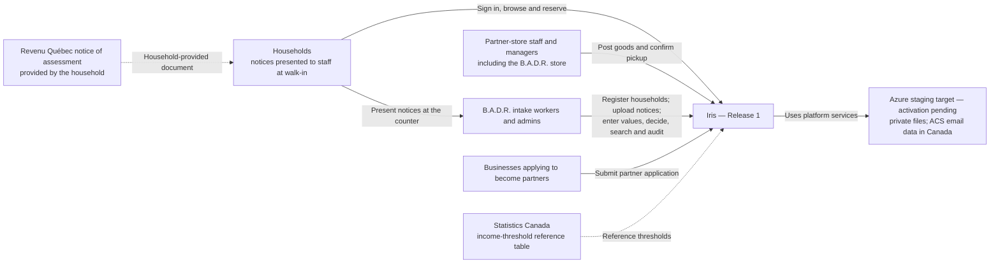
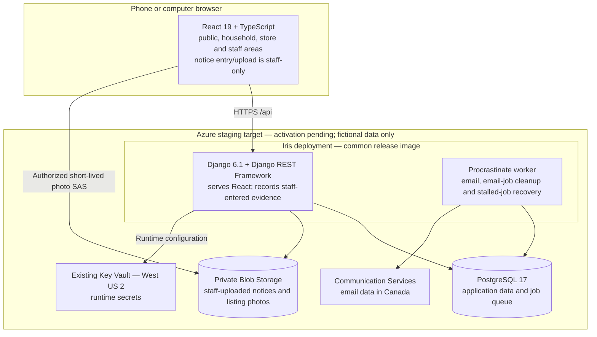
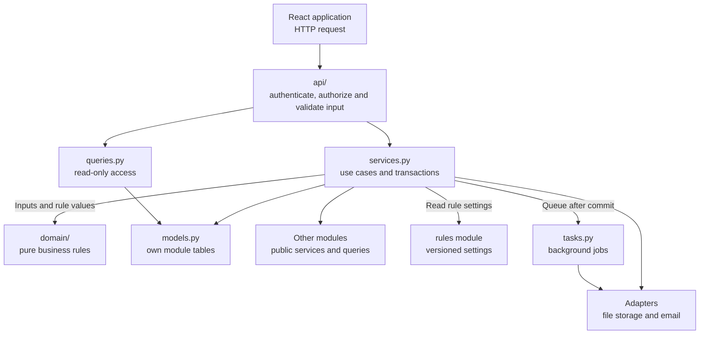
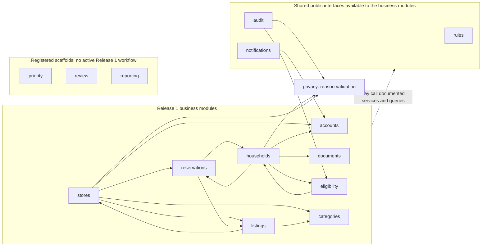
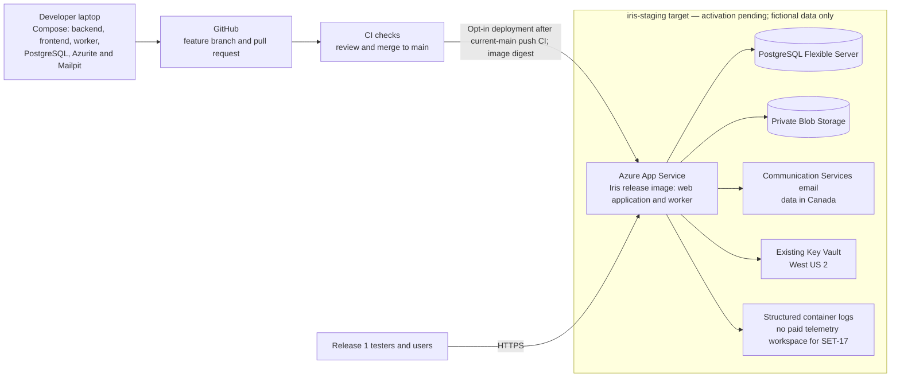

<!-- AI contribution: 50% or more AI-generated -->
<!-- File-length exception: keep the module/deployment diagrams, runtime contracts
and dated Release 1 comparison with its PR/issue evidence in this existing
canonical overview, as requested, rather than creating companion documents. -->

# Iris architecture — Release 1 implementation

Reviewed 15 November 2026 for [SET-21 (#412)](https://github.com/B-A-D-R-SL/iris/issues/412)
against local `main` at `a022580640be604eaf08f56aedd2f6d548583c65`
(through PR #710). This is a code snapshot, not a deployment certificate or a
claim that all Release 1 issues are complete. The original
[initial draft](architecture-initial-draft.md) is preserved.

The [Release 1 review below](#release-1-review) records the differences,
reasons and PR/issue evidence. The existing [database schema and ERD](../03-design/database-schema.md#erd)
now documents the 15 application models and all 27 concrete foreign keys.

## Scope

Release 1 includes:

- Sign-in.
- Partner applications and approval.
- New-account invitation acceptance, store administration and category administration.
- Staff-led walk-in household registration and eligibility decisions.
- Posting and browsing goods.
- Reservations and pickup confirmation.
- Staff search.
- Audit records and email delivery.
- Staging deployment packaging and workflow; live Azure activation/verification
  remain pending in this reviewed snapshot.

Online AI registration and automatic approval, priority tiers, strikes,
the full review queue, privacy-rights workflows, reporting, needs,
the resource assistant, furniture matching and production deployment
are outside this document’s active Release 1 flows.

These exclusions concern features and tables. The project’s baseline
data-protection requirements still apply.

A `review_required` or `no_show` status does not by itself require a
`ReviewCase` or `Strike` table.

Walk-in approval can send a set-password invitation, but linking the resulting
account to its household is Release 2 [US-93 (#704)](https://github.com/B-A-D-R-SL/iris/issues/704).
The Release 1 browse/reserve path needs an already linked approved household,
such as the fictional seed accounts. Expiry status jobs, household cancellation
screens, no-show processing and late pickup confirmation are also deferred.

AI Document Intelligence belongs to the later online registration flow.
A technical spike does not make it an active Release 1 dependency.

## Architecture decisions

- Iris is a modular monolith: one Django application and one React
  application, with module-owned tables and public services/queries.
- The repository pins Python 3.13 for builds, Django 6.1.2, DRF 3.18.3,
  allauth 65.19.7 and Procrastinate 3.10.0 in `backend/uv.lock`;
  React 19 and TypeScript are declared in `frontend/package.json` and locked
  by pnpm. These describe build inputs, not live Azure versions.
- Django serves the built React application in the deployed release image.
- Procrastinate uses PostgreSQL for background jobs and uses the same
  release image.
- PostgreSQL 17 stores application data.
- Notices and listing photos are private Blob Storage objects.
  Database models store file references.
- Django/allauth handles authentication.
- `User.password` stores a Django-managed encoded password hash. Settings prefer
  Argon2 and retain PBKDF2 for verification of existing hashes.
- Backend APIs enforce roles and ownership before invoking services.
- Business rules run on the backend.
- Configurable business thresholds, limits and timing use `RuleSetVersion`.
  Storage bounds and protocol choices also exist in code: for example,
  six-character pickup codes and the 500-character store decision reason.
- Email is queued after database commit and delivered through an adapter
  by background jobs.
- Money uses integer cents. Datetimes are timezone-aware.
- React supports French and English and separates public, household,
  store and staff areas.
- The eventual production target is Azure Canada East (SET-24).
  Fictional-data staging hosting is pending a region/subscription decision;
  existing ACS email data stays in Canada.
- Logs and audit metadata exclude sensitive document contents and
  income values.
- Release 1 staging uses generated test data. The project requires the
  signed privacy impact assessment before using real personal data.

## Changes over sprints

Module owners review changes together across architecture, ERD, domain model
and workflow diagrams. Applied databases receive new reviewed migrations;
later work should update the reviewed commit and Release 1 review below.

### Production configuration boundary (FIX-04)

WSGI/ASGI default to production settings; local Compose/management commands
explicitly retain development settings. Production validates secrets/mail,
requires HTTPS/HSTS and limits trusted proxy headers. DRF checks permissions
before throttling; allauth has separate proxy/rate policies and native responses.
See the [production settings guide](../guides/production-settings.md) and
[authentication routing](../guides/auth-routing.md#rate-limit-responses).
SET-17 owns live staging/proxy verification; FIX-17 adds CI security gates.
Configured production guards do not establish a running Azure deployment.

## Module ownership

| Module | Business models | Responsibility |
| --- | --- | --- |
| accounts | User, Invitation | Sign-in, roles, store assignments and invitations |
| stores | Store, PartnerApplication | Partner applications, decisions and store administration |
| households | Household, Member, HouseholdDraftEvent | Walk-in files, membership, local registration history, status and validity |
| documents | IncomeNotice | Staff-entered income evidence and private file references |
| eligibility | EligibilityDecision | Eligibility calculation and preserved decision inputs/results |
| rules | RuleSetVersion | Versioned thresholds, limits and timing settings |
| categories | Category | Bilingual goods categories, food flag, default value and active status |
| listings | Listing | Store offers, quantities and collection windows |
| reservations | Reservation | Reservations, cancellation and pickup confirmation |
| audit | AuditEvent | Action records without personal data in event metadata |
| notifications | EmailLog | Queued email delivery and delivery outcomes |
| privacy | None | Implemented sensitive-reason validation shared by household, store and audit services; privacy-rights workflows deferred |
| priority | None | Registered scaffold; priority, tiers and strikes deferred |
| review | None | Registered scaffold; review-case workflows deferred |
| reporting | None | Registered scaffold; reporting workflows deferred |

There are 15 registered business-module packages, 11 with models, and 15
application models (the original 14 concepts plus `HouseholdDraftEvent`).
Django/allauth and Procrastinate manage supporting tables. The SQL-created
`accounts_auth_cache` is additional authentication infrastructure, not an ORM
business model. Scaffold cleanup is still open in PR #712 at this snapshot.

`modules.common` holds shared contact-value utilities, with no tables or Django
app registration. Its `domain.contact` normalization is pure Python; Django,
DRF and form adapters delegate to it outside `domain/`. Stores and households
use this neutral package without importing each other's internals. Import-linter
continues to enforce the business-module boundaries and domain purity (FIX-14).

Reporting is not introduced into the Release 1 workflows here.

## Frontend and adapters

The React application follows the ESLint-enforced direction
`app → areas → features → shared` (imports can skip downward layers):

- `app/`: routing and providers.
- `areas/`: public, household, store and staff screens and area components.
- `features/`: module-specific code.
- `shared/`: reusable components and French/English translations.

Layouts live in `app/layouts/`, and `app/routes/` assembles routes per area.
The server enforces eligibility, ownership and stock on every action. Some
frontend controls derive display state from server values; for example the
reserve quantity picker caps its value using `units_left` and
`max_per_household`. It cannot authorize a reservation.

### Routes and authentication

| Role / area | Implemented routes and landing |
| --- | --- |
| Public | `/`, `/sign-in`, `/invitation/:token`, `/partner/apply`; `/privacy` still renders a placeholder |
| Beneficiary | Lands on `/listings`; `/listings/:id` displays detail and reservation confirmation |
| Store manager / staff | Lands on `/store/listings/new`; `/store/confirm` supports camera scan or typed code |
| Intake worker / admin | Lands on `/staff/households`; shared household detail at `/staff/households/:id`; walk-in at `/staff/walk-in`, `/staff/walk-in/:id` and `/staff/walk-in/:id/notices` |
| Admin only | `/staff/partners`, `/staff/stores`, `/staff/stores/:id`, `/staff/categories`, `/staff/audit` |

The staff landing confirms the October clarification on #422/#423. FIX-13
(PR #695) subsequently replaced `/home` and `/store` landings with the first
built screens. `/staff` redirects to `/staff/households`. The later pickup and
store-admin PRs restore their routes with real screens. Removed placeholder
routes are not implemented features.

Allauth exposes browser/session authentication under `/api/auth/browser/v1/`;
app-client routes are disabled. `GET /api/me/` supplies the account. HttpOnly
session cookies and CSRF protect mutations; deployed settings require Secure
cookies and SameSite=Lax. Public sign-up is closed, and staff MFA remains US-09.
Sign-out invalidates the browser session rather than other devices' sessions.

Login throttling uses PostgreSQL-backed `AuthCache` and a per-key advisory lock:
five email-key failures in 15 minutes start a 15-minute cooldown, alongside the
independent IP rate. Deployed DRF throttles default to 60/min anonymous and
300/min authenticated, while partner applications retain 5/hour/IP. Proxy trust
is explicit configuration. See [auth routing](../guides/auth-routing.md) and
[production settings](../guides/production-settings.md).

| Adapter | Azure staging / target provider | Development and tests |
| --- | --- | --- |
| Notice `file_store` | Private Azure Blob Storage; Iris proxies signed staff downloads | Explicitly configured Azure/Azurite backend and in-memory test fake |
| Listing `BlobPhotoStore` | Separate private Blob adapter; read-only SAS links up to 300 seconds | Azurite and injected test stores |
| mailer | Azure Communication Services | Mailpit and a test fake |
| Future `document_reader` | Proposed in [ADR 0005](../adr/0005-notice-reading.md): Gemini on Vertex AI, Montréal; fallback Azure AI Document Intelligence, Canada Central. Pending B.A.D.R.'s decision | SET-19 benchmark fixtures; no runtime reader adapter in this snapshot |

Adapters keep provider-specific calls outside `domain/`.
Notice storage and listing-photo storage are currently separate interfaces;
they have different authorization and download paths. Listing photos are
validated, reoriented, resized and stripped of metadata before private upload.
Only authorized browse results receive SAS URLs. A previously issued SAS remains
usable until expiry even after sign-out; notice download tokens require the
a session for the same staff user on each read. See [photo storage](../guides/listing-photo-storage.md).

### HTTP and generated types

These are route families confirmed in `iris/urls.py` and owning `api/urls.py`
files, not the full field-level API catalog:

| Boundary | Current implementation |
| --- | --- |
| Public application actions | `POST /api/partner-applications/`, `POST /api/invitations/accept/`; public `GET /api/categories/` supplies reference categories |
| Signed-in account | `GET /api/me/`; session operations use allauth's browser URLs |
| Staff household | `GET/POST /api/staff/households/`, `GET/PATCH /api/staff/households/{id}/`, notice list/record, decision summary, submit, approve, suspend/reactivate actions |
| Staff documents | `GET /api/staff/notices/{id}/file/` issues an audited staff-bound Iris link; `GET /api/staff/notice-files/{token}/` proxies the attachment |
| Admin | Partner list/approve/reject, store list/detail/edit/deactivate/reactivate, category list/create/edit, and audit search under `/api/staff/` |
| Store | `GET /api/store/listings/categories/`, `POST /api/store/listings/`; pickup lookup and confirmation under `/api/store/pickups/` |
| Linked approved household | `GET /api/listings/`, `POST /api/reservations/`; the browse HTTP view lives in Reservations and delegates listing visibility to Listings |
| Health | Public `/api/health/` returns process status only; it does not check the database |
| Readiness | Public staging-only `GET/HEAD /api/ready/`: 200 with status/revision when database and supervised worker process exist; otherwise 503 with `status: unavailable`; no provider or queue-progress check |

Listing detail is a React route, not a registered `GET /api/listings/{id}/`
endpoint. The frontend uses a cached card or searches up to ten browse pages
(200 cards). Neither My reservations nor household cancellation has a Release 1
API/screen. The reservation confirmation still links to `/reservations`, which
has no registered React route and therefore reaches Page not found.

DRF defaults to authenticated access, with role and ownership checks on built
views. `test_endpoint_access.py` maintains the endpoint permission inventory;
staging readiness is a plain Django probe outside the DRF matrix.

`drf-spectacular` generates implemented DRF contracts and the health contract.
Allauth and staging readiness are outside that generated schema. Schema/docs
HTTP access requires an active Iris admin in deployed settings; local/test
settings keep tooling public. `frontend/scripts/gen-api.mjs` generates
`shared/api/generated.d.ts`, and CI checks drift. Type declarations do not
replace runtime response validation.

The shared exception handler normalizes throttling only. Module-specific
handlers provide their documented error envelopes; there is no universal
`code/message/fields` guarantee for every DRF, Django and allauth response.
Browse uses a fixed 20-card page; staff lists use their own pagination classes.
UUIDs are the business IDs except RuleSetVersion, AuditEvent and
HouseholdDraftEvent bigint IDs. Money uses integer cents, and date-only values
remain dates; aware datetime serializers explicitly using UTC must be
distinguished from DRF's current-timezone default. LocaleMiddleware supports
French and English, with its language cookie taking precedence over the header.

### Queued email and operational logs

`notifications.services.send` saves `EmailLog` in the calling transaction and
enqueues through `transaction.on_commit`. The worker renders French/English
templates and uses ACS, SMTP/Mailpit or a fake. The captured retry policy defaults
to three retries after 60, 300 and 900 seconds. A sent record means provider
acceptance, not inbox delivery. Message bodies, reasons and tokens are absent
from EmailLog and stdout; restricted job payloads temporarily hold rendering
context. Hourly cleanup removes terminal email jobs after configured retention.

This is not an atomic outbox or an exactly-once delivery guarantee. Queue failure
after commit records failure where possible and preserves the business outcome.
SET-17 adds dead-worker heartbeat recovery every ten minutes: interrupted
`sending` emails become failed with `delivery_outcome_unknown` before job retry
so an ambiguous provider outcome is not automatically resent. Pending/retrying
messages retain normal delivery behavior. Legacy stalled email jobs without
EmailLog reconciliation are failed conservatively.

Implemented producers cover partner receipts/decisions/reissued invitations,
walk-in setup and household suspension/reactivation, and store-deactivation
cancellation emails. The allauth adapter bridges supported confirmation/reset
messages without enabling public registration. Later reservation-confirmed,
reminder, digest, strike and matching producers are not implemented merely
because their templates exist. General EmailLog retention and a staff failed-mail
screen are not provided by terminal job-payload cleanup.

Request IDs and allowlisted JSON logging live in `iris/observability.py`.
Exception class names and approved reason codes may appear; exception text,
request bodies and document/income contents do not. Logs are separate from
durable AuditEvent records protected by database triggers.

Central audit covers returned household search results, detail reads,
create/edit/submit, household decisions/suspension/reactivation, partner
decisions, store edits/status changes, rule publication and notice-link issuance.
Reservation creation and pickup emit application logs without central audit
records. Notice-list/decision-summary reads and central notice-update auditing
remain open in #713 / PR #715 at this snapshot.

### Notice files (T-03.18.2)

`file_store` (`backend/adapters/file_store/`) stores notices of assessment in
one private container under random names (`income-notices/<uuid>`); the
container has no public access (an existing container that allows public access
is refused before any upload) and Iris never hands out a storage URL. Staff
open a file in two steps: `GET /api/staff/notices/{id}/file/` returns a link to
Iris itself, signed for that staff user and valid `notice_upload.link_minutes`
(5) as set when the link is issued; `GET /api/staff/notice-files/{token}/`
checks the user's session and the link, reads the whole file from storage and
returns it as an attachment. The `FILE_STORE_BACKEND` setting selects Azure Blob
(Azurite in local settings) or the in-memory fake used by tests; the store is
built once per process (`adapters/file_store/registry.py`). Without storage,
uploads and downloads answer 503 `storage_unavailable`; without the
`notice_upload` rule they answer 503 `notice_settings_missing`. Who may use these
endpoints is one rule, `accounts.queries.is_intake_staff`.

**Performance:** files are at most `notice_upload.max_bytes` (10 MB) and pass
through Django on upload and download; a download holds the whole file in memory
while it is sent. Intake-worker/admin access and byte limits bound each request;
capacity for concurrent downloads has not been established by this review.
Notice validation and Blob Storage upload happen before the household
row is locked. The service then locks and rechecks the draft and adult before
saving the notice and draft history in one transaction; a save failure rolls
back those writes and invokes prepared-file cleanup. Only the final database
writes hold the household lock, so storage retries do not block draft edits.
Django parses the multipart request first (large parts go to a temporary file),
then Iris reads at most one byte over the limit, so an
oversized file is refused before anything reaches Blob Storage; the reverse
proxy's request-size limit bounds the request itself. If online registration
(US-21) raises the volume, direct uploads to Blob Storage with short-lived write
tokens are the next step.

The later `document_reader` interface is not invoked by the Release 1
staff-entry flow. Its interface and the provider comparison are in
[ADR 0005](../adr/0005-notice-reading.md); US-22 builds it in
`backend/adapters/document_reader/`.

## Diagrams

Actors in sequence diagrams enter through React and DRF.
Service arrows abbreviate that boundary.

All writes go through the module owning the affected table.

### 1. System context

Households present their Revenu Québec notices to staff at the walk-in counter.
Authorized intake workers/admins upload those files and enter the notice values
in Iris. Households do not upload notices themselves in Release 1.

The notice and threshold arrows represent supplied documents and
reference data, not live connections to government accounts or APIs.

### 2. High-level architecture — containers

The API and worker use the same release image. `backend/iris/release.py`
supervises Gunicorn and Procrastinate together: either child exiting stops both
and fails the container; shutdown signals reach both process groups. Startup and
supervision are implemented, while live Azure verification remains pending.

This is a logical process view of fictional-data staging. Its hosting region and
subscription are pending; the eventual production target is Canada East.

Online household uploads, AI reading, automatic approval and the
`document_reader` adapter are **future/non-R1** and absent from this diagram.
The Release 1 worker sends email and runs maintenance; it calls no AI service.
The future provider proposal remains in [ADR 0005](../adr/0005-notice-reading.md).

### 3. Layers inside a module

The domain layer imports no Django, ORM, network code or adapters.

Each module writes its own tables. Cross-module access uses public
service/query interfaces. The one exception is `manage.py seed`
(`backend/iris/management/commands/seed.py`): it writes fictional rows directly,
including linked approved households and deferred lifecycle states such as
`renewal_needed` and `no_show`. Approval and pickup confirmation themselves are
implemented workflows. The import-linter contract "Only the seed command imports module
models" keeps every other file in `iris` and `adapters` out of module models.

Values for eligibility, limits and time windows come from versioned
rules, not frontend decisions.

### 4. Release 1 module dependencies

Arrows describe allowed Python service/query calls.
They do not describe foreign keys, migration order or network services.

The implemented calls below are permitted by `backend/pyproject.toml`.
Accounts queries (role checks), Rules, Audit and Notifications are shared public
interfaces; their availability does not mean every module calls every one.

Audit also reads the public Eligibility query to verify that an actorless event
matches a saved automatic decision, including its household, outcome and rule
version. This read never calls the decision service or writes business state.

Eligibility **does** call `households.queries.eligibility_inputs`, which reads
Documents through its public query. Household approval calls Eligibility, while
reservation creation calls the household locking service. These bidirectional
module dependencies are implemented and allowed; individual calls must avoid
recursive workflow invocation. Public service/query entry points can delegate
to internal files such as `_approval.py` within their own module.

The diagram expands business workflow calls and the less obvious shared calls;
it is not an exhaustive import list. The full permitted graph also allows
Households → Priority/Review, Listings/Reservations → Priority,
Priority → Households/Eligibility/Review, Review → Households,
Privacy → Accounts/Households, and Reporting → Households/Listings/Reservations/Stores.
These allowances do not establish implemented features. `modules.common` is a
neutral utility package outside the 15 registered apps. The four import-linter
contracts, rather than an assumed acyclic module graph, enforce the boundaries.

### 5. Release 1 deployment

**Staging is the Release 1 deployment target, not a confirmed live deployment.**
As of this 15 November 2026 review, packaging and deployment workflow code are
merged; Azure hosting activation and live verification are pending. This matches
the owner's [SET-17 activation status](https://github.com/B-A-D-R-SL/iris/pull/700#issuecomment-6887009431)
and the [project overview](../01-project/overview.md#releases).

Production is a later release in the supplied release plan and is not
represented as an active Release 1 environment here.

The diagram describes the merged SET-17 implementation and proposed student
staging topology; it is not evidence that hosting or deployment is active.

Status reviewed 15 November 2026 against PR #700 and its 14 November activation
discussion: the resource group, Key Vault and ACS email were provisioned by
Ammar. The merged code includes a non-root release image,
serialized migrations/seeding, coupled web/worker supervision, CI image smoke
and a disabled-by-default main-after-CI deploy workflow. Database, storage,
App Service, OIDC and live verification remain owner activation steps.
**The hosting region and subscription decision is pending.** The overlapping
student-subscription and Concordia location policies allow only West US 2 and
West US, but PostgreSQL creation failed in both. The team is pursuing student
capacity and access to B.A.D.R.'s nonprofit credit in parallel. Do not provision
the database, storage or App Service until the team selects the region and
subscription; keep those three services together in the chosen region. Existing
resource group and Key Vault remain in West US 2; ACS email data remains in Canada.
B.A.D.R.'s eventual Canada East production target stays under SET-24. Review the
[policy and capacity status](../guides/azure-staging.md#subscription-and-region),
[temporary staging ADR](adr-set17-student-staging.md) and
[budget-gated activation guide](../guides/azure-staging-operations.md).

Compose runs six services: PostgreSQL, Azurite, Mailpit, Django development
server, Vite and a separate Procrastinate worker. Staging instead runs built
React and Django/Gunicorn with a supervised worker in one release container.
It uses the root `Dockerfile`; the backend/frontend development Dockerfiles
do not establish the deployed topology.

Private notices use `adapters/file_store/`; photos use the separate
`adapters/blob_photos.py` / `adapters/photos.py` path. Local settings select
the Azurite notice backend. Base settings leave `FILE_STORE_BACKEND` empty;
staging inherits that default, so activating notice upload requires explicitly
setting `adapters.file_store.azure_blob.from_settings`. A photo connection
string alone does not enable notice storage. Live storage checks remain pending.

### 6. Sequence — walk-in registration

See the [full section](architecture-workflows.md#6-sequence--walk-in-registration).

### 7. Sequence — partner onboarding

See the [full section](architecture-workflows.md#7-sequence--partner-onboarding).

### 8. Sequence — reserve and pickup

See the [full section](architecture-workflows.md#8-sequence--reserve-and-pickup).

### 9. State — household file

See the [full section](architecture-workflows.md#9-state--household-file).

### 10. State — reservation

See the [full section](architecture-workflows.md#10-state--reservation).

## Review points

See the [full section](architecture-workflows.md#review-points).

### Failed pickup attempts and no-shows — current boundary

See the [full section](architecture-workflows.md#failed-pickup-attempts-and-no-shows--proposed-handling).

## Release 1 review

Reviewed for SET-21 against the commit named at the top of this document.
Compared the models/migrations, public services/queries, registered APIs,
frontend routes, adapters, settings, boundary contracts, Compose/release
packaging and CI with the original architecture, schema and domain model.
Read Release 1 PR descriptions and linked story criteria, including discussion
on #657, #665, #684, #691, #698, #700 and #710. Later merged code supersedes
intermediate PR descriptions; open work below is not claimed as implemented.

The [Iteration 4 tracker](https://github.com/B-A-D-R-SL/iris/issues/656) includes
16-17 November buffer days. This review is not a frozen Release1 tag, a wiki
publication or live deployment verification. Application code and the initial
architecture draft are unchanged.

### Changes and reasons

| Area | Earlier description | Implemented behavior and reason for correction |
| --- | --- | --- |
| Baseline | Intended Release 1 draft tied to an earlier 14-model ERD | Identify the exact reviewed commit and separate code completion from deployment. The implementation has 15 models, including local household history. |
| Module inventory | Eleven modules shown, no implemented Privacy responsibility | All 15 Django apps are registered. Priority, Review and Reporting are scaffolds; Privacy has sensitive-reason validation but no tables/rights workflows. PRs #608, #669, #710; cleanup #712 is still open. |
| Public dependency graph | Eligibility does not call back into Households | It calls `households.queries.eligibility_inputs`; Household approval calls Eligibility. US-32/US-14 also add Households → Reservations and Stores → Listings/Reservations. Show allowed bidirectional dependencies rather than asserting an acyclic call graph. |
| Shared interfaces | Only Rules/Audit/Notifications described as shared | Role checks also use Accounts queries. Audit reads Eligibility to validate automatic decision events and Privacy for reasons; Notifications checks invitation usability through Accounts. Contract-only future edges remain labelled future. |
| Layer files | Generic service/query/domain/tasks layout implied everywhere | Internal approval/notice helpers exist; many future files are stubs at this commit. `modules.common` is a neutral, unregistered utility package. The seed command is the explicit cross-module model-import exception. |
| Staff landing | Earlier `/staff` requirement | The October clarification on #422/#423 is `/staff/households`, implemented in role routing; `/staff` is only a redirect. |
| Other landings | Issue #422/#423 still says household `/home`, store `/store` | FIX-13 (#695) moves them to `/listings` and `/store/listings/new`, and removes unfinished placeholder routes. Later PRs restore Confirm and Stores routes with real screens. |
| Frontend layers | Areas described as layouts; frontend simply displays backend decisions | Layouts are in `app/layouts`; area routes are in `app/routes`; screens are in Areas. ESLint enforces downward imports. Reservation controls derive quantity/display state, while server checks remain authoritative. |
| Auth | Password algorithm unspecified; target allauth behavior | Argon2 preferred, PBKDF2 retained; browser-only session/CSRF authentication, shared database rate-limit cache, public sign-up closed and MFA deferred. Infrastructure cache is documented outside the business ERD. |
| Invitations | Ambiguous activation language and acceptance page described as future | #430 explicitly creates **new active accounts only**, refuses existing active/inactive accounts case-insensitively, and never overwrites them. The public page is built. Hash-only invitation storage, single-use acceptance and no session switch are documented. |
| Walk-in order | Draft approval and incomplete decision flow | Record adult evidence on draft → submit/duplicate check → decision summary/approve. No notices after submission; approval refuses drafts and review files. US-18 integration #698 resolves the earlier conflicting paths. |
| Eligibility | Household pushes evidence into Eligibility | Eligibility pulls the confirmed evidence through the public household query, saves the applied LICO snapshot and appends a safe audit in the decision transaction. Household outcome has a separate decision event. |
| Holder/account relationship | Undefined relationship; implied set-password completion | Stored optional `Household.holder` → User is distinct from holder Member. Walk-ins cannot set that link yet. Account linking is Release 2 US-93 (#704), so an invitation alone does not enable browsing/reserving against the walk-in file. |
| Status and validity | Reason storage and twelve-month timing undecided | `status_reason` is implemented; validity uses calendar months from `file_validity`. Expiry is checked on reservations without relying on an unimplemented status job. Admin-only reactivation requires a still-valid file. |
| Reservation allocation | General conditional stock update and insert | Household row locking serializes the cumulative per-listing quantity and active-claim limits; conditional stock UPDATE and insert share one transaction. Six-character code collisions retry in up to five savepoints; an exhausted insert rolls back stock. |
| Pickup lookup | Ambiguity refusal only proposed | Assigned-store lookup selects the sole reserved match, refuses multiple live local matches, and returns privacy-limited refusal details otherwise. Confirmation locks/rechecks the reservation and the inclusive pickup window; stock stays allocated. |
| QR output | Reservation sequence promises pickup code and QR | The confirmation displays a text code. US-44 provides camera QR scanning and typed-code fallback, but the household confirmation does not generate a QR image. No reservation-ID QR payload is invented. |
| Cancellation | Household self-cancellation/no-show arrows implied active | Only suspension-driven and store-deactivation-driven cancellation are implemented. Suspension releases stock; store cancellation keeps counters on cancelled listings. Both lock listings before reservations. No-show and late correction remain later stories. |
| Store administration | No transaction/cancellation details | US-14 edits, deactivates and reactivates stores. Only published listings with future pickup end are cancelled; one email is queued per affected reservation. B.A.D.R. cannot be deactivated; reactivation restores no cancelled goods/claims. Reasons are kept in audit, not a new Store field. |
| Storage | One generic file adapter | Notices use a staff/session-bound Iris proxy; listing photos use a separate processor/Blob adapter with up-to-five-minute read SAS. Sign-out does not revoke an issued SAS. Future reader adapters are not active dependencies. |
| Email and worker | Generic queued delivery or planned worker | US-57 implements bilingual templates, EmailLog, captured retries and terminal-payload cleanup. SET-17 adds stalled-job recovery. Compose now runs a worker; the release container supervises worker and Gunicorn together. No exactly-once or atomic outbox claim is made. |
| Audit versus logs | General audit guarantee implied across workflows | Central audits are described only for their actual producers. Reservation/pickup have application logs; notice/summary audit gaps remain open. Database append-only history is distinguished from local draft history and ordinary logs. |
| Deployment | SET-17 described as a branch; generic auto-deploy arrow | Packaging is merged. Deployment is disabled unless opted in, gated by current-main successful push CI, uses an image digest and revision-aware smoke checks. Hosting region/capacity and live verification remain pending per #700's owner discussion. |
| Cross-document scope | Overview's “Staging online” can read as deployed; notice arrows leave the uploader ambiguous; API catalog mixes releases | Overview now distinguishes planned delivery from dated activation status. Context/container diagrams explicitly show staff-only evidence entry, with no AI reader dependency. API catalog/household tables and implementation notes prominently label future/non-R1 endpoints. |
| HTTP conventions | Uniform draft API, UUIDs/paging/errors implied universal | Document real routed families and exceptions: per-view envelopes/paging, bigint support IDs, allauth-native responses and a staging-only readiness probe outside OpenAPI. Frontend listing detail uses browse results, not a new detail API. |
| Workflow logic | Some sequences omit locks/guards, put email preparation outside its transaction, and imply duplicate checks during approval | Show submission-time duplicate checks, locked approval validation, read-only decision previews, transactional EmailLog writes and after-commit enqueue. Distinguish code-collision savepoints from whole-reservation rollback, and existing-reservation pickup from new-reservation eligibility. State arrows now show implemented transitions only; see the [workflow code trace](architecture-workflows.md#code-trace-and-other-release-1-workflows). |

### Remaining gaps and deferred work

| Item | Observed state / follow-up |
| --- | --- |
| Walk-in account access | [US-93 #704](https://github.com/B-A-D-R-SL/iris/issues/704), including #706–#709, is Release 2. New walk-in invitees can create an account but cannot yet attach that account to their file. Existing-account linking and staff walk-in invitation resend are also deferred. |
| Notice/summary audit coverage | [FIX-29 #713](https://github.com/B-A-D-R-SL/iris/issues/713), [PR #715](https://github.com/B-A-D-R-SL/iris/pull/715) remains open: notice-list and decision-summary reads have no central `view` event, and notice writes have local history only. Do not claim complete SEC-08 coverage. |
| Consent before notice upload | [FIX-30 #714](https://github.com/B-A-D-R-SL/iris/issues/714), [PR #716](https://github.com/B-A-D-R-SL/iris/pull/716) remains open. Consent is checked at submit/approval, but notice preparation does not yet refuse a draft lacking consent before storing its file. |
| Correct another adult after recording evidence | [FIX-27 #666](https://github.com/B-A-D-R-SL/iris/issues/666) is open. Changed non-holder members are replaced, so protected notices prevent that edit; unchanged members keep their rows. Holder edits are in place. |
| Scaffold removal | [FIX-06 #632](https://github.com/B-A-D-R-SL/iris/issues/632), [PR #712](https://github.com/B-A-D-R-SL/iris/pull/712) is open. Future module/task stubs still exist; their presence is not implementation. |
| No-show, late correction and renewal | [US-46 #525](https://github.com/B-A-D-R-SL/iris/issues/525) and [US-45 #524](https://github.com/B-A-D-R-SL/iris/issues/524) are unimplemented. There is no automatic window-end closure/strike or late pickup override. No scheduled household expiry status transition exists in the reviewed code. |
| QR, confirmation navigation and central reservation audit | A scanner exists but household QR generation/email is deferred to [US-42 #518](https://github.com/B-A-D-R-SL/iris/issues/518). `ReservationConfirmation.tsx` still links to `/reservations`, whose route is absent, so the link reaches Page not found. Reserve/pickup application logs are not AuditEvents. No implementation or new issue is created by this documentation change. |
| Partner already has an account | Public submission can still succeed, while approval's new-account invitation requirement refuses it and rolls back the approval. Earlier feedback and existing-user partner policy were explicitly deferred in [PR #665's review](https://github.com/B-A-D-R-SL/iris/pull/665#pullrequestreview-5869027562). |
| Notice storage activation | Base/staging default `FILE_STORE_BACKEND` is empty. Local settings enable the Azurite backend; staging needs an explicit notice backend in addition to photo configuration. A configured photo store does not establish working notice uploads. |
| Privacy page and later workflows | `/privacy` remains a placeholder. Public registration, MFA, review queue, privacy-rights workflows, priority/strikes and reporting are not completed Release 1 workflows. |
| Azure verification | [SET-17 #408](https://github.com/B-A-D-R-SL/iris/issues/408), [PR #700](https://github.com/B-A-D-R-SL/iris/pull/700): owner reports resource group/vault/ACS provisioning; database/storage/App Service activation, region/subscription decision and application-to-provider smoke remain pending. Preserve the ADR rather than selecting a region in this review. |

### Implementation evidence

The following grouped sources cover Release 1's merged implementation and later
corrections. More recent integration PRs supersede earlier intermediate states.
Each row was compared with the corresponding files in the reviewed checkout.

| Concern | Issues and merged PRs | Primary code evidence |
| --- | --- | --- |
| Original design | [SET-05 #384](https://github.com/B-A-D-R-SL/iris/issues/384), [SET-06 #387](https://github.com/B-A-D-R-SL/iris/issues/387); [#599](https://github.com/B-A-D-R-SL/iris/pull/599) | `docs/03-design/{database-schema,domain-model}.md`, original architecture and workflows |
| Stack, boundaries and data | [#593](https://github.com/B-A-D-R-SL/iris/pull/593), [#608](https://github.com/B-A-D-R-SL/iris/pull/608), [#617](https://github.com/B-A-D-R-SL/iris/pull/617), [#663](https://github.com/B-A-D-R-SL/iris/pull/663) | `backend/pyproject.toml`, `iris/settings/base.py`, `iris/management/commands/seed.py` |
| Rules and LICO | [#601](https://github.com/B-A-D-R-SL/iris/pull/601), [#603](https://github.com/B-A-D-R-SL/iris/pull/603), [#658](https://github.com/B-A-D-R-SL/iris/pull/658) | Rules models/services/schemas/seeding; Eligibility LICO data |
| Sign-in and routing | [US-01 #422](https://github.com/B-A-D-R-SL/iris/issues/422), [tests #423](https://github.com/B-A-D-R-SL/iris/issues/423); [#610](https://github.com/B-A-D-R-SL/iris/pull/610), [#681](https://github.com/B-A-D-R-SL/iris/pull/681), [#695](https://github.com/B-A-D-R-SL/iris/pull/695) | Accounts models/cache/adapter/authentication; `frontend/src/shared/auth/roles.ts`, `app/routes/` |
| Invitation clarification | [US-04 #428](https://github.com/B-A-D-R-SL/iris/issues/428), [task #430](https://github.com/B-A-D-R-SL/iris/issues/430); [#657](https://github.com/B-A-D-R-SL/iris/pull/657) | Accounts Invitation/services/API; public AcceptInvitation page |
| Partner/store workflows | [US-11 #439](https://github.com/B-A-D-R-SL/iris/issues/439), [US-12 #443](https://github.com/B-A-D-R-SL/iris/issues/443), [US-13 #447](https://github.com/B-A-D-R-SL/iris/issues/447), [US-14 #452](https://github.com/B-A-D-R-SL/iris/issues/452); [#606](https://github.com/B-A-D-R-SL/iris/pull/606), [#618](https://github.com/B-A-D-R-SL/iris/pull/618), [#674](https://github.com/B-A-D-R-SL/iris/pull/674), [#665](https://github.com/B-A-D-R-SL/iris/pull/665), [#710](https://github.com/B-A-D-R-SL/iris/pull/710) | Stores models/services/queries and staff APIs; Listings/Reservations cancellation interfaces |
| Walk-in, duplicates and search | [US-17 #461](https://github.com/B-A-D-R-SL/iris/issues/461), [US-25 #477](https://github.com/B-A-D-R-SL/iris/issues/477), [US-63 #551](https://github.com/B-A-D-R-SL/iris/issues/551); [#622](https://github.com/B-A-D-R-SL/iris/pull/622), [#660](https://github.com/B-A-D-R-SL/iris/pull/660), [#662](https://github.com/B-A-D-R-SL/iris/pull/662) | Household models/services/queries/policies and search migrations |
| Evidence and approval | [US-16 #457](https://github.com/B-A-D-R-SL/iris/issues/457), [US-18 #466](https://github.com/B-A-D-R-SL/iris/issues/466); [#621](https://github.com/B-A-D-R-SL/iris/pull/621), [#661](https://github.com/B-A-D-R-SL/iris/pull/661), [#675](https://github.com/B-A-D-R-SL/iris/pull/675), [#698](https://github.com/B-A-D-R-SL/iris/pull/698), [#687](https://github.com/B-A-D-R-SL/iris/pull/687) | Household `_approval`, approval/notice services; Documents model/storage; Eligibility decision service |
| Suspension | [US-32 #487](https://github.com/B-A-D-R-SL/iris/issues/487); [#669](https://github.com/B-A-D-R-SL/iris/pull/669) | `households.services.change_suspension`, Reservations cancellation, Privacy validation |
| Categories and safety | [US-35 #501](https://github.com/B-A-D-R-SL/iris/issues/501), [US-34 #497](https://github.com/B-A-D-R-SL/iris/issues/497); [#600](https://github.com/B-A-D-R-SL/iris/pull/600), [#649](https://github.com/B-A-D-R-SL/iris/pull/649), [#624](https://github.com/B-A-D-R-SL/iris/pull/624), [#696](https://github.com/B-A-D-R-SL/iris/pull/696) | Category model/admin API; `listings/domain/safety.py`; rule schemas |
| Listings/photos | [US-33 #491](https://github.com/B-A-D-R-SL/iris/issues/491); [#611](https://github.com/B-A-D-R-SL/iris/pull/611), [#678](https://github.com/B-A-D-R-SL/iris/pull/678), [#699](https://github.com/B-A-D-R-SL/iris/pull/699), [#689](https://github.com/B-A-D-R-SL/iris/pull/689) | Listing model/service/photo factory; `adapters/{photos,blob_photos}.py`; store NewListing components |
| Browse/reserve/pickup | [US-36 #504](https://github.com/B-A-D-R-SL/iris/issues/504), [US-41 #513](https://github.com/B-A-D-R-SL/iris/issues/513), [US-44 #520](https://github.com/B-A-D-R-SL/iris/issues/520); [#659](https://github.com/B-A-D-R-SL/iris/pull/659), [#685](https://github.com/B-A-D-R-SL/iris/pull/685), [#691](https://github.com/B-A-D-R-SL/iris/pull/691), [#684](https://github.com/B-A-D-R-SL/iris/pull/684), [#686](https://github.com/B-A-D-R-SL/iris/pull/686) | Reservations services/queries/domain/APIs, Listings stock methods and React reservation/scanner components |
| Audit and diagnostics | [US-62 #547](https://github.com/B-A-D-R-SL/iris/issues/547), [FIX-08 #634](https://github.com/B-A-D-R-SL/iris/issues/634); [#619](https://github.com/B-A-D-R-SL/iris/pull/619), [#701](https://github.com/B-A-D-R-SL/iris/pull/701), [#688](https://github.com/B-A-D-R-SL/iris/pull/688) | Audit services and triggers; household audited reads/writes; `iris/observability.py` |
| Email | [US-57 #538](https://github.com/B-A-D-R-SL/iris/issues/538); [#697](https://github.com/B-A-D-R-SL/iris/pull/697) | Notifications services/tasks/model/templates; mailer adapters; SET-17 `iris/tasks.py` recovery |
| Frontend design/i18n | [#594](https://github.com/B-A-D-R-SL/iris/pull/594), [#597](https://github.com/B-A-D-R-SL/iris/pull/597), [#607](https://github.com/B-A-D-R-SL/iris/pull/607), [#668](https://github.com/B-A-D-R-SL/iris/pull/668), [#671](https://github.com/B-A-D-R-SL/iris/pull/671), [#679](https://github.com/B-A-D-R-SL/iris/pull/679), [#702](https://github.com/B-A-D-R-SL/iris/pull/702) | App theme/tokens/layouts/routes, area translations, shared forms/contact utilities; backend Common |
| API tooling and CI | [#604](https://github.com/B-A-D-R-SL/iris/pull/604), [#598](https://github.com/B-A-D-R-SL/iris/pull/598), [#605](https://github.com/B-A-D-R-SL/iris/pull/605), [#650](https://github.com/B-A-D-R-SL/iris/pull/650), [#673](https://github.com/B-A-D-R-SL/iris/pull/673), [#676](https://github.com/B-A-D-R-SL/iris/pull/676) | API generation scripts; endpoint matrix; CI, PR policy, deploy/security gates |
| Deployment/hardening | [#683](https://github.com/B-A-D-R-SL/iris/pull/683), [#700](https://github.com/B-A-D-R-SL/iris/pull/700), [#711](https://github.com/B-A-D-R-SL/iris/pull/711) | Root/reusable development Dockerfiles, `iris/release.py`, staging settings/probes, deploy workflow |
| Spike and supporting changes | [#592](https://github.com/B-A-D-R-SL/iris/pull/592), [#612](https://github.com/B-A-D-R-SL/iris/pull/612), [#667](https://github.com/B-A-D-R-SL/iris/pull/667), [#672](https://github.com/B-A-D-R-SL/iris/pull/672), [#680](https://github.com/B-A-D-R-SL/iris/pull/680), [#609](https://github.com/B-A-D-R-SL/iris/pull/609), [#626](https://github.com/B-A-D-R-SL/iris/pull/626), [#693](https://github.com/B-A-D-R-SL/iris/pull/693) | Mock generator/AI benchmark, locked dependency fixes, wiki link, commit hooks and create-pr tooling; no additional runtime business workflow inferred |

Verification: checked the existing ERD against Django model metadata without a
database connection, migration dependencies, diagram edges against import-linter,
Markdown links/anchors and whitespace. Traced every workflow sequence/state
diagram and the overview's other active paths through HTTP permissions, services,
queries and jobs; inspected existing test assertions for the corrected behavior.
The [code trace](architecture-workflows.md#code-trace-and-other-release-1-workflows)
records entry points, guards and transaction boundaries. All 13 Mermaid blocks in the modified
documents now pass Mermaid parsing and headless Chrome rendering; sequence labels
use line breaks instead of semicolons that Mermaid treats as statement separators.
Docker's Linux daemon was unavailable;
no newly executed full application tests or live Azure verification are claimed.
