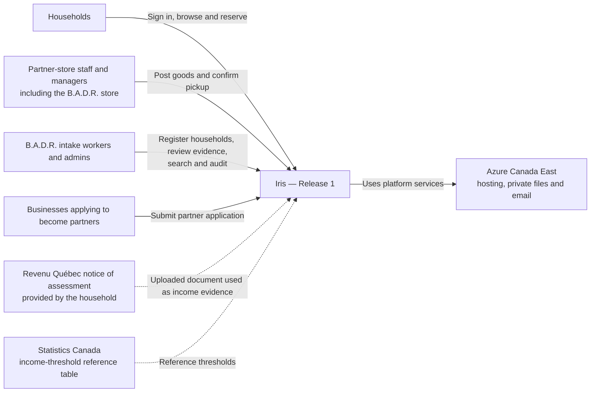
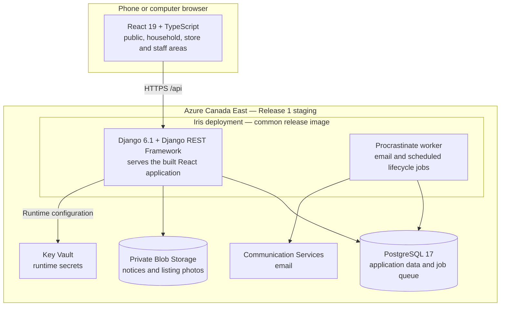
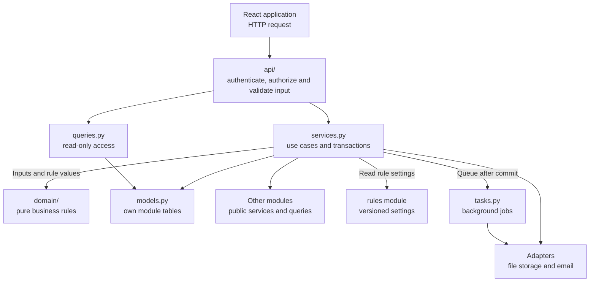
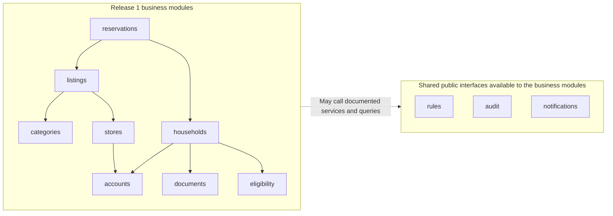
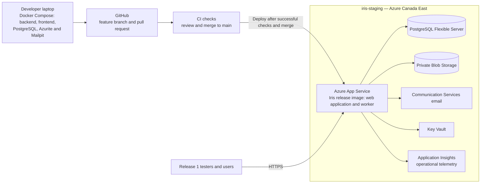

<!-- AI contribution: 50% or more AI-generated -->

# Iris architecture — Release 1 draft

This document adapts the team architecture and diagram drafts to the
Release 1 scope and the earlier 14-model ERD. It describes the intended
design, not a verified deployment or finalized implementation.

## Scope

Release 1 includes:

- Sign-in.
- Partner applications and approval.
- Staff-led walk-in household registration and eligibility decisions.
- Posting and browsing goods.
- Reservations and pickup confirmation.
- Staff search.
- Audit records and email delivery.
- Deployment to staging.

Online AI registration and automatic approval, priority tiers, strikes,
the full review queue, privacy-rights workflows, reporting, needs,
the resource assistant, furniture matching and production deployment
are outside this document’s active Release 1 flows.

These exclusions concern features and tables. The project’s baseline
data-protection requirements still apply.

A `review_required` or `no_show` status does not by itself require a
`ReviewCase` or `Strike` table.

AI Document Intelligence belongs to the later online registration flow.
A technical spike does not make it an active Release 1 dependency.

## Architecture decisions

- Iris is a modular monolith: one Django application and one React
  application, with module-owned tables and public services/queries.
- The team stack specifies Python 3.13, Django 6.1, Django REST Framework
  and React 19 with TypeScript. These are target-stack declarations,
  not verification of installed versions.
- Django serves the built React application in the deployed release image.
- Procrastinate uses PostgreSQL for background jobs and uses the same
  release image.
- PostgreSQL 17 stores application data.
- Notices and listing photos are private Blob Storage objects.
  Database models store file references.
- Django/allauth handles authentication.
- `User.password` stores a Django-managed encoded password hash,
  never the plain-text password. The hashing algorithm is a settings
  decision and is not selected by this architecture.
- Backend APIs enforce roles and ownership before invoking services.
- Business rules run on the backend.
- Thresholds, limits and timing settings come from `RuleSetVersion`.
- Email is queued after database commit and delivered through an adapter
  by background jobs.
- Money uses integer cents. Datetimes are timezone-aware.
- React supports French and English and separates public, household,
  store and staff areas.
- Data and staging services are located in Azure Canada East.
- Logs and audit metadata exclude sensitive document contents and
  income values.
- Release 1 staging uses generated test data. The project requires the
  signed privacy impact assessment before using real personal data.

## Changes over sprints

Iris follows an Agile methodology. Small design changes can be made in
later sprints.

Module owners review changes and keep this document, the ERD, domain
model, sequence/state diagrams and migration plan consistent.

Applied database changes use new reviewed migrations.

### Production configuration boundary (FIX-04)

The WSGI/ASGI entry points default to production settings, including when those
settings are used for staging. Local Compose and management commands explicitly
retain the development configuration. Production validates the secret and mailer,
requires HTTPS with HSTS, and trusts the configured HTTPS header only behind a
proxy that strips and replaces client-supplied headers. API docs require an active
Iris admin role. General DRF limits are operational environment settings;
partner applications and allauth retain their separate request policies.
DRF checks permissions before throttling, so rejected anonymous requests to
protected routes do not consume its quota. Allauth has an independent trusted
proxy count and native error responses, documented in
[authentication routing](../guides/auth-routing.md#rate-limit-responses).

The [production settings guide](../guides/production-settings.md) documents the
configuration, the deliberate HSTS preload exception and the strict deploy check.
These controls do not establish a running Azure deployment. SET-17 owns the real
staging resources and proxy verification; FIX-17 owns the dedicated CI security
gates. The Release 1 deployment scope below remains staging.

## Module ownership

| Module | Business models | Responsibility |
| --- | --- | --- |
| accounts | User, Invitation | Sign-in, roles, store assignments and invitations |
| stores | Store, PartnerApplication | Partner applications, decisions and store administration |
| households | Household, Member | Walk-in files, membership, status and validity |
| documents | IncomeNotice | Staff-entered income evidence and private file references |
| eligibility | EligibilityDecision | Eligibility calculation and preserved decision inputs/results |
| rules | RuleSetVersion | Versioned thresholds, limits and timing settings |
| categories | Category | Goods categories and category-specific safety information |
| listings | Listing | Store offers, quantities and collection windows |
| reservations | Reservation | Reservations, cancellation and pickup confirmation |
| audit | AuditEvent | Action records without personal data in event metadata |
| notifications | EmailLog | Queued email delivery and delivery outcomes |

Django, allauth and Procrastinate also manage framework tables.
These are not additional business models in the 14-model ERD.

`modules.common` holds shared contact-value utilities, with no tables or Django
app registration. Its `domain.contact` normalization is pure Python; Django,
DRF and form adapters delegate to it outside `domain/`. Stores and households
use this neutral package without importing each other's internals. Import-linter
continues to enforce the business-module boundaries and domain purity (FIX-14).

Reporting is not introduced into the Release 1 workflows here.

## Frontend and adapters

The React application uses:

- `app/`: routing and providers.
- `areas/`: public, household, store and staff layouts.
- `features/`: module-specific code.
- `shared/`: reusable components and French/English translations.

Eligibility, ownership and stock decisions remain on the backend.

| Adapter | Azure staging / target provider | Development and tests |
| --- | --- | --- |
| file_store | Private Azure Blob Storage | Azurite and a test fake |
| mailer | Azure Communication Services | Mailpit and a test fake |
| document_reader | Proposed in [ADR 0005](../adr/0005-notice-reading.md): Gemini on Vertex AI, Montréal; fallback Azure AI Document Intelligence, Canada Central. Pending B.A.D.R.'s decision | A fake returning the values in `mock-data/notices/truth.csv` |

Adapters keep provider-specific calls outside `domain/`.

The later `document_reader` interface is not invoked by the Release 1
staff-entry flow. Its interface and the provider comparison are in
[ADR 0005](../adr/0005-notice-reading.md); US-22 builds it in
`backend/adapters/document_reader/`.

## Diagrams

Actors in sequence diagrams enter through React and DRF.
Service arrows abbreviate that boundary.

All writes go through the module owning the affected table.

### 1. System context

Households provide evidence to staff for walk-in registration.

The notice and threshold arrows describe supplied reference data,
not a live connection to a government account or API.

Households provide their Revenu Québec notices of assessment.
The documents are uploaded to Iris as income evidence and reviewed
by authorized staff.

The notice and threshold arrows represent supplied documents and
reference data, not live connections to government accounts or APIs.

### 2. High-level architecture — containers

The API and worker use the same release image.

This is a logical process view. Worker startup and supervision remain
deployment decisions.

AI Document Intelligence appears in the team target architecture,
but its online-reading flow is deferred beyond Release 1.

### 3. Layers inside a module

The domain layer imports no Django, ORM, network code or adapters.

Each module writes its own tables. Cross-module access uses public
service/query interfaces. The one exception is `manage.py seed`
(`backend/iris/management/commands/seed.py`): it writes fictional rows in
states the workflows cannot create yet, such as approved files and picked-up
reservations. The import-linter contract "Only the seed command imports module
models" keeps every other file in `iris` and `adapters` out of module models.

Values for eligibility, limits and time windows come from versioned
rules, not frontend decisions.

### 4. Release 1 module dependencies

Arrows describe allowed Python service/query calls.
They do not describe foreign keys, migration order or network services.

The shared-interface allowance comes from the team architecture.
The households-to-accounts arrow is present in the supplied diagram
collection.

Households gathers the required household, member and income evidence
through public interfaces and passes the decision inputs to Eligibility.
Eligibility calculates and records the decision without calling back
into Households.

### 5. Release 1 deployment

Release 1 targets staging.

Production is a later release in the supplied release plan and is not
represented as an active Release 1 environment here.

The diagram specifies the intended deployment. It does not claim that
CI, resources or worker supervision are already configured.

### 6. Sequence — walk-in registration

See the [full section](architecture-workflows.md#6-sequence--walk-in-registration).

### 7. Sequence — partner onboarding

See the [full section](architecture-workflows.md#7-sequence--partner-onboarding).

### 8. Sequence — reserve and pickup

See the [full section](architecture-workflows.md#8-sequence--reserve-and-pickup).

### 9. State — household file

See the [full section](architecture-workflows.md#9-state--household-file).

### 10. State — reservation

See the [full section](architecture-workflows.md#10-state--reservation).

## Review points

See the [full section](architecture-workflows.md#review-points).

### Failed pickup attempts and no-shows — proposed handling

See the [full section](architecture-workflows.md#failed-pickup-attempts-and-no-shows--proposed-handling).
