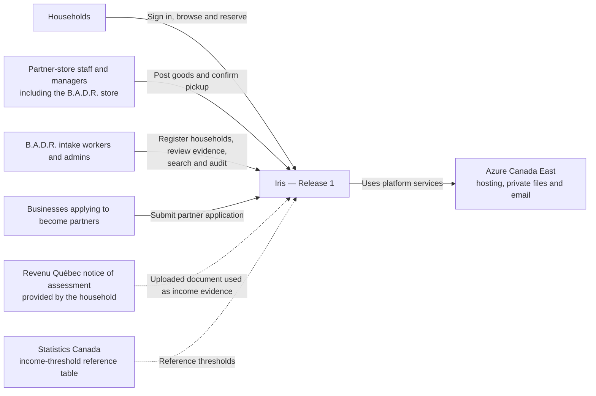
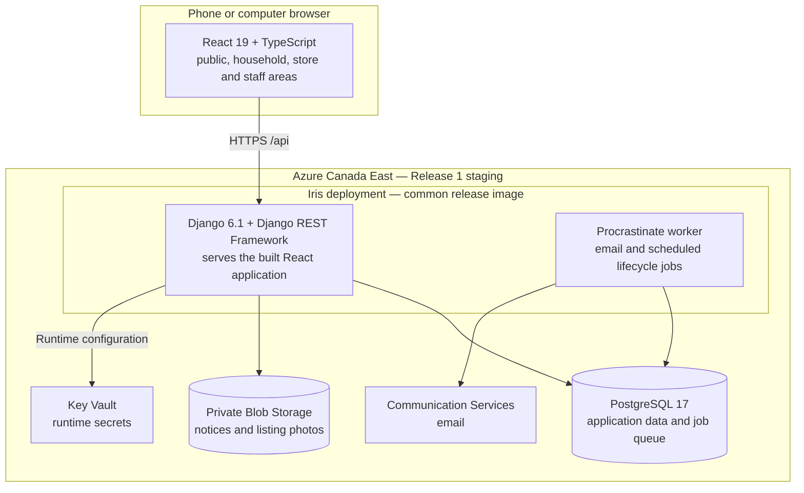
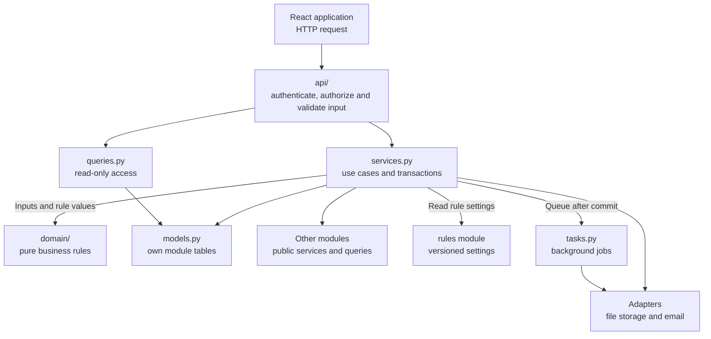
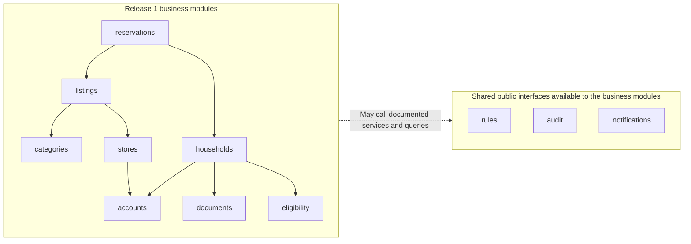
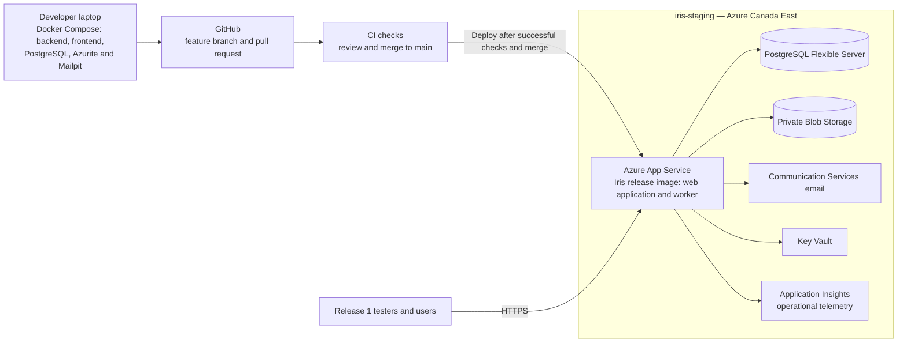
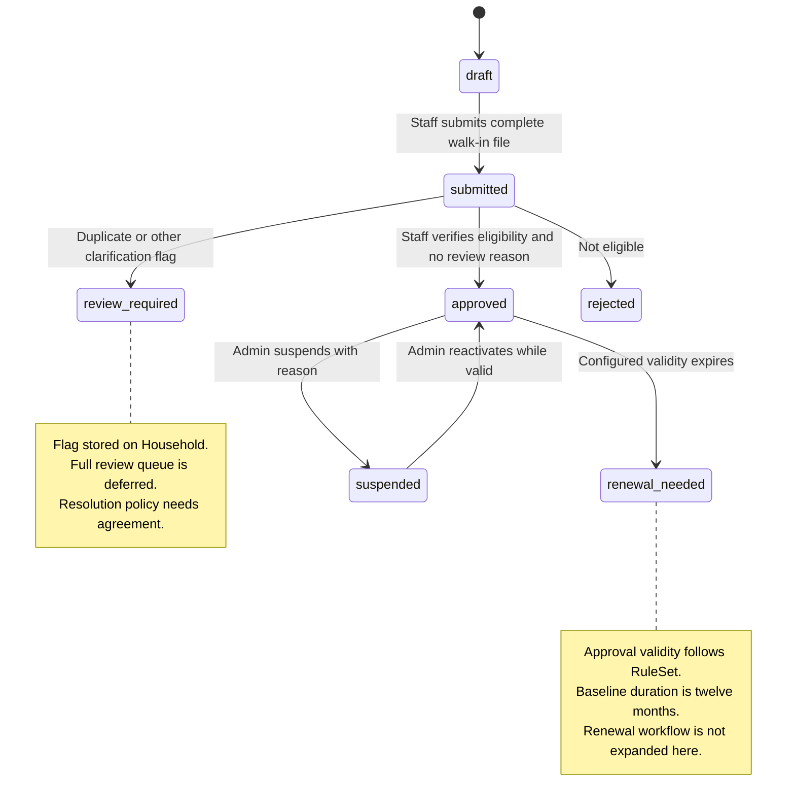
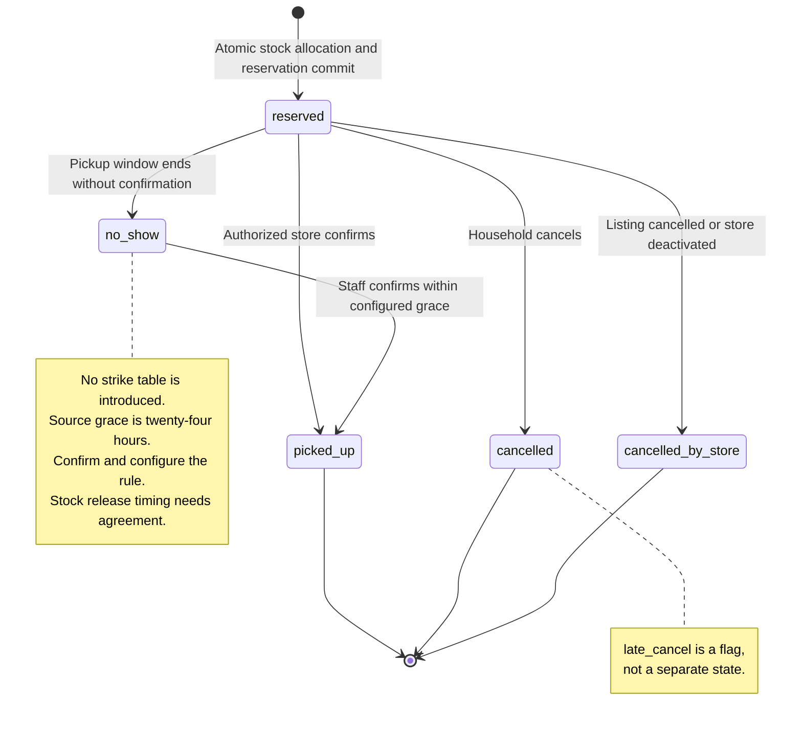

<!-- AI usage: 50% or more AI-generated. -->

# Iris architecture — Release 1 draft

This document adapts the team architecture and diagram drafts to the
Release 1 scope and the earlier 14-model ERD. It describes the intended
design, not a verified deployment or finalized implementation.

## Scope

Release 1 includes:

- Sign-in.
- Partner applications and approval.
- Staff-led walk-in household registration and eligibility decisions.
- Posting and browsing goods.
- Reservations and pickup confirmation.
- Staff search.
- Audit records and email delivery.
- Deployment to staging.

Online AI registration and automatic approval, priority tiers, strikes,
the full review queue, privacy-rights workflows, reporting, needs,
the resource assistant, furniture matching and production deployment
are outside this document’s active Release 1 flows.

These exclusions concern features and tables. The project’s baseline
data-protection requirements still apply.

A `review_required` or `no_show` status does not by itself require a
`ReviewCase` or `Strike` table.

AI Document Intelligence belongs to the later online registration flow.
A technical spike does not make it an active Release 1 dependency.

## Architecture decisions

- Iris is a modular monolith: one Django application and one React
  application, with module-owned tables and public services/queries.
- The team stack specifies Python 3.13, Django 6.1, Django REST Framework
  and React 19 with TypeScript. These are target-stack declarations,
  not verification of installed versions.
- Django serves the built React application in the deployed release image.
- Procrastinate uses PostgreSQL for background jobs and uses the same
  release image.
- PostgreSQL 17 stores application data.
- Notices and listing photos are private Blob Storage objects.
  Database models store file references.
- Django/allauth handles authentication.
- `User.password` stores a Django-managed encoded password hash,
  never the plain-text password. The hashing algorithm is a settings
  decision and is not selected by this architecture.
- Backend APIs enforce roles and ownership before invoking services.
- Business rules run on the backend.
- Thresholds, limits and timing settings come from `RuleSetVersion`.
- Email is queued after database commit and delivered through an adapter
  by background jobs.
- Money uses integer cents. Datetimes are timezone-aware.
- React supports French and English and separates public, household,
  store and staff areas.
- Data and staging services are located in Azure Canada East.
- Logs and audit metadata exclude sensitive document contents and
  income values.
- Release 1 staging uses generated test data. The project requires the
  signed privacy impact assessment before using real personal data.

## Changes over sprints

Iris follows an Agile methodology. Small design changes can be made in
later sprints.

Module owners review changes and keep this document, the ERD, domain
model, sequence/state diagrams and migration plan consistent.

Applied database changes use new reviewed migrations.

## Module ownership

| Module | Business models | Responsibility |
| --- | --- | --- |
| accounts | User, Invitation | Sign-in, roles, store assignments and invitations |
| stores | Store, PartnerApplication | Partner applications, decisions and store administration |
| households | Household, Member | Walk-in files, membership, status and validity |
| documents | IncomeNotice | Staff-entered income evidence and private file references |
| eligibility | EligibilityDecision | Eligibility calculation and preserved decision inputs/results |
| rules | RuleSetVersion | Versioned thresholds, limits and timing settings |
| categories | Category | Goods categories and category-specific safety information |
| listings | Listing | Store offers, quantities and collection windows |
| reservations | Reservation | Reservations, cancellation and pickup confirmation |
| audit | AuditEvent | Action records without personal data in event metadata |
| notifications | EmailLog | Queued email delivery and delivery outcomes |

Django, allauth and Procrastinate also manage framework tables.
These are not additional business models in the 14-model ERD.

Reporting is not introduced into the Release 1 workflows here.

## Frontend and adapters

The React application uses:

- `app/`: routing and providers.
- `areas/`: public, household, store and staff layouts.
- `features/`: module-specific code.
- `shared/`: reusable components and French/English translations.

Eligibility, ownership and stock decisions remain on the backend.

| Adapter | Azure staging / target provider | Development and tests |
| --- | --- | --- |
| file_store | Private Azure Blob Storage | Azurite and a test fake |
| mailer | Azure Communication Services | Mailpit and a test fake |

Adapters keep provider-specific calls outside `domain/`.

The later `document_reader` interface is not invoked by the Release 1
staff-entry flow.

## Diagrams

Actors in sequence diagrams enter through React and DRF.
Service arrows abbreviate that boundary.

All writes go through the module owning the affected table.

### 1. System context

Households provide evidence to staff for walk-in registration.

The notice and threshold arrows describe supplied reference data,
not a live connection to a government account or API.

Households provide their Revenu Québec notices of assessment.
The documents are uploaded to Iris as income evidence and reviewed
by authorized staff.

The notice and threshold arrows represent supplied documents and
reference data, not live connections to government accounts or APIs.

### 2. High-level architecture — containers

The API and worker use the same release image.

This is a logical process view. Worker startup and supervision remain
deployment decisions.

AI Document Intelligence appears in the team target architecture,
but its online-reading flow is deferred beyond Release 1.

### 3. Layers inside a module

The domain layer imports no Django, ORM, network code or adapters.

Each module writes its own tables. Cross-module access uses public
service/query interfaces.

Values for eligibility, limits and time windows come from versioned
rules, not frontend decisions.

### 4. Release 1 module dependencies

Arrows describe allowed Python service/query calls.
They do not describe foreign keys, migration order or network services.

The shared-interface allowance comes from the team architecture.
The households-to-accounts arrow is present in the supplied diagram
collection.

Households gathers the required household, member and income evidence
through public interfaces and passes the decision inputs to Eligibility.
Eligibility calculates and records the decision without calling back
into Households.

### 5. Release 1 deployment

Release 1 targets staging.

Production is a later release in the supplied release plan and is not
represented as an active Release 1 environment here.

The diagram specifies the intended deployment. It does not claim that
CI, resources or worker supervision are already configured.

### 6. Sequence — walk-in registration

Flagged households remain unapproved. The full review queue is outside
Release 1.

```mermaid
sequenceDiagram
    actor IW as Intake worker
    participant H as Households service
    participant D as Documents service
    participant E as Eligibility service
    participant AC as Accounts service
    participant A as Audit service
    participant N as Notification job
    actor HC as Household contact

    Note over IW,H: React and DRF authenticate staff and check permissions before service calls

    IW->>H: create_walk_in(holder, address, members)
    H->>H: Save draft household and members
    H->>A: Record household creation

    loop Each adult
        IW->>D: Record staff-entered notice or non-filing reason
        D->>D: Save evidence and private file reference when supplied
    end

    IW->>H: approve_walk_in()
    H->>H: Check completeness, verification and duplicate flags

    rect rgb(24, 42, 62)
        Note over H,A: Approval outcome and associated writes share a database transaction

        H->>H: Prepare household and member decision inputs
        H->>D: Read recorded income evidence through public query
        D-->>H: Income evidence and verification status
        H->>E: decide_for_household(household_id, decision_inputs)
        E->>E: Save decision inputs, result and applied rule version
        E-->>H: Eligibility result and threshold

        alt Eligible, verified and no review reason
            H->>H: Save approval and validity dates

            opt Holder has email and account setup is needed
                H->>AC: Prepare set-password invitation
            end

            H->>A: Record approval
        else Requires clarification or review
            H->>H: Set review_required
            H->>A: Record flagged outcome
        else Not eligible
            H->>H: Set rejected
            H->>A: Record rejection outcome
        end
    end

    opt Approval committed and invitation prepared
        H-->>N: Queue setup email after commit
    end

    H-->>IW: Return saved outcome and permitted explanation

    opt Invitation email queued
        N-->>HC: Deliver setup link independently
    end
```

### 7. Sequence — partner onboarding

The proposed store manager is the contact designated in the partner
application. Approval and rejection notifications use that person's
recorded email address. Receiving a rejection email does not require
an Iris account or invitation.

```mermaid
sequenceDiagram
    actor B as Business applicant
    actor AD as Administrator
    participant S as Stores service
    participant AC as Accounts service
    participant A as Audit service
    participant N as Notification job
    actor M as Proposed store manager

    B->>S: submit_application(form)
    S->>S: Validate and save submitted application
    S-->>N: Queue confirmation email after commit

    AD->>S: Decide application

    alt Approve
        rect rgb(24, 42, 62)
            Note over S,A: One transaction, failure rolls back all approval writes
            S->>S: Create active Store
            S->>AC: create_invitation(role=store_manager, store)
            AC-->>S: Invitation prepared
            S->>S: Save approved application and decision information
            S->>A: Record approval
        end

        S-->>N: Queue invitation email after commit
        N-->>M: Deliver invitation link

        M->>AC: accept_invitation(token, password)
        AC->>AC: Verify expiry and one-use token, create or activate User
        AC->>AC: Assign invited role and Store, mark invitation accepted
        AC-->>M: Account ready for sign-in
    else Reject
        S->>S: Save rejected status and required reason
        S->>A: Record rejection
        S-->>N: Queue decision email after commit
        N-->>M: Notify proposed store manager of rejection
    end
```

### 8. Sequence — reserve and pickup

The Listings module owns the stock UPDATE.
Reservations owns the reservation INSERT.

Code uniqueness remains per listing in the earlier ERD, so
store-and-code lookup must not assume global uniqueness.

Rejecting ambiguous matches is the proposed safe error branch pending
the final lookup policy.

Invalid or duplicate confirmations do not create a second pickup.

```mermaid

sequenceDiagram
    actor HH as Household user
    participant R as Reservations service
    participant H as Households queries
    participant L as Listings service and queries
    participant DB as PostgreSQL
    participant A as Audit service
    actor ST as Store staff

    HH->>R: reserve(listing, quantity)
    R->>H: Check approved, valid and not suspended
    H-->>R: Current household eligibility
    R->>R: Validate quantity and configured reservation limits

    break Invalid request, ineligible household or limit reached
        R-->>HH: Reject reservation before changing stock
    end

    rect rgb(24, 42, 62)
        Note over R,A: One PostgreSQL transaction for stock, reservation and audit

        R->>L: take_units(listing, quantity)
        L->>DB: Conditional UPDATE of own listing stock counter
        DB-->>L: Number of rows changed
        L-->>R: Allocation result

        alt One row changed
            R->>DB: INSERT reservation with pickup code
            R->>A: Record reservation
            R->>R: Commit
        else No stock
            R->>R: Roll back
        end
    end

    Note over R,DB: An insert or code-uniqueness failure also rolls back the stock change

    alt Committed
        R-->>HH: Pickup code and QR
    else Failed
        R-->>HH: Sold-out or validation outcome
    end

    ST->>R: lookup(permitted_store, code)
    R->>L: Query listings in the staff member's permitted store
    R->>R: Resolve a unique reservation match

    alt Unique authorized match
        R->>H: Get permitted pickup display name
        R-->>ST: First name and last initial, item and quantity

        ST->>R: confirm_pickup(reservation)
        R->>R: Recheck store, state and timing, save pickup once
        R->>A: Record pickup in the same transaction
        R-->>ST: Confirmation outcome
    else Missing, ambiguous or unauthorized match
        R-->>ST: Reject lookup without exposing household details
    end
```

### 9. State — household file

This is the staff-led Release 1 subset of the supplied state diagram.

Online registration, awaiting-visit routing and the full review
workflow are not introduced.

Validity and suspension remain visible because reservation eligibility
uses them.

Each reservation checks expiry even if a scheduled status update has
not run.

Rejection/suspension reason storage must be aligned with the selected
schema.

### 10. State — reservation

## Review points

These decisions remain open. The diagrams do not select missing
database fields or relationships to fill these gaps.

| Area | Decision needed |
| --- | --- |
| Holder/account linkage | Confirm how the household contact connects to their Member and optional User records. Do not require an account for every walk-in or assume a particular foreign key while this remains open. |
| Partner form storage | The earlier ERD retains required address, categories, frequency and opening-hours information without final storage. Complete that schema review; the onboarding sequence does not select those columns. |
| Pickup lookup | The earlier uniqueness rule is `(listing, pickup_code)`. Agree code collision handling or lookup identifiers for a store containing multiple listings. QR payload format is not selected here. |
| Household flags and reasons | Agree the minimum Release 1 handling for `review_required` files and where rejection/suspension reasons are stored. The full review queue is deferred. |
| Lifecycle timing | Confirm the configured approval-validity and late-confirmation settings. The team draft supplies twelve months and twenty-four hours respectively. |
| Cancellation/no-show stock | Agree when stock is released and how late pickup confirmation interacts with release. No counter behavior is invented by the state diagram. |
| Worker deployment | Confirm worker startup, supervision and scaling within the shared-image App Service deployment. A running web process alone does not establish that a worker is running. |
| Dependency contracts | Align the supplied architecture and diagram collection where their permitted arrows differ. Public service/query access must not introduce domain import cycles. |

### Failed pickup attempts and no-shows — proposed handling

The following handling is proposed for Release 1 and requires team
agreement. These decisions can be finalized before implementing the
reservation and pickup features.

| Situation | Proposed handling |
| --- | --- |
| Incorrect, missing or ambiguous pickup code | Refuse pickup without changing stock or cancelling a reservation. |
| Identity cannot be verified | Refuse pickup and keep the reservation until its collection deadline, including any agreed grace period. The accepted verification method remains to be decided. |
| Pickup window ends without collection | Mark the reservation as `no_show`. |
| Agreed grace period expires without collection | Release the reservation's allocated quantity exactly once and prevent further pickup confirmation against that released reservation. |

The supplied diagrams allow late pickup confirmation within a
24-hour grace period. Confirm whether this rule applies to Release 1
before implementation.

If a grace period is retained, stock must not be released while the
same reservation can still be confirmed for pickup.

Releasing an allocation does not automatically reopen the listing.
Whether the goods can be offered again depends on the listing's status,
collection window and the goods' continued availability and suitability.

Before implementation, agree on:

- What information is required to verify pickup identity.
- Whether a grace period applies and its duration.
- When reserved stock is released.
- How stock release prevents duplicate releases or conflicting pickup
  confirmations.

Once agreed, update the reserve-and-pickup sequence, reservation state
diagram and relevant business rules together.
