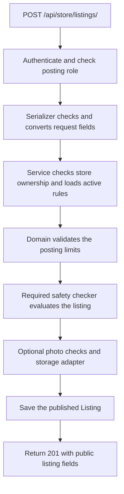

<!-- AI contribution: 50% or more AI-generated -->

# Understanding the US-33 listing-posting backend

This guide explains the backend work for **T-05.33.3 (#494)** and its
**T-05.33.1 tests (#492)**, under **US-33 (#491): Post a listing**.

The goal is to let an authorized store worker publish an offer, such as five
loaves of bread available for pickup. The backend checks the request and saves
the listing through `POST /api/store/listings/`.

**The posting backend and its tests are implemented, but the complete user
workflow still needs account, safety, photo-storage, and frontend integration.**
The tests use explicit stand-ins for those unfinished dependencies.

## 1. What can someone do today?

| Part | Current behavior |
| --- | --- |
| Posting endpoint | Accepts and validates a request, checks permissions, and can save a published listing when its required dependencies are available. |
| Posting form | This work adds no form or screen. The frontend form is a separate task, #495. |
| Real accounts | The current default Django users lack the required role/store assignments. They are refused; test assignments are not installed in the running app. |
| Safety checks | The backend calls the separate US-34 checker. If it is missing, posting is refused. This work does not implement its food-date or prohibited-category decisions. |
| Photos | Size, declared type, and JPEG/PNG signatures are checked. Saving photos needs a real private-storage adapter; tests use a fake. |
| Tests | Can exercise the backend with temporary PostgreSQL records and fake integrations, without waiting for those integrations to be finished. |

A passing test suite therefore does not mean a person can already sign in and
publish through a finished screen. In the current app, an ordinary account
receives a permission refusal before it reaches the missing safety integration.

## 2. The main ideas

| Term | Meaning in this feature |
| --- | --- |
| API endpoint | The address that receives a request: `POST /api/store/listings/`. |
| Serializer | Converts request values into Python types, checks the request's structure, and selects which values appear in a response. |
| Domain rule | A business check, such as whether the pickup window is long enough. These checks use plain Python and do not query the database. |
| Service | Coordinates permissions, rules, integrations, and database writes. |
| Model | Describes a database record. The existing `Listing` model stores the offer. |
| Transaction | Groups database changes so a failed operation can roll them back. |
| Protocol | Describes the interface an integration must provide, without implementing it. |
| Test fake | A substitute used only in tests, such as a safety checker that returns a chosen result. |

## 3. How a posting request moves through the code



For example, when a store worker submits five loaves of bread:

1. Django/DRF authenticates the request. Real cookie sessions require CSRF
   protection. Only active `store_staff` or `store_manager` accounts with a
   UUID store assignment can post.
2. The serializer reads the fields. It rejects unknown fields and attempts to
   submit server-owned values, such as `status`, `published_at`, or `photo_ref`.
3. The view checks any supplied store against the assigned store. The service
   repeats the ownership check so other service callers must follow it too.
4. Inside a database transaction, the service loads and locks the store and
   category through their modules' public queries. Both must be active.
5. The service selects the `listing_posting` and `listing_safety` rule versions
   effective at one server timestamp. Missing versions or incompatible posting
   rule keys produce a controlled unavailable response.
6. `check_posting()` returns field/reason pairs for invalid business values.
   An empty list means these posting checks passed. The separate safety checker
   must also approve the request.
7. If a photo is present, the service limits the bytes read, checks that its
   signature matches the declared JPEG/PNG type, and calls the storage adapter.
8. The service sets the creator, confirmation/publication timestamps, published
   status, and zero initial reservations, then saves the listing.
9. The output serializer builds the response. Location comes from the store;
   the private photo reference stays internal.

An error stops the flow. Failed database work rolls back. If an image was
already stored, the service attempts to delete it; cleanup failure is logged
without exposing the reference or provider error details.

## 4. Where to read the code

These links are a reading map, not a claim that every listed file was newly
created. In particular, the Listing model and its migration predate the
posting service/API work.

| File | Job |
| --- | --- |
| [API routes](../../backend/modules/listings/api/urls.py) and [project routes](../../backend/iris/urls.py) | Connect the URL to the posting view. |
| [API view](../../backend/modules/listings/api/views.py) | Handle POST, call the service, and translate exceptions into HTTP responses. |
| [API permissions](../../backend/modules/listings/api/permissions.py) | Apply the posting-account check at the HTTP boundary. |
| [Serializers](../../backend/modules/listings/api/serializers.py) | Define request/response fields, require timezone offsets, reject unknown inputs, and omit private photo references. |
| [Shared permissions](../../backend/modules/listings/permissions.py) | Check account activity, posting role, and assigned store. Django's `is_staff` flag alone grants no posting rights. |
| [Posting domain](../../backend/modules/listings/domain/posting.py) | Define `ListingInput`, `PostingLimits`, and `Refusal`; validate business values without database access. |
| [Posting service](../../backend/modules/listings/services.py) | Coordinate rules, safety, photos, transactions, and publication. Start here after reading the request flow above. |
| [Integration contracts](../../backend/modules/listings/contracts.py) | Specify the required safety-checker and photo-store interfaces. |
| [Listing model](../../backend/modules/listings/models.py) | Define stored fields, relationships, and database constraints. API `quantity` maps to model `quantity_total`. |
| [Store queries](../../backend/modules/stores/queries.py) and [category queries](../../backend/modules/categories/queries.py) | Expose reads through the owning modules, including the posting locks. |
| [Rule schemas/defaults](../../backend/modules/rules/domain/schemas.py) | Define configurable posting limits and validate rule configuration. |
| [French source catalog](../../backend/modules/listings/locale/fr/LC_MESSAGES/django.po) | Translate backend messages. The accompanying `.mo` is its compiled runtime catalog. |
| [Generated TypeScript types](../../frontend/src/shared/api/generated.d.ts) | Describe the API to frontend code. Generated types do not create a screen. |

The `__init__.py` files mark the API and domain directories as Python packages.
They do not contain the posting rules or database operations.

Inside the domain code:

- `ListingInput` groups the submitted values into one typed object.
- `PostingLimits` groups the limits supplied by the active rule version.
- `Refusal("quantity", "quantity_range")` identifies a failed field and reason.
- `check_posting(data, limits, now=...)` returns a list of these refusals.
- The service turns refusal codes into translated field messages.

These data classes keep inputs and results understandable. They are separate
from Django models because they do not represent database tables.

## 5. What gets checked?

The following are the configured defaults. The service reads active rule
versions rather than hard-coding these limits into its validation flow.

| Input | Default rule |
| --- | --- |
| Title | 2-80 characters after trimming. |
| Description | Optional; at most 500 characters. |
| Quantity | Integer from 1 to 999; defaults to 1. |
| Unit | `item` or `bundle`; defaults to `item`. |
| Household limit | Integer from 1 to 10; defaults to 1. |
| Estimated value | Optional integer cents, from 0 to 100,000. Omission stays null; this service does not apply a category value automatically. |
| Pickup start | Between now and seven days ahead. |
| Pickup duration | 30 minutes to 12 hours. |
| Pickup datetimes | Must include a timezone offset; responses use UTC. Elapsed-time checks account for daylight-saving changes. |
| Safe-and-allowed confirmation | Must be true. It does not replace the separate safety checker. |
| Best-before date | Passed to the safety checker; the actual food-date decision belongs to US-34. |
| Photo | Optional JPEG/PNG, at most 5 MiB, with a matching byte signature. The adapter receives a 1280-pixel maximum dimension. |

Signature checks do not prove that an entire image is valid. The real adapter
must decode/verify the image, strip metadata, resize it, and store it privately.
That adapter is still pending.

## 6. Request and response examples

This JSON is a template. Replace every `<...>` value with a real category code
or future ISO datetime before using it. It also requires a valid session,
CSRF token, account assignment, rule versions, and safety integration.

```json
{
  "category": "<existing active category code, for example bakery>",
  "title": "Surplus bread",
  "quantity": 5,
  "unit": "item",
  "max_per_household": 1,
  "pickup_start": "<future ISO datetime with timezone offset>",
  "pickup_end": "<later ISO datetime with timezone offset>",
  "safe_and_allowed": true
}
```

For a datetime, use a value such as `2026-10-29T20:00:00Z`, adjusting the date
when testing so it meets the active pickup rules. `Z` means UTC.

The store is normally derived from the account. Supplying a different store
returns 403. A photo uses multipart form data rather than a JSON file value.

| HTTP status | Meaning |
| --- | --- |
| 201 | The listing was saved and published. |
| 400 | Request or business values were invalid; inspect `fields`. |
| 403 | Authentication, posting permission, store ownership, or session CSRF checks refused the request. |
| 503 | A required rule version or integration is unavailable, or posting-rule keys are incompatible. |
| 405 | The method is unsupported here. This endpoint does not implement browsing, editing, or cancellation. |

For example, an English quantity error has this shape:

```json
{
  "code": "validation_error",
  "message": "Check the highlighted fields.",
  "fields": {
    "quantity": ["Enter a quantity from 1 to 999."]
  }
}
```

The [API conventions](../03-design/api.md#conventions) specify error messages
in the user's language, using `Accept-Language: en` or `fr`. Django handles
backend translations; the frontend's translation JSON files serve a separate
runtime. Sending translated API errors does not implement frontend UI.

The backend uses Django's ORM for database operations. Input validation and
server-owned fields add protection, but validation is not HTML sanitization;
the future UI must display listing text safely as text.

## 7. How the tests work without the unfinished integrations

Tests create real records in Django's temporary PostgreSQL test database.
They do not insert fake users or offers into the development database.

| Test file | What it checks |
| --- | --- |
| [Fixtures](../../backend/modules/listings/tests/conftest.py) | Create users, stores, categories, and rule versions; freeze the clock; attach test-only role/store attributes. |
| [Posting rules](../../backend/modules/listings/tests/test_posting_rules.py) | Field boundaries, configurable limits, and timezone/daylight-saving behavior. |
| [Rule configuration](../../backend/modules/listings/tests/test_posting_configuration.py) | Bounds and consistency of the versioned posting configuration. |
| [Service tests](../../backend/modules/listings/tests/test_post_listing_service.py) | Real database writes, ownership, rule selection, safety refusals, malformed rule keys, photo signatures, and cleanup after save failure. |
| [API tests](../../backend/modules/listings/tests/test_post_listing_api.py) | HTTP/database behavior, roles, rejected server fields, CSRF, translated errors, 503 responses, and exclusion of private references from responses/schema. |

Most API tests use DRF's `force_authenticate()` with a test user. This bypasses
login only: the view/service authorization still runs. A separate real-session
test verifies CSRF refusal. These are not tests of the complete US-01 login flow.

Fake safety checkers return chosen results. Fake photo adapters record calls
and return an internal reference. This verifies how our backend uses those
contracts, not Ryan's safety decisions or real image processing/cloud storage.
There is no always-passing safety checker installed in the running app.

## 8. Running the checks on Windows

Open Docker Desktop. Run commands in PowerShell from the repository root,
the directory containing `docker-compose.yml`.

For the per-user Docker Desktop installation used during this work:

```powershell
$irisDocker = Join-Path $env:LOCALAPPDATA 'Programs\DockerDesktop\resources\bin\docker.exe'
& $irisDocker compose up --build --watch
```

Keep that terminal open. In a **second PowerShell terminal at the repository
root**, set the variable again and run the tests:

```powershell
$irisDocker = Join-Path $env:LOCALAPPDATA 'Programs\DockerDesktop\resources\bin\docker.exe'

# Listing tests only
& $irisDocker compose exec backend python -m pytest modules/listings -v

# Full backend suite, including the configured 70% coverage gate
& $irisDocker compose exec backend python -m pytest --cov
```

If Docker is installed elsewhere, adjust `$irisDocker`. If `docker` already
works on PATH, replace `& $irisDocker` with `docker`. PowerShell variables do
not carry over to a new terminal.

The Compose backend already receives `DJANGO_SECRET_KEY` and `DATABASE_URL`.
The PostgreSQL container must be available for database tests. No manual test
user seed is needed. A direct host run needs those environment variables set
and the host database port, documented in the [README](../../README.md).

Other backend checks, in the second terminal:

```powershell
& $irisDocker compose exec backend ruff check .
& $irisDocker compose exec backend ruff format --check .
& $irisDocker compose exec backend mypy .
& $irisDocker compose exec backend lint-imports
& $irisDocker compose exec backend python manage.py check
& $irisDocker compose exec backend python manage.py makemigrations --check --dry-run
```

See the [API generation guide](api-generation.md) when changing the response
schema. Regenerate the TypeScript declarations and run the drift check rather
than editing generated types by hand.

### Recorded verification

The last implementation verification recorded **228 backend tests passing
with 90.01% coverage**, above the 70% gate. Pure posting rules had 100% coverage.
These are historical results from the implementation run, not a new test run
for this documentation change. Counts may change as teammates add tests.

Ruff lint/format, mypy (91 source files), the existing import-linter contract,
Django system/migration checks, OpenAPI validation, and generated-type drift
checks passed. Generator tests recorded seven passes and one expected
Python-only skip in schema-stdin mode. All 11 frontend tests, type checking,
production build, ESLint, generated-file formatting, and Git whitespace checks
also passed.

Earlier wider checks reported unrelated frontend CRLF formatting differences
and dependency-audit findings. They were outside these fixes; the results
above do not claim that every repository-wide audit or hosted CI check passed.

## 9. What teammates still need to connect

1. **US-01 accounts:** real role/store assignments and the login/session flow.
   Databases already using Django's default user need a reviewed migration
   strategy before switching user models.
2. **US-34 safety:** `modules.listings.domain.safety.check(listing_data,
   category, rules)`, returning `Refusal(field, code)` values. Adapt the boundary
   if the safety implementation uses a different result format.
3. **Photo storage:** a class configured by `LISTING_PHOTO_STORE_BACKEND` that
   implements `put_image(content, max_dimension=...)` and `delete(reference)`.
   It must verify/process images and store them privately.
4. **Rule versions:** seed/publish the required rules when the integrations
   are ready. The existing `seed_rules` command supports the posting defaults;
   tests publish their own temporary versions.
5. **Posting form (#495):** send the documented values, include session/CSRF
   handling, and show field errors. Authorization and safety remain on the server.
6. **Review and acceptance:** teammate review, hosted CI, and the remaining
   story acceptance checks before considering the complete workflow finished.

For the wider design, read the [architecture](../04-architecture/architecture.md),
[API contract](../03-design/api.md), and
[form requirements](../02-requirements/forms-and-fields.md).
